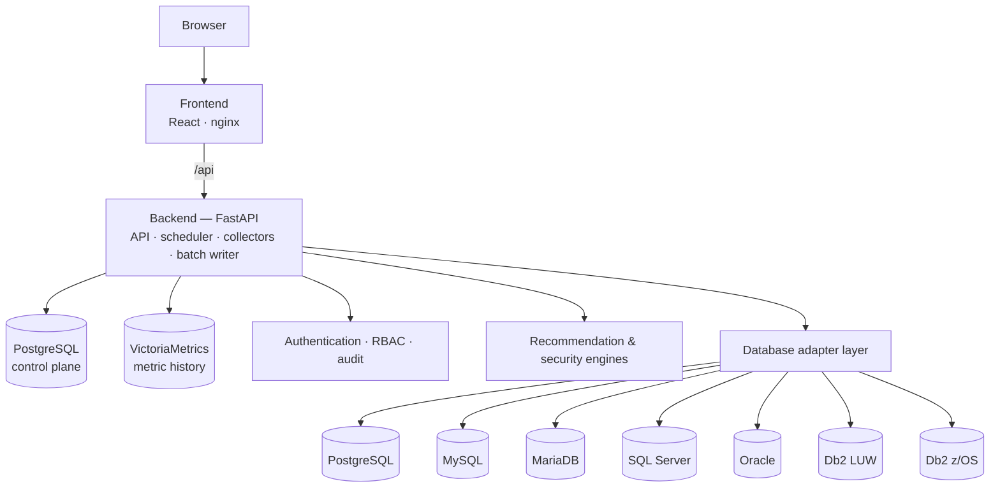
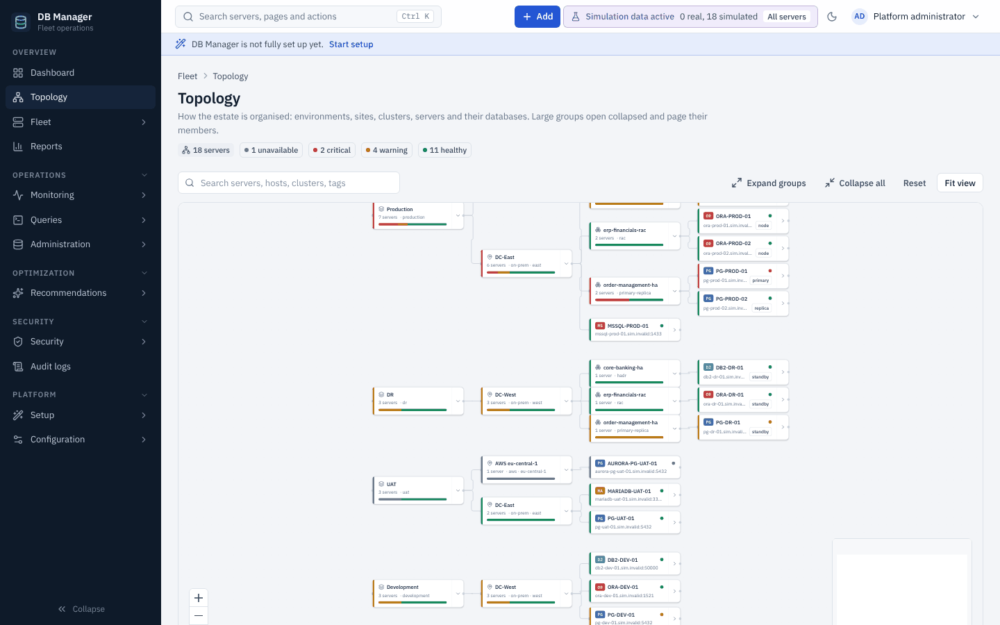
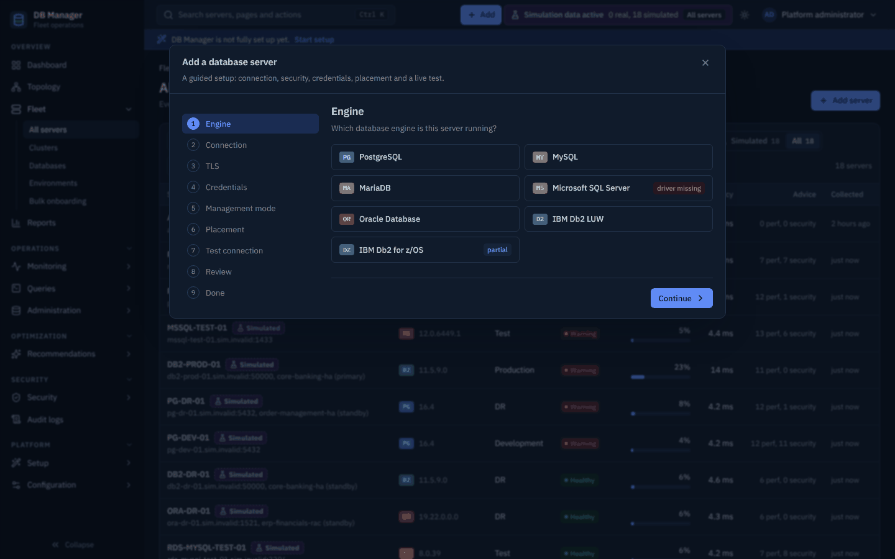
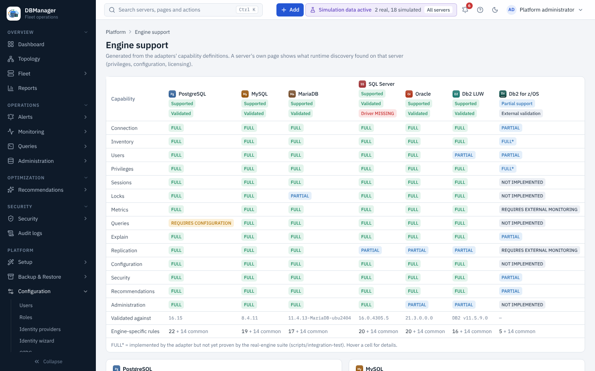

# DB Manager

**One management plane for heterogeneous relational database fleets** — inventory, monitoring,
query performance, execution plans, security posture, evidence-based recommendations and guarded
administration for PostgreSQL, MySQL, MariaDB, Microsoft SQL Server, Oracle Database and IBM Db2.

[](https://github.com/hbenabdalla/dbmanager/actions/workflows/ci-backend.yml)
[](https://github.com/hbenabdalla/dbmanager/actions/workflows/ci-frontend.yml)
[](https://github.com/hbenabdalla/dbmanager/actions/workflows/ci-docs.yml)
[](https://db-manager.readthedocs.io/en/latest/)
[](LICENSE)

**Documentation: [db-manager.readthedocs.io/en/latest](https://db-manager.readthedocs.io/en/latest/)**

> **Project status: pre-release (0.9.0-dev).** Feature-rich and validated against real engines,
> but not yet tagged as a stable release. See the [roadmap](ROADMAP.md) for what remains before 1.0.


## Why

DBAs who run several engines usually juggle one tool per vendor. DB Manager gives them one place
to see every server, compare what is slow, review who can do what, and make safe changes — while
staying honest about what each engine, version, privilege set and license actually allows. A
capability the server cannot provide is shown as *requires privilege / configuration / license*,
never filled with made-up data.

## Key capabilities

| Area | What you get |
|---|---|
| Fleet | Registration wizard with a live staged connection test, bulk onboarding (CSV / JSON / grid), environments, sites, clusters, applications, tags, interactive topology |
| Monitoring | Connections, sessions, locks and blocking chains, throughput, latency, cache, I/O, replication lag, storage; history in a time-series database |
| Query performance | Top statements from each engine's own statistics, fingerprints and trends, estimated and actual execution plans (graph, tree, raw vendor plan) |
| Alerting | Threshold, health and collector rules with sustained-for windows, firing → acknowledged → resolved lifecycle, maintenance windows, webhook (HMAC-signed) and e-mail notifications |
| Recommendations | Performance and configuration advice from common and engine-specific rules, each with its evidence and risk |
| Security | Privileged accounts, excessive grants, authentication and encryption checks, security posture score per server and fleet |
| Administration | Users, roles, grants, schemas and indexes through previewed, confirmed and audited actions — off by default (*Monitoring Only*) |
| Platform | Local, LDAP / Active Directory and OIDC sign-in, scoped RBAC, full audit trail, setup wizard, simulated demo fleet, backup/restore scripts, About page with version and schema information |

## Supported databases

| Engine | Driver | Status | Real-engine validation |
|---|---|---|---|
| PostgreSQL 13–17 | asyncpg | Supported (reference adapter) | 16.15 — all capabilities |
| MySQL 8.0 / 8.4 | PyMySQL | Supported | 8.4.11 — all capabilities |
| MariaDB 10.6–11.x | PyMySQL | Supported | 11.4.13 — all capabilities |
| SQL Server 2016–2022, Azure SQL | pyodbc + Microsoft ODBC Driver 18 | Supported | 2022 (16.0.4305.5) — all capabilities |
| Oracle Database 12.2–23ai | python-oracledb (thin, no Oracle Client) | Supported without management packs | 21c XE — all capabilities (TCPS not exercised) |
| IBM Db2 LUW 11.1–12.1 | ibm_db | Supported | 11.5.9.0 — all capabilities |
| IBM Db2 for z/OS 12–13 | ibm_db over DRDA (needs Db2 Connect) | **Partial** | External validation required |

Oracle Diagnostics and Tuning Pack features (AWR, ASH, ADDM, SQL Monitor, SQL Tuning Advisor) are
never queried unless a server is explicitly marked as licensed. Per-engine details, privileges and
limitations: [database engines](docs/database-engines/index.md); full status:
[capability matrix](docs/product/capability-matrix.md).

## Architecture



Four containers: frontend, backend, PostgreSQL (identity, inventory, findings, audit) and
VictoriaMetrics (metric history). See [architecture](docs/architecture/index.md).

| | |
|---|---|
|  |  |
|  |  |

## Quick start (Docker Compose)

Requirements: Docker with Compose v2, 4 GB RAM, ports 8080 free.

```bash
git clone https://github.com/hbenabdalla/dbmanager.git && cd dbmanager
./scripts/init-env.sh                       # Windows: powershell -ExecutionPolicy Bypass -File scripts\init-env.ps1
docker compose up -d --build
```

`init-env` creates `.env` from `.env.example` with generated secrets (master key, database and
time-series passwords, bootstrap admin password). Keep `.env` private and back up
`DBM_MASTER_KEY` — stored database credentials cannot be decrypted without it.

### First login

Open **http://localhost:8080** and sign in as `admin` with `DBM_BOOTSTRAP_ADMIN_PASSWORD` from
`.env` (outside development mode the backend refuses to start the bootstrap without it, and the
value must meet the password policy). A banner then opens the **Platform Setup Wizard**, which guides you
through organization and time zone, sites, environments, sign-in (local / LDAP / OIDC),
monitoring profile and retention. It can be resumed at any time.

### Add your first database

**Add → Database server** opens the onboarding wizard: engine, connection, TLS, a least-privilege
monitoring account, management mode (Monitoring Only by default), placement, then a live staged
test (DNS → TCP → TLS → authentication → version → privileges → capabilities). Privileges for
each engine: [database engines](docs/database-engines/index.md). Walkthrough:
[add your first database](docs/getting-started/first-database.md).

No database at hand? **Platform → Simulation** generates a clearly labelled simulated fleet.

## Configuration

All settings are environment variables prefixed `DBM_` (see [`.env.example`](.env.example)).
The most important: `DBM_MASTER_KEY`, `DBM_DATABASE_URL`, `DBM_PUBLIC_BASE_URL`,
`DBM_TIMESERIES_*`, `DBM_COOKIE_SECURE`, `DBM_SMTP_*` for e-mail alerts, and
`DBM_DOCUMENTATION_URL` (the Help menu links to the published documentation by default; set your
own URL for an internal copy or `off` to hide it). LDAP and
OIDC are configured in the UI. Reference:
[installation](docs/getting-started/installation.md) and [deployment](docs/deployment/index.md).

## Documentation

The documentation is published on Read the Docs at **[https://db-manager.readthedocs.io/en/latest/](https://db-manager.readthedocs.io/en/latest/)**
(`latest` = `main`; a `stable` version follows the first release tag). Its source is
[`docs/`](docs/index.md) (MkDocs Material):
getting started, user guide, administration, database engines, monitoring and performance,
security, deployment, operations, architecture, [API](docs/api/index.md),
[development](docs/development/index.md) and [troubleshooting](docs/troubleshooting/index.md).
Build it locally with `pip install -r docs/requirements.txt && mkdocs serve`.

## Roadmap

Milestones and sprints, with their status and acceptance criteria: [ROADMAP.md](ROADMAP.md) and
the detailed [product roadmap](docs/product/roadmap.md).

## Contributing

Contributions are welcome — see [CONTRIBUTING.md](CONTRIBUTING.md) for the development setup,
tests, the adapter tutorial and the pull-request process, and [CODE_OF_CONDUCT.md](CODE_OF_CONDUCT.md).

## Security

Please report vulnerabilities privately as described in [SECURITY.md](SECURITY.md) — never in a
public issue.

## License

DB Manager is licensed under the [Apache License, Version 2.0](LICENSE) (SPDX: `Apache-2.0`).
Contributions are accepted under the same license (see [CONTRIBUTING.md](CONTRIBUTING.md)).

The license covers DB Manager's own code only. Database drivers and the vendor database images
used for integration testing (SQL Server Developer, Oracle Database, IBM Db2 Community Edition)
are under their vendors' terms, and nothing in DB Manager grants rights to Oracle Diagnostics or
Tuning Pack features or other separately licensed database options.
