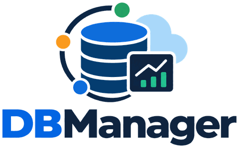
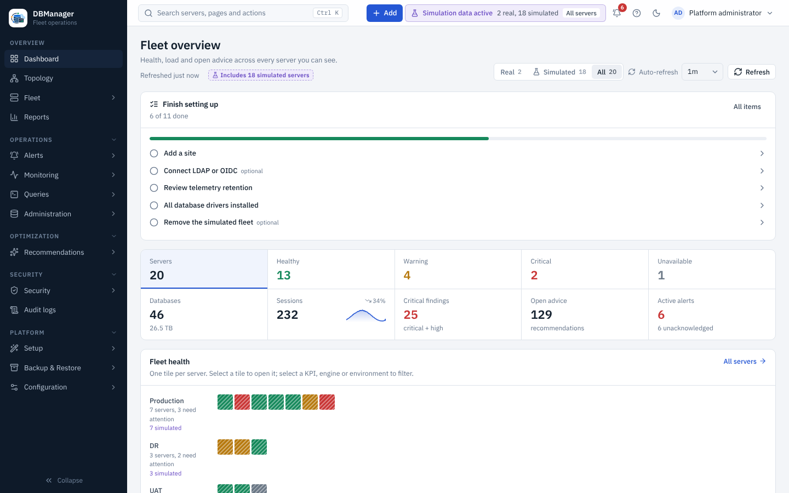
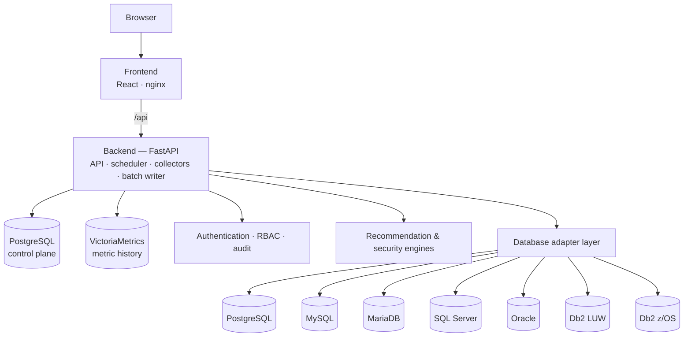
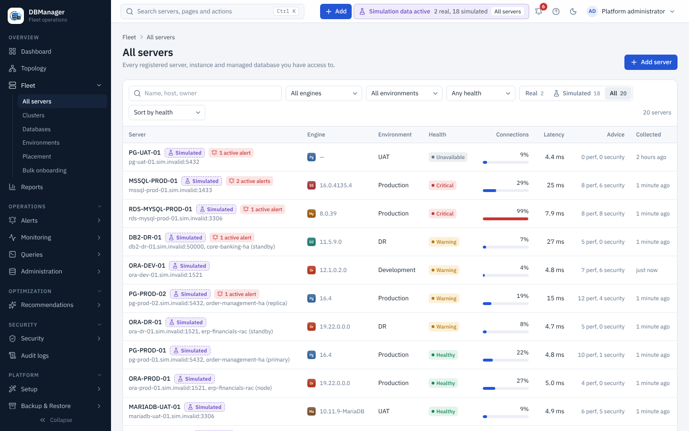
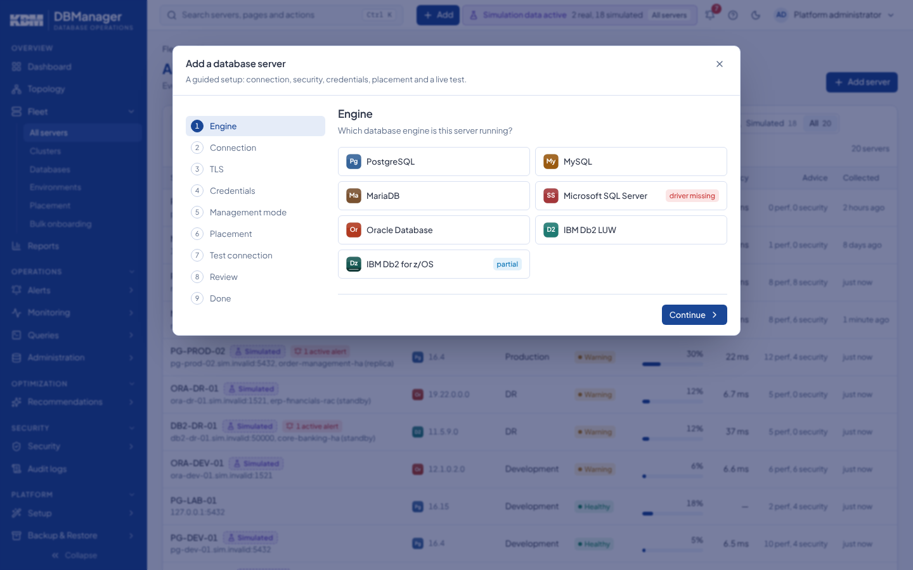
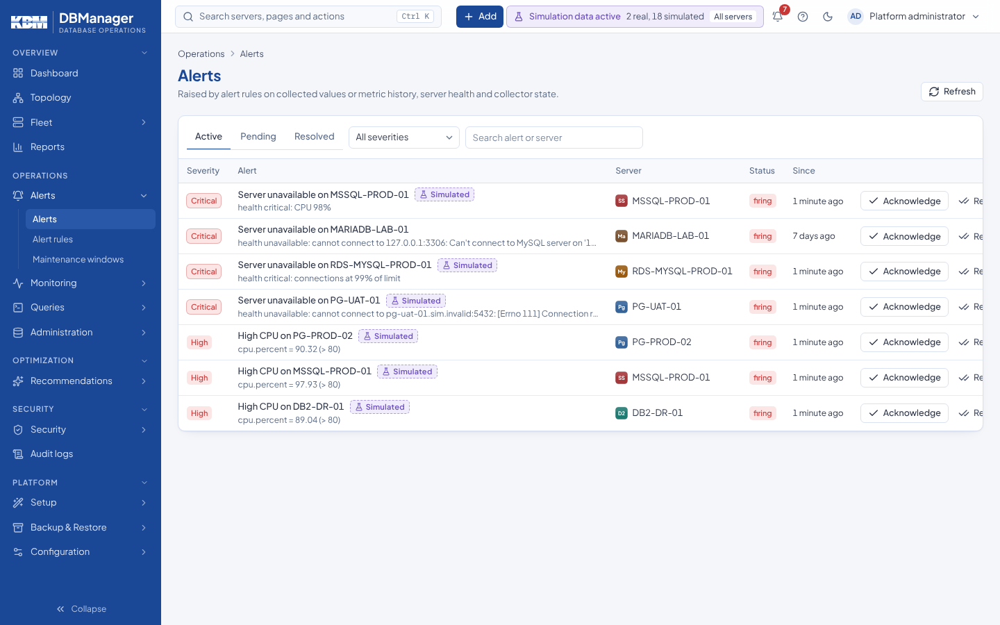
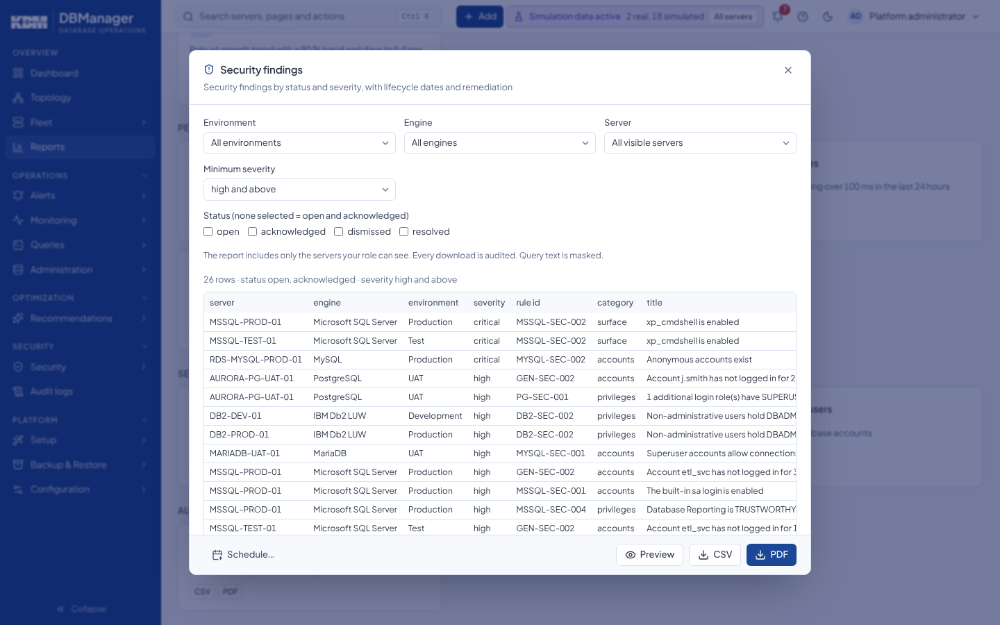
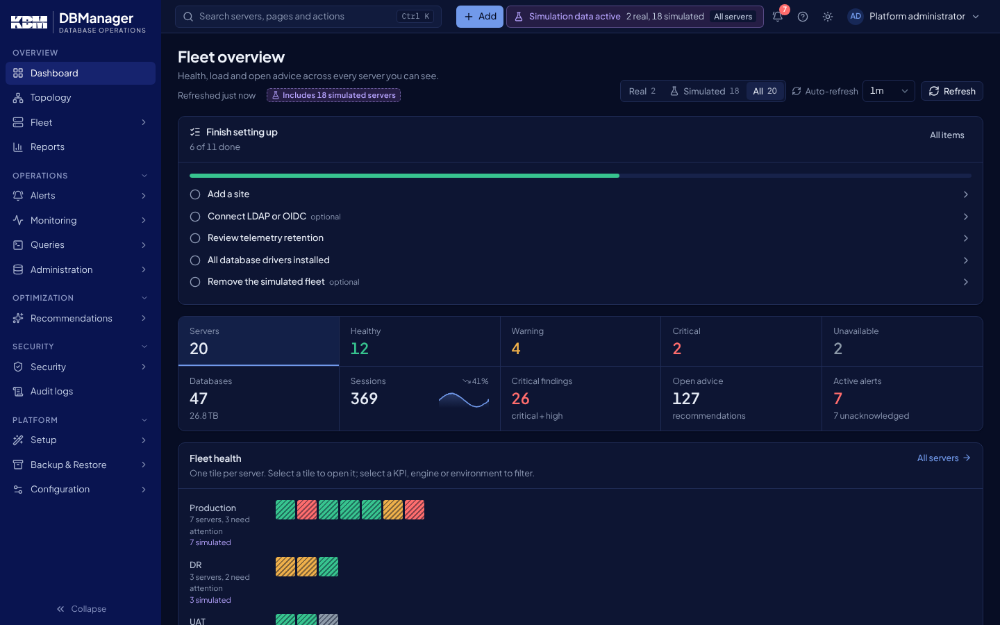

<p align="center">
  
</p>

# DBManager

**One management plane for heterogeneous relational database fleets** — inventory, monitoring,
query performance, execution plans, security posture, evidence-based recommendations and guarded
administration for PostgreSQL, MySQL, MariaDB, Microsoft SQL Server, Oracle Database and IBM Db2.

[](https://github.com/hbenabdalla/dbmanager/actions/workflows/ci-backend.yml)
[](https://github.com/hbenabdalla/dbmanager/actions/workflows/ci-frontend.yml)
[](https://github.com/hbenabdalla/dbmanager/actions/workflows/ci-docs.yml)
[](https://db-manager.readthedocs.io/en/latest/)
[](CHANGELOG.md)
[](LICENSE)

**Documentation: [db-manager.readthedocs.io/en/latest](https://db-manager.readthedocs.io/en/latest/)**

> **Version 0.15.1: cloud-native deployment** (0.15.0 plus release and CI fixes). A Helm chart for Kubernetes and OpenShift, signed
> images with SBOMs, highly available API and worker replicas with a visible scheduler leader, and
> TLS to the control-plane databases. DBManager is pre-1.0; 0.12.0 was its first public release.
> What changed is in the [changelog](CHANGELOG.md); what remains before 1.0 is in the
> [roadmap](ROADMAP.md).



## Why

DBAs who run several engines usually juggle one tool per vendor. DBManager gives them one place
to see every server, compare what is slow, review who can do what, and make safe changes — while
staying honest about what each engine, version, privilege set and license actually allows. A
capability the server cannot provide is shown as *requires privilege / configuration / license*,
never filled with made-up data.

## Key capabilities

| Area | What you get |
|---|---|
| Fleet | Registration wizard with a live staged connection test, bulk onboarding (CSV / JSON / grid), environments, sites, clusters, applications, tags, interactive topology |
| Monitoring | Connections, sessions, locks and blocking chains, throughput, latency, cache, I/O, replication lag, storage; history in a time-series database |
| Query performance | Top statements from each engine's own statistics, fingerprints and trends, estimated and actual execution plans (graph, tree, raw vendor plan), regression and plan-change detection, period-vs-period and plan-vs-plan comparison |
| Capacity | Storage forecasts per server, database and tablespace with a robust trend, 90 % band and days to full |
| Alerting | Threshold, health and collector rules (latest value, window aggregates or deviation from the server's own baseline (z-score), scope by server, environment or tag), alert inbox with acknowledge / comment / resolve and re-notification, recurring maintenance windows, webhook (generic, Slack, Teams) and e-mail notifications with retries and routing |
| Backup & restore | Encrypted (age) platform backups and managed-database backups (PostgreSQL, MySQL, MariaDB, SQL Server, Oracle Data Pump, Db2 LUW) to local, NFS or S3-compatible storage; policies, retention, verification, restore wizard with impact analysis, disaster-recovery scan |
| Reports | Fleet, capacity and forecast, performance, query statistics and regressions, security findings, privileged users, audit — previewed, downloaded as CSV or PDF, or e-mailed on a schedule with the owner's access |
| Recommendations | 116 rules (61 performance and configuration, 55 security), common and engine-specific, each with its evidence and risk, and a before/after outcome once resolved |
| Security | Privileged accounts, excessive grants, authentication and encryption checks, security posture score per server and fleet |
| Administration | Users, roles, grants, schemas and indexes through previewed, confirmed and audited actions — off by default (*Monitoring Only*) |
| Platform | Local sign-in with TOTP MFA, LDAP / Active Directory and OIDC, API tokens, rate limiting, scoped RBAC, full audit trail with SIEM forwarding (syslog RFC 5424 / webhook), HashiCorp Vault credentials, redacted diagnostic bundles, setup wizard, simulated demo fleet, About page |

## Supported databases

| Engine | Driver | Status | Real-engine validation |
|---|---|---|---|
| PostgreSQL 12–17 | asyncpg | Supported (reference adapter) | 16.15 — adapter, backup and restore |
| MySQL 8.0 / 8.4 / 9.x | PyMySQL | Supported | 8.4.11 — adapter, backup and restore |
| MariaDB 10.5–11.x | PyMySQL | Supported | 11.4.13 — adapter, backup and restore |
| SQL Server 2016–2022, Azure SQL | pyodbc + Microsoft ODBC Driver 18 | Supported | 2022 (16.0.4305.5) — adapter, backup and restore |
| Oracle Database 12.2–23ai | python-oracledb (thin, no Oracle Client) | Supported without management packs | 21c XE — adapter, Data Pump backup and restore (TCPS not exercised) |
| IBM Db2 LUW 11.1–12.1 | ibm_db | Supported | 11.5.9.0 — adapter and backup (restore external) |
| IBM Db2 for z/OS 12–13 | ibm_db over DRDA (needs Db2 Connect) | **Partial** | External validation required |

Oracle Diagnostics and Tuning Pack features (AWR, ASH, ADDM, SQL Monitor, SQL Tuning Advisor) are
never queried unless a server is explicitly marked as licensed. The SQL workspace refuses them
too. Per-engine details, privileges and
limitations: [database engines](docs/database-engines/index.md); per-capability results (TLS, replication and
what is not exercised): [real-engine validation report](docs/product/real-engine-validation.md); full status:
[capability matrix](docs/product/capability-matrix.md).

## Architecture



Four containers: frontend, backend, PostgreSQL (identity, inventory, findings, audit) and
VictoriaMetrics (metric history). See [architecture](docs/architecture/index.md).

## Screenshots

These are real captures of the running application. The fleet is a simulated one, plus two real
lab servers.

| | |
|---|---|
|  |  |
|  |  |
|  |  |
|  |  |
|  |  |
|  |  |

## Quick start (Docker Compose)

Requirements: Docker with Compose v2, 4 GB RAM, ports 8080 free.

```bash
git clone https://github.com/hbenabdalla/dbmanager.git && cd dbmanager
./scripts/init-env.sh                       # Windows: powershell -ExecutionPolicy Bypass -File scripts\init-env.ps1
docker compose up -d --build
```

`init-env` creates `.env` from `.env.example` with generated secrets (master key, database and
time-series passwords, bootstrap admin password). Keep `.env` private and back up
`DBM_MASTER_KEY` — stored database credentials cannot be decrypted without it.

### First login

Open **http://localhost:8080** and sign in as `admin` with `DBM_BOOTSTRAP_ADMIN_PASSWORD` from
`.env` (outside development mode the backend refuses to start the bootstrap without it, and the
value must meet the password policy). A banner then opens the **Platform Setup Wizard**, which guides you
through organization and time zone, sites, environments, sign-in (local / LDAP / OIDC),
monitoring profile and retention. It can be resumed at any time.

### Add your first database

**Add → Database server** opens the onboarding wizard: engine, connection, TLS, a least-privilege
monitoring account, management mode (Monitoring Only by default), placement, then a live staged
test (DNS → TCP → TLS → authentication → version → privileges → capabilities). Privileges for
each engine: [database engines](docs/database-engines/index.md). Walkthrough:
[add your first database](docs/getting-started/first-database.md).

No database at hand? **Platform → Simulation** generates a clearly labelled simulated fleet.

## Kubernetes and OpenShift (Helm)

```bash
helm install dbm oci://ghcr.io/hbenabdalla/charts/dbmanager --version 0.15.1 \
  --namespace dbmanager --create-namespace \
  --set secrets.masterKey="$(head -c32 /dev/urandom | base64)" \
  --set secrets.bootstrapAdminPassword='<a strong password>' \
  --set secrets.postgresPassword='<a strong password>' --set secrets.timeseriesPassword='<a strong password>'
```

The chart runs two API and two worker replicas under the restricted Pod Security Standard (and
OpenShift restricted-v2 with `--set openshift=true`); images and chart are signed with cosign.
Production values (external PostgreSQL with `verify-full` TLS, Ingress, existing Secret) and
signature verification: [Kubernetes and OpenShift with Helm](docs/deployment/kubernetes-helm.md);
replicas and leader election: [high availability](docs/deployment/high-availability.md).

## Configuration

All settings are environment variables prefixed `DBM_` (see [`.env.example`](.env.example)).
The most important: `DBM_MASTER_KEY`, `DBM_DATABASE_URL`, `DBM_PUBLIC_BASE_URL`,
`DBM_TIMESERIES_*`, `DBM_COOKIE_SECURE`, `DBM_SMTP_*` for e-mail alerts, and
`DBM_TRUSTED_PROXIES` / `DBM_OUTER_PROXY` when DBManager runs behind a reverse proxy (so the
audit log and rate limits see the real client address), and
`DBM_DOCUMENTATION_URL` (the Help menu links to the published documentation by default; set your
own URL for an internal copy or `off` to hide it). LDAP and
OIDC are configured in the UI. Reference:
[installation](docs/getting-started/installation.md) and [deployment](docs/deployment/index.md).

## Documentation

The documentation is published on Read the Docs at **[https://db-manager.readthedocs.io/en/latest/](https://db-manager.readthedocs.io/en/latest/)**
(`latest` = `main`; a `stable` version follows the first release tag). Its source is
[`docs/`](docs/index.md) (MkDocs Material):
getting started, user guide, administration, database engines, monitoring and performance,
security, deployment, operations, architecture, [API](docs/api/index.md),
[development](docs/development/index.md) and [troubleshooting](docs/troubleshooting/index.md).
Build it locally with `pip install -r docs/requirements.txt && mkdocs serve`.

## Roadmap

Milestones and sprints, with their status and acceptance criteria: [ROADMAP.md](ROADMAP.md) and
the detailed [product roadmap](docs/product/roadmap.md).

## Contributing

Contributions are welcome — see [CONTRIBUTING.md](CONTRIBUTING.md) for the development setup,
tests, the adapter tutorial and the pull-request process, and [CODE_OF_CONDUCT.md](CODE_OF_CONDUCT.md).

## Security

Please report vulnerabilities privately as described in [SECURITY.md](SECURITY.md) — never in a
public issue.

## License

DBManager is licensed under the [Apache License, Version 2.0](LICENSE) (SPDX: `Apache-2.0`). The
DBManager logo is part of the project ([brand assets](docs/development/brand-assets.md)).
Contributions are accepted under the same license (see [CONTRIBUTING.md](CONTRIBUTING.md)).

The license covers DBManager's own code only. Database drivers and the vendor database images
used for integration testing (SQL Server Developer, Oracle Database, IBM Db2 Community Edition)
are under their vendors' terms, and nothing in DBManager grants rights to Oracle Diagnostics or
Tuning Pack features or other separately licensed database options.

PostgreSQL, MySQL, MariaDB, SQL Server, Oracle and Db2 are trademarks of their respective owners.
DBManager is not affiliated with or endorsed by them; the engine marks in the product are
DBManager's own designs, not the vendors' logos ([brand assets](docs/development/brand-assets.md#trademark-notice)).
