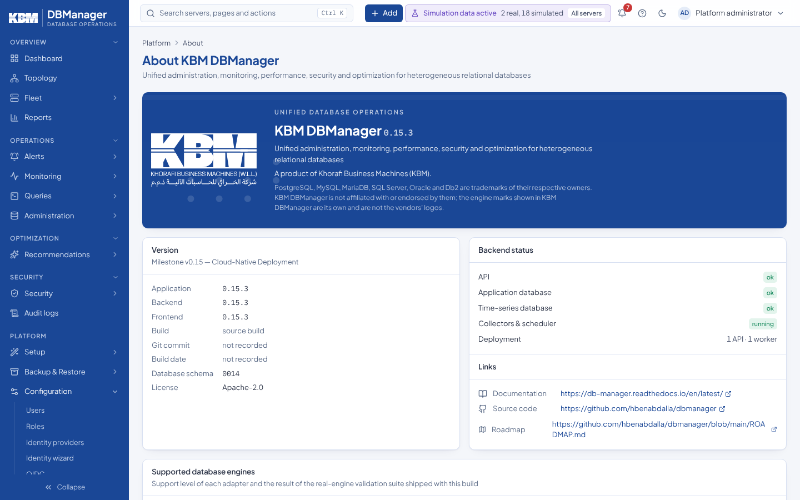

# About, version and product links



**Platform → Configuration → About** (also reachable from the **Help** menu in the top bar and the command palette, *About DBManager*) shows:

- the application, backend and frontend versions, the build identifier, git commit and build date, and the database schema (Alembic) revision;
- a warning when the frontend and backend versions differ (rebuild both images from the same release);
- the status of the API, the application database, the time-series store and the collector scheduler, and whether background jobs run in this process, in another replica (*running elsewhere*) or nowhere;
- the deployment as counts: API processes, workers, stale processes and a mixed-versions warning ([high availability](../deployment/high-availability.md#the-instance-registry); the per-process list with host names is on **Platform → Collectors**, permission `collectors.view`);
- the configured documentation, source code and roadmap links;
- the support level of each database engine and the result of the real-engine validation suite shipped with the build;
- the DBManager logo, the license (`Apache-2.0`), the current milestone and the trademark notice for the database engine names (see [brand assets](../development/brand-assets.md)).

Every signed-in user can open the page; it never shows host names, file paths or environment contents.

## Version source

There is one version per release: `backend/app/__init__.py` (`__version__`) and `frontend/package.json` (`version`) carry the same value (currently `0.15.1`). The frontend embeds its version at build time.

## Build metadata

Set these at image build time; they are shown as-is after sanitising (printable characters, at most 64):

| Variable | Where | Purpose |
|---|---|---|
| `DBM_BUILD_VERSION` | backend build arg / env; frontend `VITE_BUILD_VERSION` | release or CI build identifier |
| `DBM_GIT_COMMIT` | backend build arg / env | source commit |
| `DBM_BUILD_DATE` | backend build arg / env | ISO-8601 build timestamp |

```bash
DBM_BUILD_VERSION=0.15.1 DBM_GIT_COMMIT=$(git rev-parse --short HEAD) \
DBM_BUILD_DATE=$(date -u +%Y-%m-%dT%H:%M:%SZ) docker compose build
```

## Links and license

| Variable | Default | Effect |
|---|---|---|
| `DBM_DOCUMENTATION_URL` | empty | Help → *Documentation*. Empty = the published documentation, [https://db-manager.readthedocs.io/en/latest/](https://db-manager.readthedocs.io/en/latest/); a URL = your own copy (for example an internal mirror); `off` hides the entry |
| `DBM_GITHUB_URL` | `https://github.com/hbenabdalla/dbmanager` | Help → *Source code on GitHub* |
| `DBM_ROADMAP_URL` | empty | roadmap link; empty = `ROADMAP.md` in the GitHub repository |
| `DBM_LICENSE` | empty | license shown on the About page; empty = the project license, `Apache-2.0` |

## API

- `GET /api/v1/version` — public, `{"product": "DBManager", "version": "0.15.1"}`; suitable for load-balancer checks and upgrade scripts.
- `GET /api/v1/about` — authenticated; everything shown on the About page.

See also [Notification channels](notifications.md) and [Alerting](../user-guide/alerting.md).
