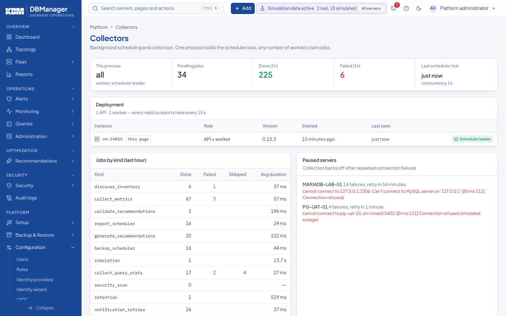

# Diagnostics

There is no separate diagnostics page in the application; the information is spread over the
places below.

| Where | What |
|---|---|
| `GET /healthz` | liveness |
| `GET /readyz` | readiness with per-component status (`application`, `postgresql` with `schema_version`, `timeseries`) |
| `GET /metrics` | Prometheus metrics of the platform itself |
| Platform → Configuration → Collectors | scheduler leader, pending and failed jobs per kind, servers paused by the circuit breaker |
| Platform → Configuration → Monitoring storage | time-series database status and ingestion |
| Platform → Configuration → Database drivers | driver availability |
| Platform → Configuration → About | versions and the status of the API, database, time-series store and scheduler |
| Server page → Overview tab → collection status | per-component state (ok, insufficient privilege, not supported, error) |
| `app.cli metrics status` | time-series status from the CLI |

### `/metrics` is unauthenticated

`GET /metrics` (and `/healthz`, `/readyz`) need no sign-in, so that Prometheus and container
orchestrators can scrape them. They are served by the **backend** on port 8000 only: the
frontend's nginx proxies `/api/` and `/healthz` but not `/metrics` or `/readyz`, so in the
shipped Compose file they are reachable only from the internal Docker network. The metrics hold
platform counters (requests, collector runs, job queue, connection pool), never credentials,
SQL text or database names. If you publish the backend port, restrict `/metrics` at your proxy
or firewall to the Prometheus host.

## Diagnostics bundle

For support cases, the server page's **Settings** tab → **Operations** → **Download diagnostics** (permission
`collectors.view` on the server) downloads one JSON file, `dbm-diagnostics-<server>.json`
(API: `GET /api/v1/servers/{id}/diagnostics`). It contains:

* the server's settings: engine and version, environment, host, port, default database, TLS mode,
  management mode, collection interval and connection options;
* its logins, without secrets: purpose, masked username, secret provider and whether a secret is stored;
* health: status and reasons, connection status, last error, last connection and collection,
  consecutive failures and circuit-breaker state;
* collector state per component and the detected capabilities;
* the last 50 collector jobs with kind, status, duration, error and result;
* driver, DBManager, Python and database schema versions.

Passwords, tokens, keys and `user:password@` in connection strings are replaced by `***` wherever
they appear, including error messages, options and job results. Review the file before sending it
anyway. Every download is audited (`server.diagnostics`).

The same screen offers **Test connection** (staged DNS, TCP, TLS, sign-in, version and privilege
checks with the stored settings) and **Scan security now**.

Logs: JSON lines on stdout of each container (`docker compose logs backend`), with `request_id` and
user. Details and common problems: [Health and logs](../operations/health-and-logs.md),
[Troubleshooting](../troubleshooting/index.md).
