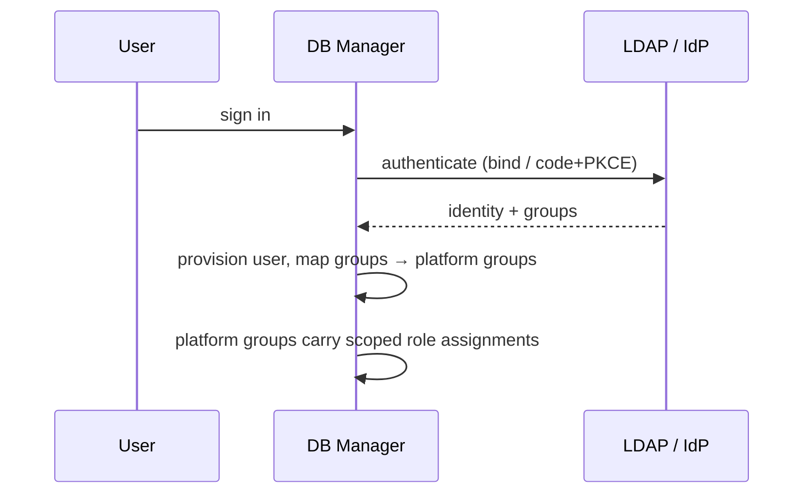

# Identity providers

Identity providers are configured at **Platform → Identity providers / LDAP** (permission `idp.manage`)
or through `POST /api/v1/identity-providers`. Secrets (LDAP bind password, OIDC client secret) are
write-only and encrypted.

## Group mapping

1. Create platform groups (**Platform → Users → Groups**), e.g. `dba-production`.
2. Give each group role assignments with scopes (e.g. *DBA Administrator* @ environment *Production*).
3. Map directory groups to platform groups on the provider (full DN or CN for LDAP; group name/id
   from the token for OIDC). Memberships are synchronised at every sign-in; directory-sourced
   memberships are removed when the user leaves the directory group.

Users without any mapping can sign in but see nothing until an administrator assigns a role.
External identities never merge into existing local accounts with the same username.

## Providers

* [LDAP / Active Directory](ldap.md)
* [OpenID Connect](oidc.md) (Keycloak, Microsoft Entra ID, Okta, Auth0, generic)

Both can be created with the guided wizards ([LDAP wizard](../user-guide/onboarding/ldap.md),
[OIDC wizard](../user-guide/onboarding/oidc.md)) or the flat form (*All fields*) on
**Platform → Configuration → Identity providers**. The draft test endpoint
`POST /api/v1/identity-providers/test-draft` checks a configuration before it is saved.

## SAML

The provider model includes `kind = saml`, but SAML is not enabled in this release. Most SAML IdPs
(ADFS, Entra ID, Okta, Keycloak) also speak OIDC, which is the recommended integration.
