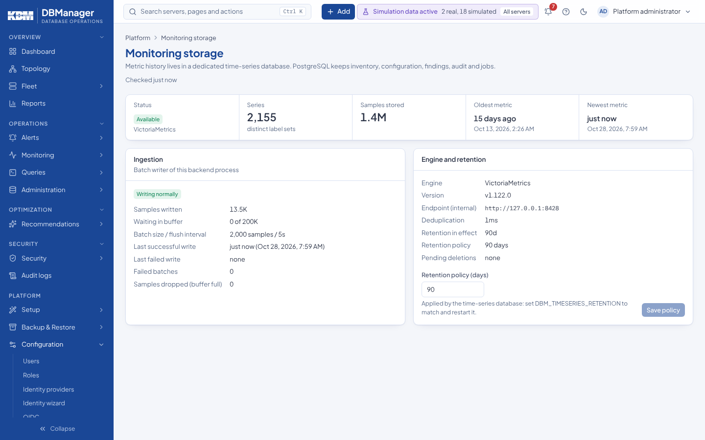

# Monitoring storage

**Platform → Configuration → Monitoring storage** (`collectors.view`; changing retention needs
`settings.manage`) shows the time-series database:

* status, version, number of series and samples, oldest and newest metric;
* retention **policy** vs. retention **in effect** (and how to apply a change);
* ingestion: samples written, buffered, failed and dropped, last success and last failure;
* pending deletions (series of removed servers are deleted asynchronously and retried).

When VictoriaMetrics is unreachable, collection keeps running, samples are buffered in memory up to
`DBM_METRIC_BUFFER_MAX` (oldest dropped beyond), metric reads return `503 timeseries_unavailable`
and `/readyz` reports `degraded: true` without making the backend unready.

Operating the storage (container, credentials, snapshots, migration from the legacy PostgreSQL
tables): [Time-series storage](../monitoring/timeseries-storage.md).
