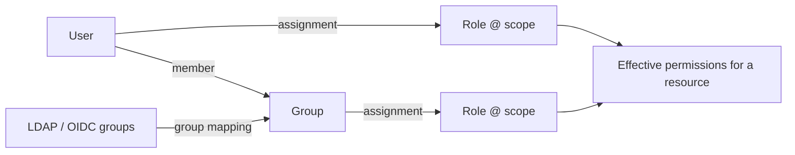

# RBAC model

Permissions are granular capabilities. Roles are named sets of permissions. A **role assignment**
grants a role to a user or group **at a scope**. Code only ever checks permissions — never role names.

## Scopes

`platform ⊃ environment | site ⊃ cluster ⊃ server ⊃ database ⊃ schema`

| Scope type | `scope_id` format | Covers |
|---|---|---|
| platform | `*` | everything, including platform-level resources |
| environment | environment UUID | every server in that environment (and its databases/schemas) |
| site | site UUID | every server at that site |
| cluster | cluster UUID | every member server |
| server | server UUID | that server, its databases and schemas |
| database | `<server UUID>/<database>` | that database and its schemas |
| schema | `<server UUID>/<database>/<schema>` | that schema |

**Contains vs. touches.** An assignment *contains* a resource when it grants permissions on it.
It *touches* a resource when it covers the resource or something inside it — used for visibility: a
database-scoped DBA sees the server in lists, but gets no server-level actions.

## Permission catalog

| Group | Permissions |
|---|---|
| Fleet | `server.view`, `server.register`, `server.modify`, `server.delete`, `credentials.manage` |
| Administration | `database.view`, `database.create`, `database.modify`, `database.delete`, `schema.view`, `schema.modify` |
| Access | `user.view`, `user.manage`, `privilege.view`, `privilege.manage` |
| Monitoring | `session.view`, `session.manage`, `performance.view`, `logs.view` |
| Queries | `query.view`, `query.view_text`, `query.execute`, `query.modify`, `query.explain`, `query.explain_analyze` |
| Optimization / Security | `performance.tune`, `security.view`, `security.manage` |
| Platform | `audit.view`*, `audit.export`*, `reports.view`, `users.manage`*, `roles.manage`*, `rbac.manage`, `idp.manage`*, `collectors.view`, `collectors.manage`, `settings.manage`*, `inventory.manage`* |

\* platform scope only (granting them at narrower scopes has no effect).

## System roles

| Role | Intended for |
|---|---|
| Platform Administrator | all permissions |
| DBA Administrator | full administration of assigned systems (incl. credentials, DDL, grants, EXPLAIN ANALYZE) |
| Database Operator | sessions (cancel/terminate), read-only SQL, EXPLAIN, metrics, logs, trigger collection |
| Performance Engineer | metrics, query statistics with full text, EXPLAIN/ANALYZE, tuning status |
| Security Auditor | users, privileges, security findings, audit log, reports |
| Monitoring User | `server.view`, `performance.view` |
| Log Viewer | `server.view`, `logs.view` |
| Read Only | metadata, users/privileges, metrics, findings, masked query statistics |

System roles are immutable; create custom roles for variations.

## Examples from the requirements

| User | Assignment |
|---|---|
| A — Production PostgreSQL, monitoring only | *Monitoring User* @ environment *Production* (or @ each PostgreSQL server) |
| B — Development PostgreSQL, DBA | *DBA Administrator* @ environment *Development* |
| C — Oracle production, logs and performance | *Performance Engineer* + *Log Viewer* @ server `ora-erp-prod-01` |
| D — Db2 development, administration | *DBA Administrator* @ server `db2-dev-01` |

The API test suite creates equivalent accounts against its simulated CI fleet
(`backend/tests/api/conftest.py`).

## Simulation permissions

`simulation.view`, `simulation.generate` and `simulation.delete` are platform-only and held only
by **Platform Administrator** out of the box. Regenerating needs both `simulation.generate` and
`simulation.delete`. See [simulation.md](simulation.md).

## Anti-escalation rules (enforced in `POST /role-assignments`)

1. The actor must hold `rbac.manage` at a scope that **contains** the target scope.
2. The actor must hold **every permission of the role** at the target scope ("you cannot give what you don't have").
3. Nobody can assign or remove roles for themselves, or for a group they belong to.
4. Users with `users.manage` cannot add themselves to groups.
5. System roles cannot be edited; only `roles.manage` (platform) can create/edit roles.
6. Every attempt — successful or denied — is audited with the missing permissions.

## Backend enforcement points

* `Authorizer.require(perm, ResourceRef)` — single check.
* `Authorizer.server_filter(perm)` — SQL predicate for lists (fleet lists, dashboards, reports, findings),
  so large fleets are filtered in the database rather than in Python.
* `load_server(db, principal, id, perm)` — 404 for invisible servers, 403 for visible servers without the permission.
* SQL workspace: required permissions come from the statement classification (e.g. GRANT needs
  `query.modify` + `privilege.manage`), checked against the database-level resource.
