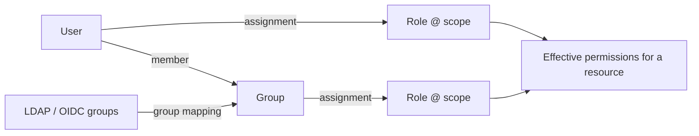

# RBAC model

Permissions are granular capabilities. Roles are named sets of permissions. A **role assignment**
grants a role to a user or group **at a scope**. Code only ever checks permissions — never role names.

## Scopes

`platform ⊃ environment | site ⊃ cluster ⊃ server ⊃ database ⊃ schema`

| Scope type | `scope_id` format | Covers |
|---|---|---|
| platform | `*` | everything, including platform-level resources |
| environment | environment UUID | every server in that environment (and its databases/schemas) |
| site | site UUID | every server at that site |
| cluster | cluster UUID | every member server |
| server | server UUID | that server, its databases and schemas |
| database | `<server UUID>/<database>` | that database and its schemas |
| schema | `<server UUID>/<database>/<schema>` | that schema |

**Contains vs. touches.** An assignment *contains* a resource when it grants permissions on it.
It *touches* a resource when it covers the resource or something inside it — used for visibility: a
database-scoped DBA sees the server in lists, but gets no server-level actions.

## Permission catalog

The catalog is defined in `backend/app/domain/permissions.py`; **Platform → Configuration → Roles**
shows it against every role. Permissions marked \* are **platform-only**: granting them at a
narrower scope has no effect.

| Group | Permission | Allows |
|---|---|---|
| Fleet | `server.view` | view registered servers and their metadata |
| | `server.register` | register new servers (lets the backend open connections to any host — grant narrowly) |
| | `server.modify` | modify server metadata and monitoring settings |
| | `server.delete` | remove servers from the platform |
| | `credentials.manage` | set or rotate the credentials used to connect to servers |
| Administration | `database.view` | list databases and their properties |
| | `database.create`, `database.modify`, `database.delete` | create, modify, drop databases |
| | `schema.view` | browse schemas and objects |
| | `schema.modify` | create / alter schema objects (DDL) |
| Access | `user.view`, `user.manage` | view / create, alter and drop database users and roles |
| | `privilege.view`, `privilege.manage` | view / grant and revoke privileges |
| Monitoring | `session.view`, `session.manage` | view sessions and locks / cancel queries and terminate sessions |
| | `performance.view` | view metrics, dashboards and recommendations |
| | `logs.view` | view collection and database logs |
| Queries | `query.view` | query statistics with normalized, masked text |
| | `query.view_text` | unmasked SQL text including literals |
| | `query.execute` | run read-only SQL in the workspace |
| | `query.modify` | run data-modifying and DDL SQL in the workspace (and EXPLAIN ANALYZE of such statements) |
| | `query.explain`, `query.explain_analyze` | estimated plans / EXPLAIN ANALYZE (executes the statement) |
| Optimization | `performance.tune` | acknowledge, dismiss and resolve recommendations |
| Security | `security.view`, `security.manage` | view posture and findings / triage findings and run scans |
| Alerting | `alerts.view`, `alerts.acknowledge` | view alerts of visible servers / acknowledge, resolve and comment |
| | `alerts.manage`\* | alert rules, maintenance windows, **Evaluate now** |
| | `channels.manage`\* | notification channels |
| Platform | `audit.view`\*, `audit.export`\* | view / export the audit log |
| | `audit.forward`\* | configure audit forwarding to a SIEM |
| | `reports.view` | generate and download reports |
| | `reports.schedule`\* | schedule reports e-mailed to notification channels (each runs with its owner's access) |
| | `users.manage`\* | platform users and groups |
| | `roles.manage`\* | create and edit roles |
| | `rbac.manage` | assign roles to users and groups (at scopes the actor holds it) |
| | `idp.manage`\* | LDAP / OIDC identity providers |
| | `collectors.view`, `collectors.manage` | collector status / trigger and configure collection |
| | `settings.manage`\* | platform settings and the setup wizard |
| | `inventory.manage`\* | environments, sites, clusters and applications |
| Backup | `backup.view` | backups, backup jobs, policies and protection status |
| | `backup.create` | run backups and cancel backup jobs (platform backups need it at platform scope) |
| | `backup.verify` | verify stored backups |
| | `backup.delete`\* | delete stored backups |
| | `backup.policy.manage`\* | backup policies (schedule, retention) and pinning backups |
| | `backup.target.manage`\* | backup storage targets |
| | `restore.execute` | start restores, together with `restore.platform` or `restore.database` |
| | `restore.platform`\* | restore KBM DBManager's own configuration from a platform backup |
| | `restore.database` | restore a managed database from its backup into a new database |
| Simulation | `simulation.view`\*, `simulation.generate`\*, `simulation.delete`\* | view, generate / regenerate, remove the simulated fleet |

## System roles

`Read base` below means `server.view`, `database.view` and `schema.view`.

| Role | Permissions |
|---|---|
| Platform Administrator | every permission |
| DBA Administrator | read base, `server.modify`, `credentials.manage`, `database.create/modify/delete`, `schema.modify`, `user.view/manage`, `privilege.view/manage`, `session.view/manage`, `query.view`, `query.view_text`, `query.execute`, `query.modify`, `query.explain`, `query.explain_analyze`, `performance.view/tune`, `security.view`, `logs.view`, `alerts.view/acknowledge`, `reports.view`, `collectors.view/manage`, `backup.view/create/verify`, `restore.execute`, `restore.database` |
| Backup Operator | `server.view`, `database.view`, `backup.view`, `backup.create`, `backup.verify`, `restore.execute`, `restore.database` — runs and verifies database backups and restores databases, never the platform itself |
| Database Operator | read base, `session.view/manage`, `query.view`, `query.execute`, `query.explain`, `performance.view`, `logs.view`, `alerts.view/acknowledge`, `collectors.view/manage` |
| Performance Engineer | read base, `session.view`, `query.view`, `query.view_text`, `query.execute`, `query.explain`, `query.explain_analyze`, `performance.view/tune`, `logs.view`, `alerts.view/acknowledge`, `reports.view`, `collectors.view` |
| Security Auditor | read base, `user.view`, `privilege.view`, `security.view/manage`, `audit.view`, `audit.export`, `reports.view`, `logs.view`, `alerts.view`, `backup.view` |
| Monitoring User | `server.view`, `performance.view`, `alerts.view` |
| Log Viewer | `server.view`, `logs.view` |
| Read Only | read base, `user.view`, `privilege.view`, `performance.view`, `security.view`, `query.view` (masked), `alerts.view` |

System roles are synchronised at every start and are immutable; create custom roles for
variations. Platform-only permissions in a system role (for example `audit.view` of the Security
Auditor) only take effect when the role is assigned at platform scope.

## Examples from the requirements

| User | Assignment |
|---|---|
| A — Production PostgreSQL, monitoring only | *Monitoring User* @ environment *Production* (or @ each PostgreSQL server) |
| B — Development PostgreSQL, DBA | *DBA Administrator* @ environment *Development* |
| C — Oracle production, logs and performance | *Performance Engineer* + *Log Viewer* @ server `ora-erp-prod-01` |
| D — Db2 development, administration | *DBA Administrator* @ server `db2-dev-01` |

The API test suite creates equivalent accounts against its simulated CI fleet
(`backend/tests/api/conftest.py`).

## Simulation and backup permissions

`simulation.view`, `simulation.generate` and `simulation.delete` are held only by **Platform
Administrator** out of the box. Regenerating needs both `simulation.generate` and
`simulation.delete`. See [Simulation](simulation.md).

Backups and backup jobs are filtered like servers: a user whose `backup.view` is scoped to some
servers sees only those servers' backups and jobs; platform backups need platform scope. See
[Backup security and RBAC](../backup-restore/security.md).

Step by step: [Give a colleague scoped access](../user-guide/tasks/give-scoped-access.md).

## Anti-escalation rules (enforced in `POST /role-assignments`)

1. The actor must hold `rbac.manage` at a scope that **contains** the target scope.
2. The actor must hold **every permission of the role** at the target scope ("you cannot give what you don't have").
3. Nobody can assign or remove roles for themselves, or for a group they belong to.
4. Users with `users.manage` cannot add themselves to groups.
5. System roles cannot be edited; only `roles.manage` (platform) can create/edit roles.
6. Every attempt — successful or denied — is audited with the missing permissions.

## Backend enforcement points

* `Authorizer.require(perm, ResourceRef)` — single check.
* `Authorizer.server_filter(perm)` — SQL predicate for lists (fleet lists, dashboards, reports, findings),
  so large fleets are filtered in the database rather than in Python.
* `load_server(db, principal, id, perm)` — 404 for invisible servers, 403 for visible servers without the permission.
* SQL workspace: required permissions come from the statement classification (e.g. GRANT needs
  `query.modify` + `privilege.manage`), checked against the database-level resource.
