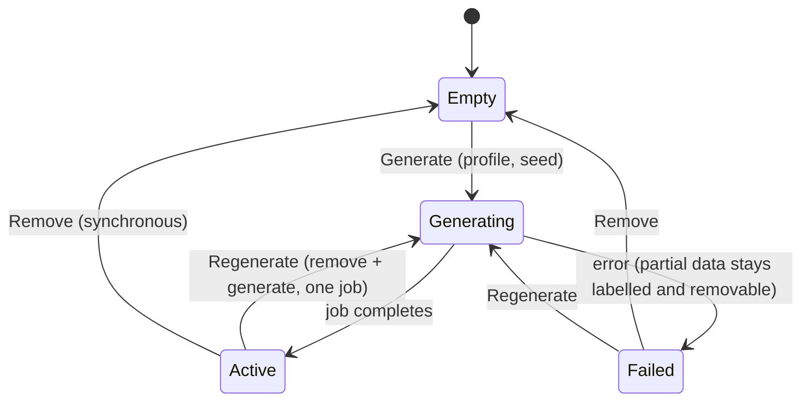

# Demo / simulation data

DBManager never creates demo data on its own. A new installation contains only what the
platform needs to run: the default organization, the five reference environments, the
system roles and permissions, and the bootstrap administrator. The fleet starts **empty**.

A Platform Administrator can generate a simulated estate on request (for demonstrations,
training, UI testing or bug reproduction) and remove it again at any time. Simulated and real
servers can coexist; they are always distinguishable.

## Lifecycle



| Action | Where it runs | Permission(s) | Confirmation |
|---|---|---|---|
| Generate | background job on the existing queue (`collector_jobs`, kind `simulation`) | `simulation.generate` | dialog |
| Regenerate | same job: removes the simulated fleet, then generates a new one | `simulation.generate` **and** `simulation.delete` | type `REGENERATE` |
| Remove | the request itself, one transaction, set-based deletes (75 servers / 2 M metric rows: ~4 s) | `simulation.delete` | type `REMOVE` |

Only one simulation operation can be active at a time (HTTP 409 `simulation_busy`).
Generation progress (0–100 % and a phase text) is written to the `simulation_runs` row and
shown on **Platform → Simulation**. If the backend restarts mid-run, the run is marked
failed and the job is released by the scheduler's stale-job recovery.

## How simulated data is identified

`data_source` (`real` | `simulated` | `system`) is a column on `servers`, `sites`, `clusters`,
`applications` and `environments`.

* Everything a simulated server owns — databases, metric samples, query statistics,
  recommendations, security findings, account snapshots, tags, jobs, workspace history —
  references the server row and is deleted with it.
* Simulated sites, clusters and applications are deleted with the fleet **unless a real server
  has been attached to one**; such groupings are kept and reported.
* Role assignments scoped to a simulated server, cluster or site (or a database/schema on a
  simulated server) are removed, because their target no longer exists. All other
  assignments, users, groups, roles, identity providers and settings are untouched.
* Nothing is ever classified by name.

`system` marks platform reference data (the bootstrap environments). Users are not
classified: the simulation never creates accounts.

## Safety

* Simulated servers are served exclusively by the simulation adapter
  (`app/adapters/demo`): no network connection, no credentials, no SQL execution. Their host
  names end in `.sim.invalid` (RFC 2606, never resolvable).
* `create_adapter` refuses to build a real engine adapter for a spec carrying a simulation
  profile; collectors route simulated servers through the simulation adapter.
* Credentials cannot be set on a simulated server (HTTP 409 `simulated_server`), and the
  Credentials page lists real servers only.
* The SQL workspace classifies statements for simulated servers but never executes them.
* Removal deletes `WHERE data_source = 'simulated'` only, and never sets a real server's
  references to NULL (groupings used by real servers are kept).
* Every endpoint checks its `simulation.*` permission on the backend; denials are audited.

## Profiles

| Profile | Servers | Environments | History | Query snapshots | Cloud services |
|---|---|---|---|---|---|
| Small | 5 | Production 2, UAT, Development, Test | 1 day | 12 h | no |
| Standard | 18 | Production 7, DR 3, UAT 3, Development 3, Test 2 | 7 days | 24 h | RDS MySQL, Aurora PostgreSQL |
| Large | 75 | Production 28, DR 12, UAT 13, Development 14, Test 8 | 30 days | 24 h | RDS, Aurora, Azure SQL, Oracle Autonomous Database, IBM Db2 on Cloud |

Profiles are configuration objects in `app/simulation/profiles.py`; add one with
`register_profile(SimulationProfile(...))`. Metric resolution is coarser for older history
(Large: 1 min for 2 h, 5 min for a day, 15 min for a week, hourly beyond), so Large stays
around 2 million samples.

The same profile and seed always produce the same estate (names, topology, conditions);
values are a deterministic function of the seed and the timestamp.

## What gets generated

* **Estate**: business applications, each with engines and environments that make sense
  (production primary + replicas / RAC nodes, DR standbys, pre-production copies), sites per
  provider and region, clusters. Names follow `ENGINE-ENV-NN` (`PG-PROD-01`, `ORA-DR-01`,
  `RDS-MYSQL-PROD-01`, `AZSQL-PROD-01`, `ADB-PROD-01`, `DB2C-PROD-01`…).
* **Conditions**: about 60 % healthy, 22 % warning, 12 % critical, 6 % unavailable. A
  condition is not assigned to the health field: it selects scenarios, the scenarios shape
  the generated metrics, and the platform's normal health model rates the server.

  | Condition | Scenarios (examples) | Evidence |
  |---|---|---|
  | Critical | `connection_saturation`, `cpu_saturation` + `slow_queries`, `storage_full` | connection utilization ≥ 95 % at peak, CPU ≥ 95 %, storage ≥ 95 % |
  | Warning | `high_cpu`, `blocking` + `deadlocks`, `storage_pressure`, `cache_pressure`, `replica_lag` | CPU 85–93 %, 1–4 blocked sessions and deadlocks, storage 90–94 %, buffer hit ratio < 92 %, lag 60–300 s |
  | Unavailable | `down` | history until two hours ago, then `availability.up = 0` and a connection error |
  | Healthy | optionally `regressing_query` | health stays green while the hottest statement gets steadily slower |

* **Queries**: harmless sample statements per engine (lookups, hot updates, full scans,
  reporting aggregates, missing-index cases) with hourly cumulative snapshots.
* **Recommendations and security findings** come from the platform's own rule engines
  evaluated on the generated evidence — nothing is hand-written — so they cannot contradict
  the metrics. Security posture follows the scenarios: `hardened` production systems raise
  few findings; neglected development systems (`weak_security`, `outdated_version`, TLS
  `disable`/`prefer`) raise many.

## Visual identification

* A **Simulated** badge (dashed, violet, flask icon) on server lists, cards, the server page,
  findings, query lists and inventory tables, plus a banner on every simulated server's page.
* Fleet-health tiles of simulated servers are hatched.
* While simulated servers exist, the header shows **Simulation data active** with real and
  simulated counts. This is a data indicator, not a platform "demo mode".
* Fleet-wide views (dashboard, servers, databases, monitoring, queries, recommendations,
  security) take `source=all|real|simulated|auto`. The UI default is *automatic*: real servers
  whenever any exist, otherwise everything. The choice is remembered per browser.

## API

| Method | Path | Permission | Notes |
|---|---|---|---|
| GET | `/api/v1/simulation/status` | `simulation.view` | presence, profile, seed, generated at/by, counts, active run, history |
| GET | `/api/v1/simulation/profiles` | `simulation.view` | profile catalog |
| GET | `/api/v1/simulation/cleanup-preview` | `simulation.delete` | what a removal deletes / keeps |
| POST | `/api/v1/simulation/generate` | `simulation.generate` | `{"profile": "standard", "seed": 42}` → 202 with the queued run |
| POST | `/api/v1/simulation/regenerate` | `simulation.generate` + `simulation.delete` | adds `"confirm": "REGENERATE"` |
| DELETE | `/api/v1/simulation?confirm=REMOVE` | `simulation.delete` | returns `servers_deleted`, `telemetry_samples_deleted`, `timeseries_delete`, … |
| GET | `/api/v1/fleet/sources` | authenticated | real / simulated counts visible to the caller |

The completed run's statistics (`servers_created`, `databases_created`, `metrics_created`,
`queries_created`, `findings_created`, `recommendations_created`, …) are in the status
response (`last_run.stats`) and in the audit event.

## Audit events

| Action | Result | Details |
|---|---|---|
| `simulation.generate_requested`, `simulation.regenerate_requested` | `accepted` | profile, seed, servers planned |
| `simulation.generated`, `simulation.regenerated` | `success` / `failure` | profile, seed, every count, originating `request_id` |
| `simulation.removed` | `success` / `failure` | every count deleted, groupings kept |
| `access.denied` | `denied` | attempts without the permission |

Each event records the administrator, timestamp and request/correlation ID; no credentials
or secrets are ever included.

## Permissions

`simulation.view`, `simulation.generate`, `simulation.delete` are platform-only permissions.
Out of the box only the **Platform Administrator** role holds them. They can be added to a
custom role, but only at platform scope.

## CLI

```bash
docker compose exec backend python -m app.cli simulation status
docker compose exec backend python -m app.cli simulation cleanup --dry-run   # show what would be removed
docker compose exec backend python -m app.cli simulation cleanup --yes       # remove it
docker compose exec backend python -m app.cli simulation generate --profile small --seed 42
docker compose exec backend python -m app.cli simulation generate --profile standard --replace
```

Without `--yes`, `cleanup` asks for `REMOVE` on an interactive terminal and refuses otherwise.

## Upgrading an installation that used `DBM_DEMO_MODE`

Migration `0002` classifies the existing data; it deletes nothing.

* Servers created by the old demo seeder carried `is_demo = true`; they become
  `data_source = 'simulated'` (reliable: only the seeder ever set that flag).
* Sites, clusters and applications become simulated only when demo servers used them and no
  other server did.
* A `legacy` entry appears in the simulation history, so the page shows where the data came
  from.
* `DBM_DEMO_MODE` is ignored from now on (a warning is logged if it is still set).

Then remove the old demo fleet from **Platform → Simulation → Remove simulated data**, or:

```bash
docker compose exec backend python -m app.cli simulation cleanup --dry-run
docker compose exec backend python -m app.cli simulation cleanup --yes
```

The old demo mode also created the accounts `monitor`, `dba.dev`, `perf.oracle`, `db2.dba` and
`auditor`. Nothing marks them as demo accounts, so they are **not** deleted automatically;
the dry run lists the ones that exist. Review them under **Platform → Users** and disable or
delete those you do not need. Their permissions that pointed at simulated servers are removed
with the fleet.

## Where simulated data is stored

* Inventory, findings, recommendations, fingerprint metadata → PostgreSQL rows marked
  `data_source = 'simulated'` (or owned by such servers).
* Metric history and query telemetry → the time-series database, bulk-imported with the label
  `data_source="simulated"` and each server's id (Standard profile: ~600 k samples in ~12 s;
  Large: 2.8 M samples in ~52 s).
* Removal deletes the PostgreSQL rows and the time-series data by those labels — never by
  name — discards samples still buffered for them, and repeats the time-series deletion by the
  removed servers' ids 90 seconds later. Real servers' telemetry (`data_source="real"`) is never
  matched. If the time-series database is down, the deletion is queued and retried.
