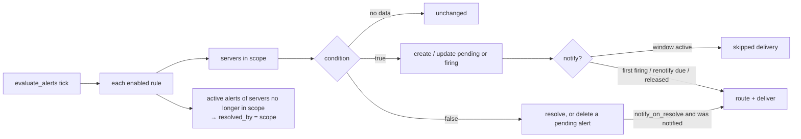
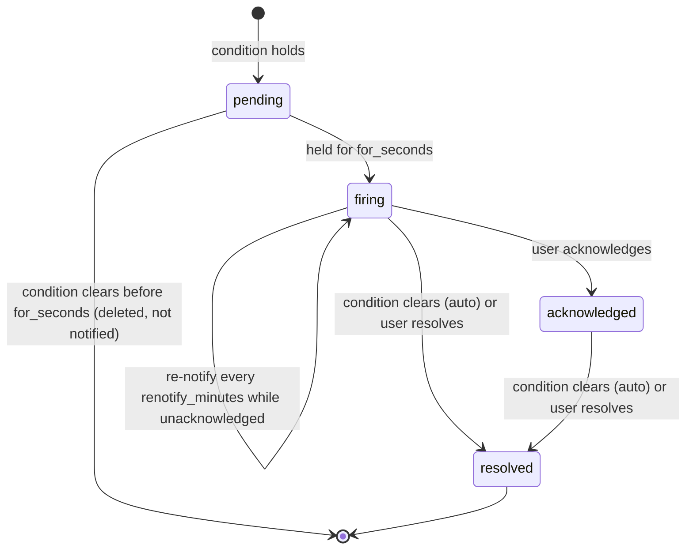

# Alerting architecture

Alerting turns collected monitoring data into alert instances and notifications. It lives in the
backend: `app/services/alerting.py` (evaluation, routing, delivery and retries),
`app/services/notify.py` (webhook and SMTP senders, payload presets, channel secrets),
`app/api/v1/alerting.py` (REST API) and `app/models/alerting.py` (tables `alert_rules`, `alerts`,
`alert_comments`, `maintenance_windows`, `notification_channels`, `notification_deliveries`;
migrations `0004_alerting` and `0007_alerting_completion`).

## Jobs

Two global jobs run on the scheduler leader (see [scheduler and jobs](design-document.md)):

| Job | Interval | Does |
|---|---|---|
| `evaluate_alerts` | `DBM_ALERT_EVALUATION_SECONDS` (default 60 s, minimum 15 s) | evaluates every enabled rule against every monitored server in its scope, updates alert instances, sends notifications |
| `notification_retries` | 60 s | re-sends deliveries in state `retrying` whose backoff has elapsed |

`POST /api/v1/alerts/evaluate` runs the evaluation on demand (`alerts.manage`).

## What a rule evaluates

| Rule kind | Input |
|---|---|
| `metric`, evaluation `latest` | the collector's latest snapshot of the server (`servers.latest_metrics`, the values the dashboards show). It is available even when the time-series database is down. A value older than three collection intervals counts as *no data*. |
| `metric`, evaluation `avg` / `min` / `max` | an aggregate of the metric's history over `window_seconds` (at least 60 s), read in one query for all servers in scope through the time-series repository (`TimeSeriesRepository.aggregate`, VictoriaMetrics in production). If the storage is unavailable, or a server has no samples in the window, the rule sees *no data* for it. |
| `metric`, evaluation `zscore` | the latest value (or the window average) as a z-score against the server's own baseline: mean and standard deviation over `baseline_days`, the recent window excluded — [baseline-relative rules](../performance/baselines-and-capacity.md#baseline-relative-alert-rules-z-score) |
| `health` | the server health state (`unavailable`, `critical`, `warning`, `unknown`) |
| `collector` | failing collector components, or the number of consecutive failed collections |

*No data* never changes an alert: an active alert stays as it is until data returns — in
particular it is never auto-resolved without an evaluation that saw the condition clear.

Scopes are `all`, one `environment`, one `server`, or `tag` (`key` matches any value of the
tag, `key=value` an exact value; keys are case-insensitive). Rules and windows are scope-filtered
for viewers whose `alerts.view` grant is limited to some servers.

## Lifecycle

* **De-duplication**: at most one active alert (`pending`, `firing` or `acknowledged`) per rule and
  server, enforced by the partial unique index `uq_alerts_active_rule_server`. Later evaluations
  update its value and message.
* **Notifications**: `firing` is sent when the alert fires. With `renotify_minutes` > 0 it is
  repeated while the alert is firing and unacknowledged (payload flag `renotify: true`,
  `notify_count` counts them). Acknowledging stops repetition. `resolved` is sent when the rule has
  `notify_on_resolve` and the alert was actually notified before.
* Disabling or deleting a rule closes its active alerts without notifications.
* An active alert of an enabled rule whose server is no longer evaluated (left the rule's scope,
  monitoring disabled, server deleted) is resolved with `resolved_by = scope`, without a
  notification; a pending one is deleted. Nobody can tell whether its condition still holds.
* Comments (`alert_comments`) and the notification history of an alert are returned by
  `GET /api/v1/alerts/{id}`.

## Maintenance windows

A window applies to a scope (as for rules) and has a first occurrence `starts_at` – `ends_at`
(half-open: active from `starts_at`, inactive at `ends_at`). Recurring windows (`daily`, or
`weekly` on ISO weekdays 1 = Monday … 7 = Sunday) repeat the first occurrence's **local** time of
day in their IANA `time_zone`, so `02:00–04:00 Europe/Berlin` stays 02:00 local across daylight
saving changes. An occurrence lasts at most 24 hours. Recurrence stops at `repeat_until`.

An alert that fires while its server is inside an active window is marked `suppressed`; a
`skipped` delivery is logged per channel and `notified_at` stays empty. At the first evaluation
after the window, an alert that is still firing and was never notified is notified then
(`released` in the evaluation statistics). An alert that clears during the window is never
notified.

## Routing

A notification for an alert goes to every enabled channel that:

1. is listed by the rule (`channel_ids`) **or** subscribes to all alerts (`routes.subscribe_all`);
2. has a `min_severity` at or below the alert's severity;
3. matches its route filters, when set: `environment_ids`, `tags` (any of them) and `engines`.

Alerts of simulated servers are skipped (and logged) unless the channel has
`send_for_simulated`.

## Delivery and retries

`deliver()` makes the first attempt immediately and records a `notification_deliveries` row
with the alert snapshot (`payload`). A failure that may be temporary (network error, timeout,
HTTP 408, 425, 429 or 5xx) sets the row to `retrying` with `next_attempt_at` after the backoff
step for that attempt (`DBM_NOTIFY_RETRY_BACKOFF_SECONDS`, default 60, 300, 900, 3600 s; the last
step repeats). The `notification_retries` job picks due rows with `FOR UPDATE SKIP LOCKED`
(safe with several workers) until the delivery is `sent` or `DBM_NOTIFY_MAX_ATTEMPTS` (default 5)
is reached (`failed`). Other 4xx answers fail at once. Test sends (`POST
/notification-channels/{id}/test`) make one attempt and report the result directly.

## Senders and presets

* **Webhook**: JSON `POST`, optional `X-DBM-Signature: sha256=<HMAC>` over the raw body, SSRF
  guard on the resolved address. The body depends on the channel `preset`: `generic` (KBM DBManager
  JSON), `slack` (incoming-webhook message with blocks) or `teams` (a message with an Adaptive
  Card 1.4 attachment, as accepted by Teams workflow webhooks).
* **Email**: SMTP with `security` `starttls` (default, port 587), `tls` (implicit TLS, SMTPS,
  port 465) or `none` (plain, for internal relays only). Certificates are verified against the
  system trust store or `DBM_SMTP_CA_FILE`.
* Channel secrets — the **webhook URL and extra headers** (a Slack or Teams URL is the
  credential), the signing secret and the SMTP password — are envelope-encrypted with the platform
  keyring (associated data = channel id), write-only, and never returned by the API or written to
  audit details. The API shows a webhook URL as scheme and host only (`config.url_display`,
  `has_url`) and headers by name (`config.header_names`). Plain-text URLs from older versions are
  moved into the secret at start-up (`migrate_plaintext_webhooks`).

## Backup events

Backup and restore problems are sent through the same channels and the same `deliver()` code
(retries, delivery log), but they are **not alerts**: no `alerts` row is created, nothing appears
on the Alerts page, and there is no acknowledge, resolve or re-notify. They go to the channels of
the backup policy, or for backups without a policy to the channels named in the platform setting
`backup.notification_channels`. Titles and triggers: [Backup policies → Notifications](../backup-restore/policies.md#notifications).

## Permissions and audit

| Permission | Allows |
|---|---|
| `alerts.view` | alerts, rules and windows of servers in scope |
| `alerts.acknowledge` | acknowledge, resolve and comment on alerts of servers in scope |
| `alerts.manage` (platform) | rules, maintenance windows, evaluate now |
| `channels.manage` (platform) | notification channels, test sends, delivery logs |

Audited actions: `alert.acknowledge`, `alert.resolve`, `alert.comment`, `alert.evaluate`,
`alert_rule.create|update|delete`, `maintenance_window.create|update|delete`,
`notification_channel.create|update|delete|test`. Secrets never appear in audit details.

## Limitations

* Range rules use avg/min/max over a window; baseline-relative rules use a z-score against the
  server's own history ([Baselines and capacity](../performance/baselines-and-capacity.md#baseline-relative-alert-rules-z-score)).
  Rate-of-change conditions are not available.
* Re-notification repeats to the same channels; there is no multi-level escalation chain.
* The SSRF guard checks the address at send time; DNS answers that change between the check and
  the connection are not detected.
