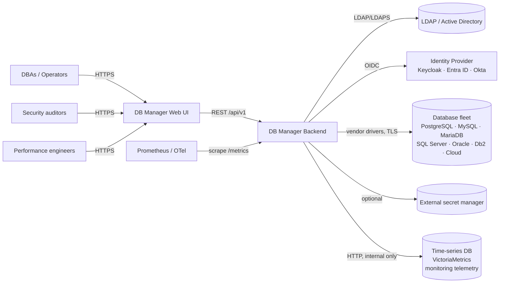
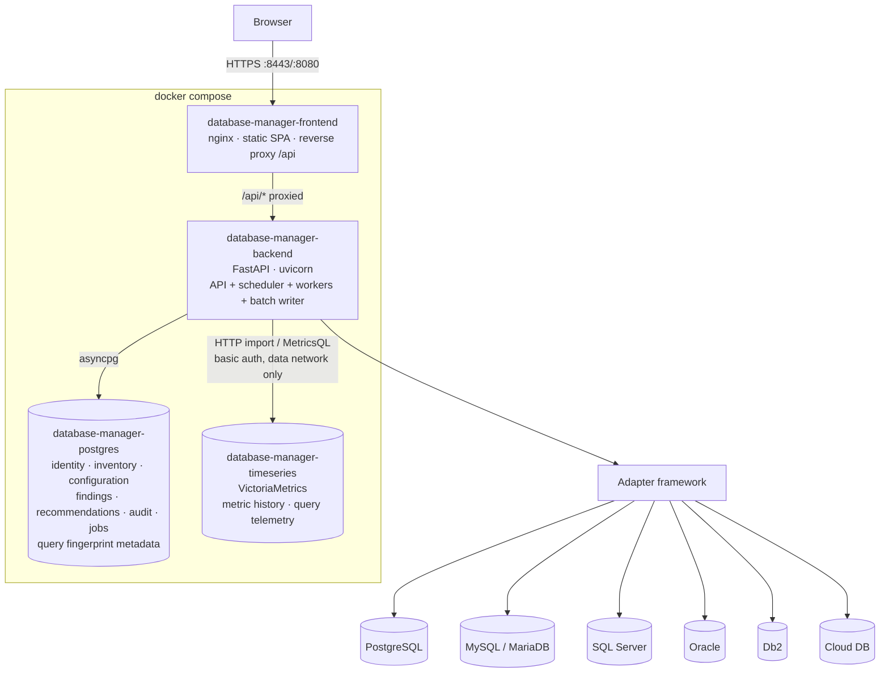
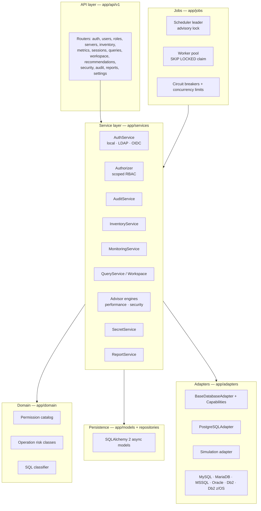
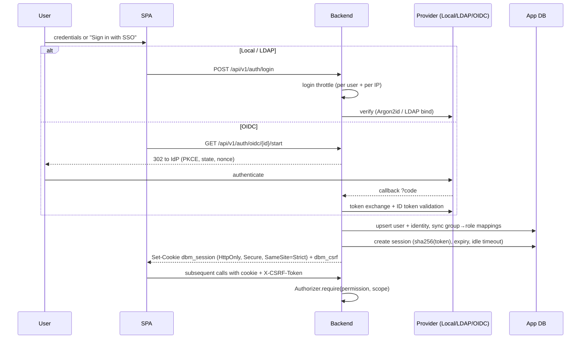
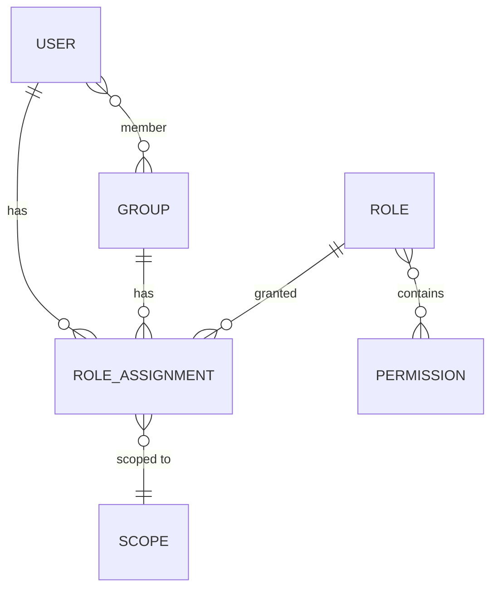
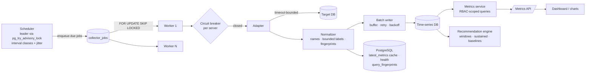
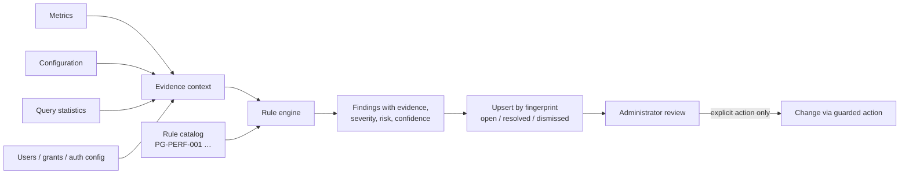
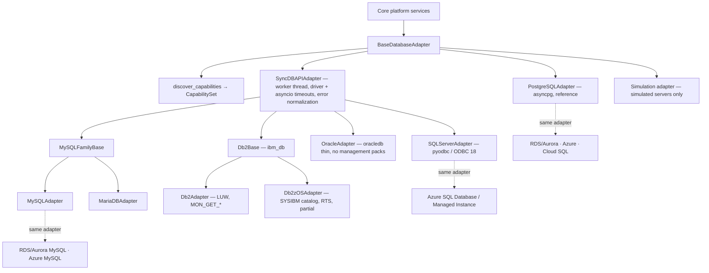
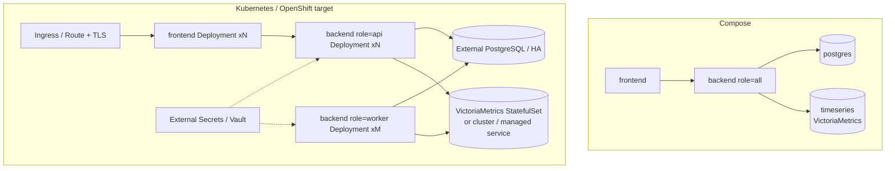

# DB Manager — Product Requirements & Architecture

This document covers Steps 1–8 of the delivery workflow: normalized requirements,
architecture, technology decisions, data model, API surface, UX architecture,
repository layout and the phased implementation plan. Companion documents:

| Topic | Document |
|---|---|
| Writing new engine adapters | [database-adapter-development.md](../development/adding-a-database-engine.md) |
| Security model | [security.md](../security/index.md) |
| Permissions & scoping | [rbac.md](../administration/rbac.md) |
| Deployment | [deployment.md](../deployment/index.md) |
| LDAP / OIDC | [ldap-oidc.md](../administration/identity-providers.md) |
| REST API | [api.md](../api/index.md) |
| Operations / runbook | [operations.md](../operations/index.md) |
| Engine capability matrix | [database-support-matrix.md](../database-engines/index.md) |

---

## 1. Requirements analysis

### 1.1 Normalized requirements

| ID | Area | Requirement |
|---|---|---|
| R1 | Fleet | Register an unbounded number of servers / instances / clusters / databases / cloud services, organized by organization, environment, site, cluster, group, tags, application, business service. |
| R2 | Fleet | Track metadata (engine, version, host, port, TLS, monitoring config, owner, health, last connection / collection). |
| R3 | Secrets | Target credentials are never stored or returned in plaintext; pluggable secret providers. |
| R4 | Admin | Browse databases, schemas, tables, views, indexes, sequences, routines, triggers, constraints; DDL actions gated by risk class. |
| R5 | Access | Central view of DB users, roles, grants; answer "who has access", "who is admin", "dormant", "direct grants", "excessive". Never auto-revoke. |
| R6 | Monitoring | Background collection of normalized + vendor metrics, stored historically, queryable over 15m…30d/custom. |
| R7 | Queries | Top-N query statistics from vendor facilities, never assuming optional/licensed features are present. |
| R8 | Plans | EXPLAIN (estimate) vs EXPLAIN ANALYZE (executes) clearly separated; ANALYZE requires extra permission + confirmation; plan tree + issue detection. |
| R9 | Advisor | Deterministic, evidence-based tuning rules (id, engine, category, severity, evidence, recommendation, impact, risk, confidence, guidance). Never auto-apply. |
| R10 | Security | Security advisor with Critical→Informational findings and remediation. |
| R11 | AuthN | Local accounts (Argon2id), LDAP/AD with group→role mapping, OIDC (Keycloak, Entra ID, Okta, Auth0, generic); SAML architected. |
| R12 | AuthZ | Capability-based RBAC scoped to platform / environment / site / cluster / server / database / schema. Enforced in the backend for every call. |
| R13 | Audit | Every administrative action audited with who/what/where/result/correlation id; no secrets in audit; UI with filters + CSV export. |
| R14 | Workspace | SQL editor with tabs, history, EXPLAIN, grid, limits, timeouts, dangerous-statement detection and confirmation. |
| R15 | UX | Production-grade, desktop-first responsive console with themes, command palette, skeletons, empty/error states. |
| R16 | Platform | Python/FastAPI backend, React/TS frontend, PostgreSQL internal store plus a dedicated time-series database for telemetry; 4-container compose; K8s/OpenShift-ready. |
| R17 | Ops | JSON logs, health/readiness/metrics endpoints, correlation ids, collector status. |
| R18 | Demo | On-request simulated multi-engine fleet (Super Administrator only), clearly labelled, removable without touching real data ([simulation.md](../administration/simulation.md)). |

### 1.2 Assumptions & default decisions

1. **Single-tenant install, multi-organization data model.** An `organization` entity exists so a later SaaS/multi-tenant mode is possible; the MVP ships with one default organization.
2. **No Redis in the base deployment.** PostgreSQL is used as the job queue (`SELECT … FOR UPDATE SKIP LOCKED`) and for leader election (advisory locks). This keeps the container topology small (frontend, backend, PostgreSQL, time-series DB) while allowing workers to scale independently (see §2.6).
3. **Server-side sessions** (opaque, hashed tokens in PostgreSQL) rather than long-lived JWTs, so sessions can be revoked instantly and work across replicas.
4. **Demo data is simulated, on request and labelled.** Nothing is generated at startup. Simulated rows carry `data_source = 'simulated'` (servers, sites, clusters, applications) and the UI marks them "Simulated". No metrics are ever fabricated for real servers — if a facility is unavailable, the API says so.
5. **Least-privileged monitoring credential by default.** Each server has a *monitoring* credential and an optional *administration* credential. Read-only features use only the monitoring credential.
6. **One SQL statement per workspace execution.** Batches are rejected; this makes statement classification reliable.
7. **Oracle diagnostics** (ASH/AWR = Diagnostics Pack) are disabled per server until an administrator declares the license (`licensed_features`). Same for SQL Server Query Store (version dependent) and pg_stat_statements (extension).
8. **Time-series storage** uses a plain, indexed PostgreSQL table with retention pruning. TimescaleDB / native partitioning is a documented upgrade path, not a requirement.

### 1.3 Explicit non-goals for the first release

* Automatic remediation of any kind (by design, permanently).
* Approval workflows are modelled (`change_requests` architecture) but not enforced in v1.
* PDF/XLSX reports (CSV now; the report service has a renderer interface).
* SAML (designed; OIDC is the preferred federation path and is implemented).

---

## 2. Architecture

### 2.1 System context



### 2.2 Container architecture



The frontend container serves the compiled SPA and reverse-proxies `/api` to the
backend, so the browser sees a single origin (simplifies cookies, CSRF and CORS).
PostgreSQL and the time-series database sit on the internal `data` network: neither
publishes a port, and the browser never talks to the time-series database — every metric
read goes through the backend, which authorizes the caller first. Details:
[metrics-architecture.md](../monitoring/architecture.md), [timeseries-storage.md](../monitoring/timeseries-storage.md).

### 2.3 Backend component architecture



Route handlers only parse input, call `Authorizer.require(...)`, call a service, and
map the result to a schema. All vendor SQL lives inside adapter packages.

### 2.4 Authentication architecture



### 2.5 RBAC model

* **Permission** — a capability string (`server.register`, `query.explain`, …). Catalog in `app/domain/permissions.py`.
* **Role** — a named set of permissions (system roles are seeded and immutable; custom roles are editable).
* **Group** — a set of users; LDAP/OIDC group claims map to groups.
* **Role assignment** — `(principal: user|group, role, scope_type, scope_id)`.
* **Scope hierarchy** — `platform ⊃ environment ⊃ site ⊃ cluster ⊃ server ⊃ database ⊃ schema`.

An assignment grants its permissions for the target resource when its scope
*contains* the resource (e.g. an `environment=Production` assignment covers every
server whose environment is Production, and their databases and schemas).
Details and anti-escalation rules: [rbac.md](../administration/rbac.md).



### 2.6 Monitoring architecture & background work



The full write and read paths are described in [monitoring-pipeline.md](../monitoring/pipeline.md).

* **Job types**: `collect_metrics` (NORMAL class, follows the server's interval), `collect_query_stats` (SLOW, 5 min), `discover_inventory` (VERY_SLOW, 1 h), `generate_recommendations`, `security_scan`, and the global `retention` and `timeseries_deletes` jobs. Each (server, job) gets a stable phase offset (`DBM_COLLECTION_JITTER_RATIO`) so a large fleet never collects in lock-step.
* **No persistent connections to every target.** Adapters open a short-lived connection (or a tiny bounded pool) per job; a global semaphore (`DBM_COLLECTOR_CONCURRENCY`) caps concurrent target connections; each call has connect and statement timeouts.
* **Circuit breaker** per server: after N consecutive failures the server is skipped with exponential back-off, and marked `unavailable`.
* **Process roles** (`DBM_PROCESS_ROLE`): `api`, `worker`, or `all` (default in compose). In Kubernetes you run `api` replicas behind a Service and a separately scaled `worker` Deployment — no code changes.

### 2.7 Recommendation architecture



Rules are deterministic Python objects with `rule_id, engines, category, severity,
evaluate(ctx) -> list[Finding]`. Each finding stores the measured evidence values,
so every recommendation is explainable and auditable. Findings are fingerprinted
(`rule_id + server + object`) so re-evaluation updates rather than duplicates, and
auto-resolves when evidence disappears.

**Optional AI insights layer (future):** a separate `insights` service that may
summarize findings. It is off by default, and when enabled only receives finding
metadata the administrator has approved — never SQL text, credentials or row data.

### 2.8 Database adapter architecture



Each adapter declares a **static capability profile** (what this adapter implements, with notes)
and performs **runtime discovery** (version, edition, configuration, privileges of the monitoring
account, licensing flags). The merged capability set is stored on the server; the API, the server
tabs, the registration wizard (engine-specific `connection_options`, `licensable_features`) and
**Platform → Engine support** are generated from it. Errors are normalized
(`AdapterErrorCode`). Vendor SQL lives in each package's `sql.py`; inventory, monitoring and evidence
are separate mixins. See [database-adapter-development.md](../development/adding-a-database-engine.md) and
[database-support-matrix.md](../database-engines/index.md).

Servers are registered as **Monitoring only** or **Administration enabled**; credentials are kept
per purpose (monitoring, administration, optional read-only).

### 2.9 Safe management actions

Every mutating adapter operation is declared with a risk class:

| Class | Examples | Requirements |
|---|---|---|
| `READ` | list, describe, metrics | view permission |
| `LOW_RISK_CHANGE` | `ANALYZE` a table, cancel own query | modify permission + audit |
| `PRIVILEGED_CHANGE` | create database/role, grant, terminate session | manage permission + reason + audit |
| `DESTRUCTIVE` | DROP, TRUNCATE, REVOKE, critical config | manage permission + typed confirmation of target name + reason + audit (approval-workflow hook) |

The SQL workspace uses the same classes via a parser-based classifier (sqlglot). Guarded
administration actions (create database/schema/user/role, grant, revoke, create index) are built by
each adapter (`build_admin`) — never one generic statement — previewed with secrets masked,
confirmed, executed with the administration credential and audited. They are refused on
Monitoring-only servers.

### 2.10 Deployment architecture



All containers run as non-root, read config only from environment variables,
write nothing to local disk except temp, and expose health/readiness probes.
OpenShift arbitrary-UID compatibility is preserved (group 0 writable dirs only).

---

## 3. Technology decisions

| Component | Selected technology | Reason | Alternatives considered |
|---|---|---|---|
| Backend language | Python 3.12 | Required; mature DB driver ecosystem | — |
| Web framework | FastAPI | Async, Pydantic validation, automatic OpenAPI | Litestar, Django REST |
| Validation | Pydantic v2 + pydantic-settings | Fast, typed schemas and 12-factor config | marshmallow |
| ORM | SQLAlchemy 2.0 (async) | Typed mapped classes, mature, Alembic | Tortoise, SQLModel |
| Migrations | Alembic | Standard for SQLAlchemy | yoyo |
| App DB driver | asyncpg | Fastest async PG driver | psycopg 3 |
| PG target driver | asyncpg | Same driver, server-side timeouts | psycopg 3 |
| Other target drivers | aiomysql, pyodbc/aioodbc, python-oracledb (thin), ibm_db | Vendor-supported; loaded lazily as optional extras | JDBC bridge |
| Password hashing | argon2-cffi (Argon2id) | OWASP recommended | bcrypt, scrypt |
| Secret encryption | AES-256-GCM envelope (cryptography) | AEAD, key-id for rotation, provider interface | Fernet, Vault Transit (later provider) |
| Sessions | Opaque server-side sessions in PG | Revocable, replica-safe, no token leakage | JWT access/refresh |
| LDAP | ldap3 | Pure Python, AD-compatible, LDAPS/StartTLS | python-ldap |
| OIDC | httpx + joserfc (JWT/JWKS validation) | Small, audited JOSE library; explicit PKCE flow | Authlib (its JOSE module is deprecated in favour of joserfc), python-jose |
| SQL classification | sqlglot | Multi-dialect parser, no DB round trip | sqlparse (tokenizer only) |
| Background jobs | In-process asyncio scheduler + PG `SKIP LOCKED` queue | No extra broker; horizontally scalable | Celery/RQ/Arq + Redis (optional later) |
| Monitoring telemetry storage | VictoriaMetrics single node (Apache-2.0) | ~1 byte/sample on disk, PromQL/MetricsQL, native retention, dedup, label deletes, one small container | TimescaleDB (PG extension; compression and continuous aggregates, but row-based ingest and much larger footprint), InfluxDB 3 Core (72-hour query window / license changes across versions) — see [metrics-architecture.md](../monitoring/architecture.md) |
| Cache | None (no Redis) | Measured: fleet dashboard 52 ms and current values for 1,000 servers in 125 ms without a cache | Redis (re-evaluate above ~5,000 servers or for multi-replica dashboards) |
| Logging | stdlib logging + JSON formatter | Structured, zero extra deps | structlog |
| Metrics | prometheus-client | Prometheus/OpenMetrics; OTel collector can scrape | OTel SDK direct |
| Frontend | React 18 + TypeScript + Vite | Fast build, wide ecosystem | Next.js (SSR not needed) |
| Styling | Tailwind CSS + shadcn-style components on Radix primitives | Accessible primitives, owned components | MUI, Mantine |
| Data fetching | TanStack Query | Caching, polling, invalidation | SWR |
| Tables | TanStack Table | Headless, sort/filter/paginate large grids | AG Grid |
| Charts | Recharts | Declarative, theme-able | ECharts, visx |
| Routing | React Router 6 | Standard | TanStack Router |
| SQL editor | CodeMirror 6 (@uiw/react-codemirror + lang-sql) | Light, accessible, dialect modes | Monaco (heavier) |
| Command palette | cmdk | Accessible, fast | kbar |
| Toasts | sonner | Accessible, minimal | react-hot-toast |
| Frontend tests | Vitest + Testing Library | Vite-native | Jest |
| Backend tests | pytest + httpx ASGI client | De facto standard | unittest |
| Web server | nginx (unprivileged) | Static + reverse proxy, OpenShift friendly | Caddy |

---

## 4. Data model

```mermaid
erDiagram
    ORGANIZATION ||--o{ ENVIRONMENT : has
    ORGANIZATION ||--o{ SITE : has
    ORGANIZATION ||--o{ APPLICATION : has
    ENVIRONMENT ||--o{ SERVER : contains
    SITE ||--o{ SERVER : hosts
    CLUSTER ||--o{ SERVER : groups
    APPLICATION ||--o{ SERVER : uses
    SERVER }o--o{ TAG : tagged
    SERVER ||--o{ DATABASE_ENTRY : has
    SERVER ||--o{ CREDENTIAL : "monitoring / admin"
    SERVER ||--o{ METRIC_SAMPLE : emits
    SERVER ||--o{ QUERY_STAT_SNAPSHOT : emits
    SERVER ||--o{ RECOMMENDATION : has
    SERVER ||--o{ SECURITY_FINDING : has
    SERVER ||--o{ COLLECTOR_JOB : scheduled
    USER ||--o{ IDENTITY : "local/ldap/oidc"
    USER ||--o{ USER_SESSION : has
    USER }o--o{ GROUP : member
    ROLE }o--o{ PERMISSION : grants
    USER ||--o{ ROLE_ASSIGNMENT : principal
    GROUP ||--o{ ROLE_ASSIGNMENT : principal
    ROLE ||--o{ ROLE_ASSIGNMENT : of
    USER ||--o{ AUDIT_EVENT : performs
    IDENTITY_PROVIDER ||--o{ GROUP_MAPPING : maps
    GROUP_MAPPING }o--|| GROUP : to
```

| Entity | Key columns | Notes |
|---|---|---|
| `organizations` | id, name, slug | Default org seeded |
| `environments` | id, org_id, name, tier(production/dr/uat/development/test), color, data_source | Seeded: Production, DR, UAT, Development, Test (`system`) |
| `sites` | id, org_id, name, region, data_source | Data centers / cloud regions |
| `clusters` | id, name, kind(primary-replica, rac, ag, galera, hadr), description, data_source | |
| `applications` | id, org_id, name, business_service, owner, data_source | |
| `tags` / `server_tags` | key, value | Free-form key/value tags |
| `servers` | id, name, engine, version, host, port, environment_id, site_id, cluster_id, application_id, owner, tls_mode, monitoring_enabled, collection_interval_s, health_status, connection_status, last_connected_at, last_collected_at, capabilities jsonb, licensed_features jsonb, data_source(real/simulated), options jsonb | Central inventory record |
| `simulation_runs` | operation(generate/regenerate/remove/legacy), profile, seed, status, progress, phase, requested_by, request_id, stats jsonb, error | Simulation lifecycle and progress |
| `database_entries` | server_id, name, size_bytes, owner, properties jsonb, discovered_at | Discovered inventory cache |
| `credentials` | id, server_id, purpose(monitoring/admin), username, provider, secret_ref, ciphertext, nonce, wrapped_dek, key_id, rotated_at | Secret never leaves service layer |
| `query_fingerprints` | server_id, fingerprint, database, engine, normalized_query (literal-free), engine_query_id, data_source, first_seen, last_seen | Metadata of query telemetry; the series live in the time-series DB |
| `metric_samples` | server_id, metric, ts, value, labels jsonb | **Legacy** (read by the migration utility, dual-write optional); dropped in phase F |
| `query_stat_snapshots` | server_id, ts, query_id, query text, calls, total_ms, … | **Legacy**, as above |
| `recommendations` | fingerprint, rule_id, server_id, category, severity, title, finding, evidence jsonb, recommendation, expected_impact, risk, confidence, guidance, status, first_seen, last_seen | |
| `security_findings` | same shape, severity critical…info, affected_object | |
| `users` | id, username, email, display_name, auth_source, password_hash, is_active, is_platform_admin? (no — via RBAC), failed_logins, locked_until, last_login_at | |
| `identities` | user_id, provider_id, subject | LDAP DN / OIDC sub |
| `user_sessions` | token_hash, user_id, csrf_hash, created_at, expires_at, last_seen_at, ip, user_agent | |
| `groups` / `group_members` | | |
| `roles` / `role_permissions` | name, description, is_system | |
| `role_assignments` | principal_type, principal_id, role_id, scope_type, scope_id | |
| `identity_providers` | kind(ldap/oidc/saml), name, enabled, config jsonb (secrets encrypted) | |
| `group_mappings` | provider_id, external_group, group_id | |
| `audit_events` | ts, user_id, username, auth_source, source_ip, action, target_type, target_id, server_id, database, object, result, failure_reason, request_id, details jsonb | Append-only |
| `collector_jobs` | id, server_id, kind, status, run_after, attempts, locked_by, locked_at, last_error, duration_ms | Queue + history |
| `query_history` | user_id, server_id, database, statement_hash, statement (masked), risk_class, duration_ms, row_count, status | |
| `app_settings` | key, value jsonb | |

---

## 5. API specification (summary)

All endpoints are under `/api/v1`, JSON, cookie session + CSRF header for unsafe
methods. Lists accept `page`, `page_size` (≤ 500), `sort` (`field` / `-field`),
`q` and resource filters, and return `{items, total, page, page_size}`. Errors use
`{"error": {"code", "message", "details", "request_id"}}`. Full detail in
[api.md](../api/index.md); live schema at `/api/docs`.

| Area | Endpoints |
|---|---|
| Auth | `POST /auth/login`, `POST /auth/logout`, `GET /auth/me`, `GET /auth/providers`, `GET /auth/oidc/{id}/start`, `GET /auth/oidc/{id}/callback`, `POST /auth/change-password` |
| Users | `GET/POST /users`, `GET/PATCH/DELETE /users/{id}`, `POST /users/{id}/reset-password` |
| Groups | `GET/POST /groups`, `PATCH/DELETE /groups/{id}`, `PUT /groups/{id}/members` |
| Roles | `GET/POST /roles`, `PATCH/DELETE /roles/{id}`, `GET /permissions` |
| Assignments | `GET/POST /role-assignments`, `DELETE /role-assignments/{id}`, `GET /users/{id}/effective-permissions` |
| Inventory | `GET/POST /environments`, `/sites`, `/clusters`, `/applications`, `/tags` |
| Servers | `GET/POST /servers`, `GET/PATCH/DELETE /servers/{id}`, `POST /servers/test-connection`, `POST /servers/{id}/test-connection`, `POST /servers/{id}/collect`, `PUT /servers/{id}/credentials/{purpose}`, `GET /servers/{id}/capabilities` |
| Objects | `GET /servers/{id}/databases`, `GET /servers/{id}/databases/{db}/schemas`, `GET …/schemas/{schema}/objects?type=`, `GET …/objects/{name}` |
| Access | `GET /servers/{id}/database-users`, `GET /servers/{id}/roles`, `GET /servers/{id}/privileges?grantee=` , `GET /access/privileged-accounts` |
| Monitoring | `GET /servers/{id}/metrics?metric=&range=1h`, `GET /servers/{id}/metrics/latest`, `GET /servers/{id}/sessions`, `GET /servers/{id}/locks`, `GET /servers/{id}/replication`, `GET /servers/{id}/storage`, `GET /servers/{id}/configuration`, `POST /servers/{id}/sessions/{pid}/cancel` |
| Queries | `GET /servers/{id}/query-stats`, `GET /queries/top`, `POST /servers/{id}/explain` |
| Workspace | `POST /workspace/classify`, `POST /workspace/execute`, `GET /workspace/history` |
| Advisor | `GET /recommendations`, `PATCH /recommendations/{id}` (status), `GET /security/findings`, `PATCH /security/findings/{id}`, `GET /security/posture` |
| Dashboard | `GET /dashboard/summary` |
| Audit | `GET /audit`, `GET /audit/export.csv` |
| Reports | `GET /reports`, `GET /reports/{kind}.csv` |
| Platform | `GET /collectors/status`, `GET/PUT /settings`, `GET/POST/PATCH/DELETE /identity-providers` |
| Ops (unversioned) | `GET /healthz`, `GET /readyz`, `GET /metrics` |

---

## 6. UX architecture

### 6.1 Design direction

A calm, dense control-room console: cool porcelain surfaces in light mode and a
deep navy instrument panel in dark mode, a single cobalt action color, and status
colors (green / amber / red / slate) reserved strictly for health and severity so
they always mean something. Typography is IBM Plex Sans for UI with tabular
numerals for metrics, IBM Plex Mono only where text *is* code (SQL, plans).

The one memorable element is the **fleet health strip** on the dashboard: every
registered server rendered as a small tile coloured by health, grouped by
environment, readable at a glance even with thousands of servers. Everything else
stays quiet.

### 6.2 Information architecture

```
Dashboard
Fleet ─ All servers · Clusters · Databases · Environments
Monitoring ─ Overview · Performance · Sessions · Locks · Replication
Queries ─ Query performance · Slow queries · Execution plans · SQL workspace
Administration ─ Databases · Schemas · Objects · Database users · Roles & privileges
Optimization ─ Performance · Query · Configuration recommendations
Security ─ Posture · Findings · Privileged accounts · Compliance
Reports
Audit logs
Platform ─ Users · Roles · Identity providers · LDAP · Credentials · Collectors · Settings
```

Navigation entries are hidden when the user holds no permission for them anywhere;
server tabs are disabled (with an explanation tooltip) when the engine/adapter
does not support the capability.

### 6.3 Key screens

* **Dashboard** — KPI row (servers, healthy, warning, critical, unavailable, databases, active connections, critical findings, open recommendations), fleet health strip, engine / environment distribution, connections & latency trends, servers requiring attention, top recommendations.
* **Server detail** — header (name, engine, version, environment, status, last collection, simulated badge) and tabs: Overview · Performance · Databases · Schemas · Sessions · Queries · Locks · Replication · Storage · Users · Privileges · Recommendations · Security · Configuration · Logs · Audit.
* **Object browser** — database → schema → object tree with a detail pane (columns, indexes, constraints, DDL).
* **Query analyzer** — top queries table with sort by total/mean/calls/IO, query detail drawer with history trend and "Explain" (estimate) / "Explain analyze" (warning-gated).
* **SQL workspace** — tabs, server/database picker, CodeMirror editor, risk badge that updates as you type, result grid, history, CSV export.
* **Security** — posture score by server, findings table with severity filters, privileged accounts across fleet.
* **Recommendations** — evidence-first cards: finding, measured evidence, recommendation, impact/risk/confidence, guidance; acknowledge / dismiss / resolve.
* **Audit** — filterable event log with CSV export.
* **Platform** — users, roles (permission matrix editor), assignments with scope picker, identity providers, collectors status, settings.

---

## 7. Repository structure

```
database-manager/
├── README.md
├── docker-compose.yml
├── .env.example
├── backend/
│   ├── Dockerfile
│   ├── pyproject.toml
│   ├── alembic.ini
│   ├── alembic/
│   │   ├── env.py
│   │   └── versions/0001_initial.py
│   ├── app/
│   │   ├── main.py                 # app factory, middleware, routers, lifespan
│   │   ├── worker.py               # `python -m app.worker` stand-alone worker
│   │   ├── cli.py                  # migrate / bootstrap / simulation / key commands
│   │   ├── core/                   # config, logging, security, crypto, errors, middleware, rate limit
│   │   ├── db/                     # engine, session, base
│   │   ├── models/                 # SQLAlchemy models by aggregate
│   │   ├── schemas/                # Pydantic API schemas
│   │   ├── domain/                 # permissions catalog, risk classes, SQL classifier, plan analysis
│   │   ├── repositories/           # query helpers (pagination, filters)
│   │   ├── services/               # auth, authz, audit, inventory, monitoring, queries, workspace, reports, secrets
│   │   ├── adapters/
│   │   │   ├── base.py             # BaseDatabaseAdapter, CapabilitySet, DTOs
│   │   │   ├── registry.py
│   │   │   ├── postgres/           # reference adapter (adapter.py, queries.py, explain.py)
│   │   │   ├── demo/               # simulated multi-engine adapter
│   │   │   ├── mysql/ mssql/ oracle/ db2/ db2zos/   # MySQL+MariaDB family, SQL Server, Oracle, Db2 LUW, Db2 z/OS
│   │   ├── advisors/
│   │   │   ├── engine.py           # rule engine
│   │   │   ├── performance/        # common.py + one module per engine (scoped with engines=...)
│   │   │   └── security/           # common.py + one module per engine
│   │   ├── jobs/                   # scheduler, worker, circuit breaker, job handlers
│   │   ├── api/
│   │   │   ├── deps.py
│   │   │   └── v1/                 # routers
│   │   ├── simulation/             # on-request demo fleet: profiles, generators, service
│   │   └── seed/                   # bootstrap admin, system roles, environments
│   ├── app/data/                   # real_engine_validation.json (written by scripts/integration-test)
│   └── tests/                      # unit, api, integration (real engines, validation matrix)
├── frontend/
│   ├── Dockerfile
│   ├── nginx/default.conf
│   ├── package.json, vite.config.ts, tailwind.config.ts, tsconfig.json
│   └── src/
│       ├── main.tsx, App.tsx, routes.tsx
│       ├── api/                    # typed client + query hooks
│       ├── components/ui/          # design system (button, card, dialog, table, tabs, badge…)
│       ├── components/             # app shell, sidebar, command palette, charts, data table
│       ├── features/               # dashboard, fleet, server, monitoring, queries, workspace, admin, security, optimization, audit, platform, reports
│       ├── lib/                    # auth context, permissions, formatting, theme
│       └── test/                   # vitest setup + tests
├── deployment/
│   ├── kubernetes/                 # reference manifests (api, worker, frontend, ingress)
│   └── openshift/                  # route + notes
├── docs/                           # this document set
├── scripts/                        # dev helpers (dev-up, test-all, gen-master-key)
└── docker-compose.test.yml          # optional profiles with real PostgreSQL / MySQL / MariaDB / SQL Server / Db2
```

---

## 8. Implementation plan

| Phase | Scope | Depends on | Status in this release |
|---|---|---|---|
| 1 Foundation | Repo, compose, app DB, FastAPI, React, auth (local+LDAP+OIDC), RBAC, audit, inventory, adapter interface, on-request simulation | — | **Implemented** |
| 2 PostgreSQL | Full reference adapter: discovery, objects, users/roles/privileges, sessions, locks, metrics, pg_stat_statements, EXPLAIN, security & performance rules | 1 | **Implemented** |
| 3 MySQL/MariaDB | PyMySQL family adapter (shared base, MySQL and MariaDB variants) on information_schema + performance_schema | 1 | **Implemented**, validated on MySQL 8.0 / MariaDB 10.11 |
| 4 SQL Server | pyodbc + ODBC Driver 18 on DMVs; Query Store detected; SHOWPLAN plans | 1 | **Implemented**; real-server validation pending |
| 5 Oracle | python-oracledb thin; V$ views without management packs; CDB/PDB aware; pack flags off by default | 1 | **Implemented**; real-server validation pending |
| 6 Db2 | ibm_db LUW on MON_GET_* and SYSCAT; separate z/OS adapter on SYSIBM + real-time statistics | 1 | **Implemented** (z/OS partial); real-server validation pending |
| 7 Cloud | Provider discovery extensions (RDS/Aurora, Azure, Cloud SQL, OCI, IBM) layered on engine adapters | 2–6 | Model + engine flags |
| 8 Intelligence | Baselines, anomaly detection, forecasting, cross-fleet comparison, optional AI summaries | 2 | Designed |

The current gaps per engine are listed in [adapter-gap-analysis.md](../database-engines/adapter-gap-analysis.md).

Each later phase only adds a package under `app/adapters/<engine>/`, rules in
`app/advisors/`, and capability-matrix entries — no core changes.
