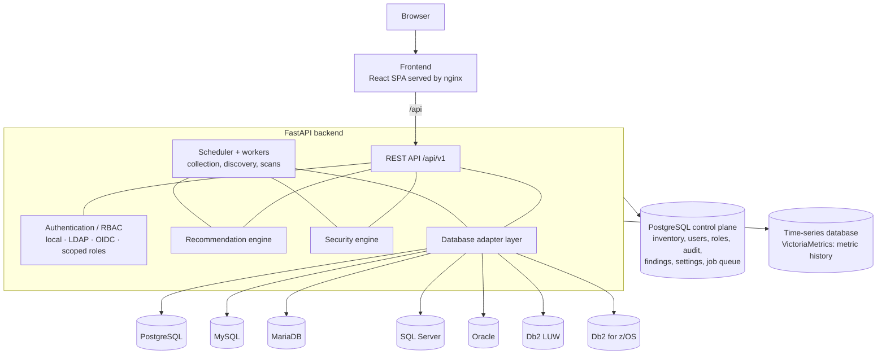

# System architecture

| Component | Responsibility | Code | More |
|---|---|---|---|
| Frontend | single-page application; nginx serves it, proxies `/api/` and sets security headers | `frontend/` | [Reverse proxy and TLS](../deployment/reverse-proxy-tls.md) |
| REST API | versioned endpoints, validation, error model, CSRF, rate limits, OpenAPI | `backend/app/api/` | [REST API](../api/index.md) |
| Authentication | local accounts (Argon2id), LDAP / Active Directory, OIDC; server-side sessions in PostgreSQL | `app/services/auth.py`, `ldap_auth.py`, `oidc.py` | [Identity providers](../administration/identity-providers.md) |
| Authorization | permission checks against role assignments at scopes (platform … schema), filtered in SQL | `app/services/authz.py` | [RBAC](../administration/rbac.md) |
| Audit | append-only `audit_events` for sign-ins, changes, executions and exports | `app/services/audit.py` | [Audit](../administration/audit.md) |
| Adapter layer | one adapter per engine behind a common contract and capability model | `app/adapters/` | [Adding a new database engine](../development/adding-a-database-engine.md) |
| Scheduler and workers | one leader schedules (advisory lock), workers claim jobs (`SKIP LOCKED`) | `app/jobs/` | [Collectors and intervals](../monitoring/collectors.md) |
| Metric pipeline | normalization, rate derivation, batch writes, health | `app/services/collection.py`, `metric_catalog.py`, `app/timeseries/` | [Pipeline](../monitoring/pipeline.md) |
| Recommendation engine | deterministic performance rules over evidence and history | `app/advisors/performance/` | [Recommendations](../performance/recommendations.md) |
| Security engine | deterministic security rules, privileged-account snapshots | `app/advisors/security/` | [Security](../user-guide/security.md) |
| Control plane | PostgreSQL: inventory, identities, roles, credentials (encrypted with the master key), findings, audit, settings, job queue | `app/models/`, `backend/alembic/` | [Design document](design-document.md#4-data-model) |
| Time-series database | VictoriaMetrics: all metric history and query-statistics counters | `app/timeseries/` | [Monitoring architecture](../monitoring/architecture.md) |
| Simulation | generates a simulated fleet that never connects anywhere | `app/simulation/` | [Simulation](../administration/simulation.md) |
| Onboarding | setup wizard, database onboarding, bulk import, IdP wizard | `app/services/onboarding.py` | [Onboarding](../user-guide/onboarding/index.md) |

## Process roles

The backend image runs as `DBM_PROCESS_ROLE=all` (API, scheduler and workers in one process; the
Docker Compose default), `api` or `worker` (`python -m app.worker`). Kubernetes deployments run
separate API and worker Deployments — see [Deployment](../deployment/index.md#kubernetes-openshift)
and [Scaling](../deployment/scaling.md).

## Further reading

* [Design document](design-document.md) — requirements, decisions and the full architecture
* [UX audit](ux-audit.md)
