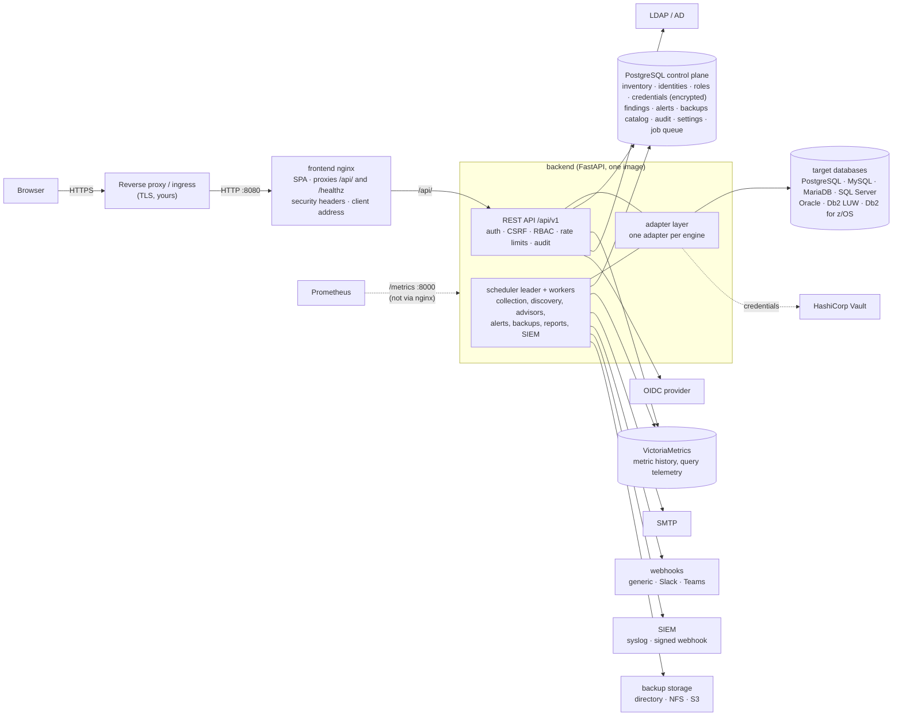
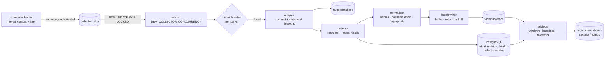
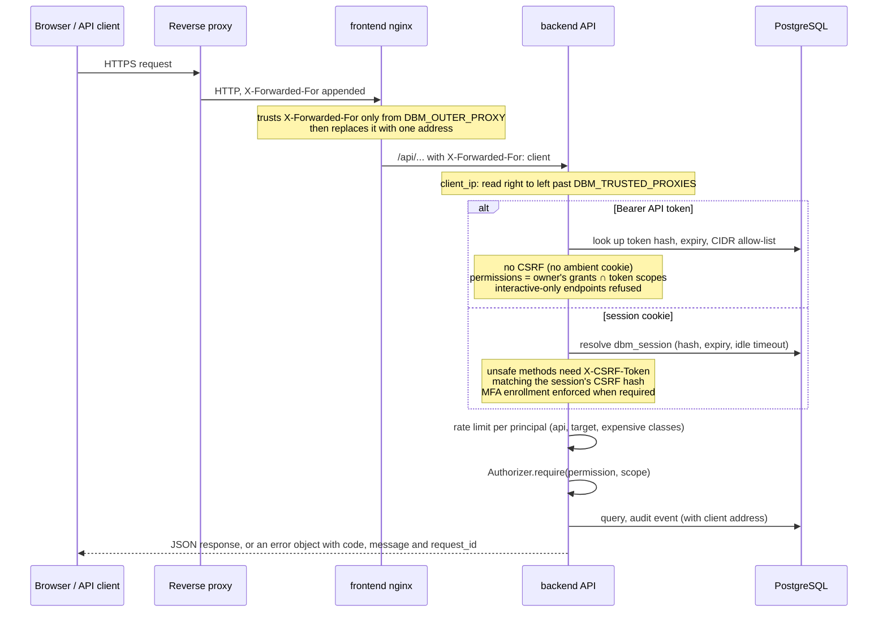
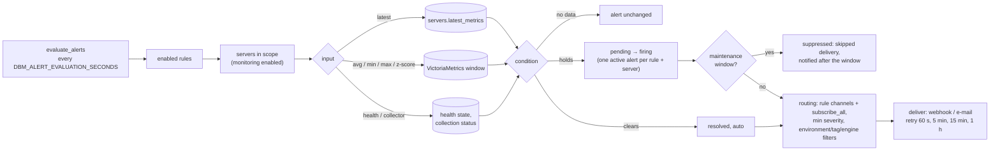
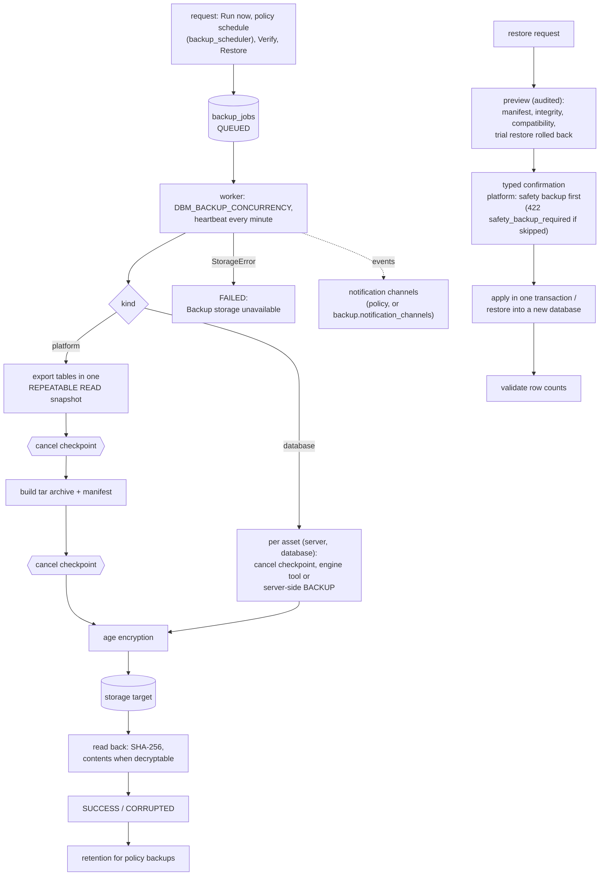

# System architecture

## Component overview

PostgreSQL and VictoriaMetrics sit on the internal `data` network; neither is reachable from the
browser. Every metric read goes through the API, which authorizes the caller first. `/metrics` is
unauthenticated and only served on the backend port ([Diagnostics](../administration/diagnostics.md)).

| Component | Responsibility | Code | More |
|---|---|---|---|
| Frontend | single-page application; nginx serves it, proxies `/api/` and `/healthz`, sets security headers and the verified client address | `frontend/` | [Reverse proxy and TLS](../deployment/reverse-proxy-tls.md) |
| REST API | versioned endpoints, validation, error model, CSRF, rate limits, OpenAPI | `backend/app/api/` | [REST API](../api/index.md) |
| Authentication | local accounts (Argon2id, TOTP MFA), LDAP / Active Directory, OIDC, API tokens; server-side sessions in PostgreSQL | `app/services/auth.py`, `ldap_auth.py`, `oidc.py`, `mfa.py`, `api_tokens.py` | [Identity providers](../administration/identity-providers.md) |
| Authorization | permission checks against role assignments at scopes (platform … schema), filtered in SQL | `app/services/authz.py` | [RBAC](../administration/rbac.md) |
| Audit | append-only `audit_events`; optional forwarding to a SIEM | `app/services/audit.py`, `siem.py` | [Audit](../administration/audit.md) |
| Adapter layer | one adapter per engine behind a common contract and capability model | `app/adapters/` | [Database engines](../database-engines/index.md) |
| Scheduler and workers | one leader schedules (advisory lock on a dedicated connection), workers claim jobs (`SKIP LOCKED`) | `app/jobs/` | [Scaling](../deployment/scaling.md#several-workers-scheduler-leadership) |
| Metric pipeline | normalization, rate derivation, batch writes, health | `app/services/collection.py`, `metric_catalog.py`, `app/timeseries/` | [Pipeline](../monitoring/pipeline.md) |
| Recommendation engine | deterministic performance rules over evidence and history (61 rules) | `app/advisors/performance/` | [Recommendations](../performance/recommendations.md) |
| Security engine | deterministic security rules (55 rules), privileged-account snapshots | `app/advisors/security/` | [Security](../user-guide/security.md) |
| Alerting | rules → alert instances → notifications, maintenance windows, retries | `app/services/alerting.py`, `notify.py` | [Alerting architecture](alerting.md) |
| Backup and restore | platform and database backups, verification, retention, restore with trial run | `app/backup/` | [Backup & Restore](../backup-restore/index.md) |
| Reports | report definitions, CSV/PDF, scheduled e-mail delivery | `app/services/reports.py`, `report_pdf.py`, `report_schedules.py` | [Reports](../user-guide/reports.md) |
| Secret providers | encrypted-at-rest credentials, `env:` / `file:` references, Vault | `app/services/secrets.py`, `vault.py` | [Secret providers](../administration/secret-providers.md) |
| Control plane | PostgreSQL: inventory, identities, roles, credentials (encrypted with the master key), findings, alerts, backup catalog, audit, settings, job queue | `app/models/`, `backend/alembic/` | [Design document](design-document.md#4-data-model) |
| Time-series database | VictoriaMetrics: all metric history and query-statistics counters | `app/timeseries/` | [Monitoring architecture](../monitoring/architecture.md) |
| Simulation | generates a simulated fleet that never connects anywhere | `app/simulation/` | [Simulation](../administration/simulation.md) |
| Onboarding | setup wizard, database onboarding, bulk import, IdP wizard | `app/services/onboarding.py` | [Onboarding](../user-guide/onboarding/index.md) |

## Collection pipeline

Job kinds per server: `collect_metrics` (the server's interval), `collect_query_stats` (slow
class), `discover_inventory` (very slow class), `generate_recommendations` (15 min) and
`security_scan` (6 h). Global jobs run on the leader: `evaluate_alerts`, `notification_retries`,
`siem_export`, `backup_scheduler`, `report_scheduler`, `validate_recommendations`, `retention` and
`timeseries_deletes` (`app/jobs/handlers.py`). A missing privilege limits one component; it never
takes the server offline. Details: [Pipeline](../monitoring/pipeline.md),
[Collectors](../monitoring/collectors.md).

## Request and authentication flow

Sign-in (`POST /api/v1/auth/login` for local and LDAP accounts, or the OIDC code flow with PKCE)
creates the server-side session and sets the `dbm_session` (HttpOnly) and `dbm_csrf` cookies; see
[design document §2.4](design-document.md#24-authentication-architecture). The client address is
used for the audit trail, per-IP sign-in limits and API-token allow-lists, which is why it is
derived only through trusted proxies ([Reverse proxy and TLS](../deployment/reverse-proxy-tls.md#how-the-client-address-is-determined)).

## Alert evaluation and notification

Alerts of servers that left a rule's scope are resolved (`resolved_by = scope`). Backup events use
the same channels and delivery code but are **not alerts**: they never appear on the Alerts page
([Backup notifications](../backup-restore/policies.md#notifications)). Details:
[Alerting architecture](alerting.md).

## Backup and restore flow

Visibility of backups, jobs, policies and targets follows the caller's `backup.view` scope.
Details: [Backup architecture](../backup-restore/architecture.md),
[Restore](../backup-restore/restore.md).

## Process roles

The backend image runs as `DBM_PROCESS_ROLE=all` (API, scheduler and workers in one process; the
Docker Compose default), `api` or `worker` (`python -m app.worker`). Kubernetes deployments run
separate API and worker Deployments — see [Deployment](../deployment/index.md#kubernetes-openshift)
and [Scaling](../deployment/scaling.md).

## Further reading

* [Design document](design-document.md) — requirements, decisions and the full architecture
* [Alerting architecture](alerting.md)
* [UX audit](ux-audit.md)
