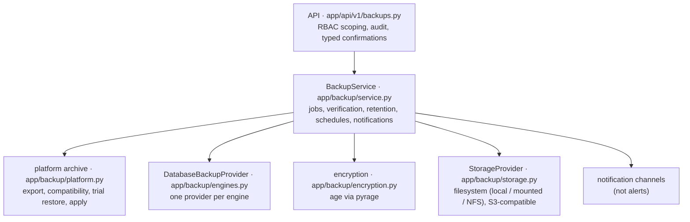

# Architecture



The end-to-end flow is drawn in [System architecture → Backup and restore flow](../architecture/index.md#backup-and-restore-flow).

## Asynchronous jobs

Every backup, verification and restore is a job in `backup_jobs`. The API returns the job at once
(`202`); the worker process (`BackgroundRunner`, `DBM_PROCESS_ROLE=worker` or `all`) claims queued
jobs with `FOR UPDATE SKIP LOCKED`, runs at most `DBM_BACKUP_CONCURRENCY` (default 1) at a time and
commits progress in small steps, so the history shows what is happening. A running job sends a
heartbeat every minute; a job without heartbeat for `DBM_BACKUP_STALE_MINUTES` (default 30) is
marked `FAILED` ("worker lost").

| Job state | Meaning |
|---|---|
| `QUEUED` | waiting for a worker (can be cancelled) |
| `RUNNING` / `VERIFYING` | in progress; a cancel request is honoured at the next checkpoint (see below) |
| `SUCCESS` | every asset succeeded |
| `PARTIAL_SUCCESS` | some assets of a bulk backup failed |
| `FAILED` / `CANCELLED` | ended without (complete) result |

**Cancellation checkpoints.** *Cancel* on a queued job ends it at once. On a running job it sets
`cancel_requested`, which the job checks at defined points, so nothing half-stored remains:

* platform backup: after the tables are exported and again after the archive is built — before
  anything is written to the storage target;
* database backup: before each asset, and while an external tool (`pg_dump`, `mysqldump`, …)
  runs;
* a running platform restore cannot be cancelled: it commits in one transaction.

A cancelled job ends `CANCELLED` and its backup `FAILED` ("cancelled: …"). Cancelling needs the
permission that starting the job needed, on every server it touches.

**Failure classification.** A job that fails because the storage target cannot be written or read
(a `StorageError` from the storage provider) is recorded with `storage_errors` in its result and
notified as *Backup storage unavailable*; in a bulk database backup each asset carries
`error_class: storage` when that was the cause. The classification uses the exception type, not
the error text. Other failures are notified as *Backup failed* (see
[Policies → Notifications](policies.md#notifications)).

**Visibility.** A `backup.view` grant at platform scope sees every backup, job, policy and target.
A grant limited to environments or servers sees only the database backups, jobs, policies and
coverage of the servers it covers — a policy or job only when every server it acts on is in scope —
and never platform backups, platform jobs or platform policies; storage targets are listed by name
and kind only (to choose one for a backup). The overview counters are filtered the same way
(`app/api/v1/backups.py`, `_visible_server_ids`).

Secrets supplied for one run (a passphrase, an age identity) are sealed with the platform key ring
in the job and removed when the job ends; they are never logged or returned by the API.

## Backup states

```text
CREATING ──► VERIFYING ──► SUCCESS
    │             └──────► CORRUPTED   (the stored copy does not match what was written)
    └──────────────────►  FAILED
SUCCESS ──(verification later fails)──► CORRUPTED
any ──(deleted)──► DELETED             (catalog entry kept for the audit trail)
```

## Storage layout

Every backup gets its own folder in the target:

```text
<target>/platform/2026/10/<backup id>/archive.tar.age   the archive (encrypted)
                                     /key.age           passphrase mode only: the wrapped per-backup key
                                     /manifest.json     catalog entry, unencrypted, no secrets
<target>/database/2026/10/<backup id>/<db>.dump.age     pg_dump / mysqldump output
```

`manifest.json` lets a fresh installation find and register backups without the original
database ([disaster recovery](disaster-recovery.md)). DBManager only deletes inside a backup's own
folder.

## Scheduler

The global job `backup_scheduler` runs every minute on the scheduler leader: it queues policies
whose next run is due (never twice while a run is active), marks lost jobs as failed, updates the
`dbm_backup_last_successful_backup_timestamp_seconds` gauge and sends "no successful backup within
policy" notifications.
