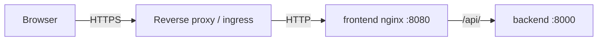

# Reverse proxy and TLS

DBManager does not terminate TLS itself. The frontend container (nginx, port 8080) serves the SPA
and proxies `/api/` and `/healthz` to the backend; put your TLS-terminating reverse proxy, load
balancer, ingress or OpenShift Route in front of it.



## Settings

| Variable | Value behind TLS |
|---|---|
| `DBM_PUBLIC_BASE_URL` | `https://dbmanager.example.com` — used for OIDC redirect URIs and links in notifications |
| `DBM_COOKIE_SECURE` | `true` (default): session and CSRF cookies are only sent over HTTPS (browsers also accept them on `http://localhost`) |
| `DBM_HTTP_BIND` | `127.0.0.1` (default) when the proxy runs on the same host; `0.0.0.0` only when the host is protected by the proxy/firewall |
| `DBM_TRUSTED_PROXIES` | networks whose `X-Forwarded-For` is trusted for the client IP in audit and rate limiting (Compose default: private ranges and `127.0.0.1`) |

The frontend's nginx forwards `X-Forwarded-For`, `X-Forwarded-Proto` (it keeps the value set by your
proxy) and `X-Request-ID`. Configure your proxy to set `X-Forwarded-Proto: https`.

## Example: nginx in front

```nginx
server {
  listen 443 ssl;
  server_name dbmanager.example.com;
  ssl_certificate     /etc/ssl/dbmanager.crt;
  ssl_certificate_key /etc/ssl/dbmanager.key;

  location / {
    proxy_pass http://127.0.0.1:8080;
    proxy_set_header Host $host;
    proxy_set_header X-Forwarded-For $proxy_add_x_forwarded_for;
    proxy_set_header X-Forwarded-Proto https;
    proxy_read_timeout 180s;   # long CSV exports and EXPLAIN ANALYZE
    proxy_buffering off;
  }
}
```

## Kubernetes / OpenShift

`deployment/kubernetes/30-frontend.yaml` contains the frontend Deployment, Service and Ingress;
`deployment/openshift/route.yaml` an edge-terminated Route. Set `DBM_PUBLIC_BASE_URL` in
`00-config.yaml` to the external HTTPS URL.

## Security headers

The frontend sends a strict Content-Security-Policy (`default-src 'self'`, `frame-ancestors 'none'`),
`X-Frame-Options: DENY`, `X-Content-Type-Options: nosniff` and `Referrer-Policy: no-referrer`.
Add `Strict-Transport-Security` at your TLS proxy.

## TLS to target databases

TLS to the monitored databases is configured per server (TLS mode, CA certificate, host name in
certificate) — see [Database onboarding](../user-guide/onboarding/database-onboarding.md) and the
[engine pages](../database-engines/index.md).
