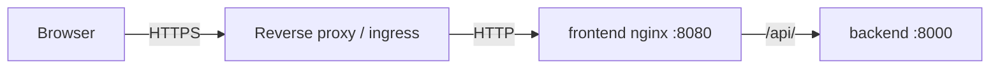

# Reverse proxy and TLS

KBM DBManager does not terminate TLS itself. The frontend container (nginx, port 8080) serves the SPA
and proxies `/api/` and `/healthz` to the backend; put your TLS-terminating reverse proxy, load
balancer, ingress or OpenShift Route in front of it.



## Settings

| Variable | Value behind TLS |
|---|---|
| `DBM_PUBLIC_BASE_URL` | `https://dbmanager.example.com` — used for OIDC redirect URIs and links in notifications |
| `DBM_COOKIE_SECURE` | `true` (default): session and CSRF cookies are only sent over HTTPS (browsers also accept them on `http://localhost`) |
| `DBM_HTTP_BIND` | `127.0.0.1` (default) when the proxy runs on the same host; `0.0.0.0` only when the host is protected by the proxy/firewall |
| `DBM_OUTER_PROXY` | address (one CIDR) of **your** reverse proxy as the frontend nginx sees it. Only this address may set `X-Forwarded-For`. When the proxy runs on the Docker host, that is the Docker network gateway (for example `172.18.0.1/32`; `docker network inspect database-manager_app`). Default `127.0.0.1/32`: no outer proxy is trusted |
| `DBM_TRUSTED_PROXIES` | addresses whose `X-Forwarded-For` the **backend** trusts — in Compose only the frontend nginx (`172.16.0.0/12` covers the Compose network) |

### How the client address is determined

The client address is used for audit, per-IP rate limits and API-token CIDR allow-lists, so a
client must not be able to choose it:

1. The frontend nginx accepts `X-Forwarded-For` only from `DBM_OUTER_PROXY` (`set_real_ip_from`,
   recursive) and otherwise uses the TCP peer address. It then **replaces** the header with that
   single address before passing the request to the backend — a value a client sends itself is
   discarded.
2. The backend reads `X-Forwarded-For` only when the request comes from `DBM_TRUSTED_PROXIES`, and
   reads it **from the right**, skipping trusted hops; the first untrusted address is the client.

Do not add client networks to `DBM_TRUSTED_PROXIES` or `DBM_OUTER_PROXY`: every trusted address can
claim to be anybody.

The backend's uvicorn runs with `--no-proxy-headers`, so the peer address KBM DBManager starts from
is always the TCP peer. Even a client that reaches port 8000 directly cannot choose its address,
because a peer outside `DBM_TRUSTED_PROXIES` makes the backend ignore the header.

If the audit log shows your proxy's address for every user, `DBM_OUTER_PROXY` does not match the
proxy as nginx sees it ([troubleshooting](../troubleshooting/platform.md)). The frontend's nginx also forwards `X-Forwarded-Proto` (it keeps the value set
by your proxy) and `X-Request-ID`. Configure your proxy to set `X-Forwarded-Proto: https`.

## Example: nginx in front

```nginx
server {
  listen 443 ssl;
  server_name dbmanager.example.com;
  ssl_certificate     /etc/ssl/dbmanager.crt;
  ssl_certificate_key /etc/ssl/dbmanager.key;

  location / {
    proxy_pass http://127.0.0.1:8080;
    proxy_set_header Host $host;
    proxy_set_header X-Forwarded-For $proxy_add_x_forwarded_for;
    proxy_set_header X-Forwarded-Proto https;
    proxy_read_timeout 180s;   # long CSV exports and EXPLAIN ANALYZE
    proxy_buffering off;
  }
}
```

## Kubernetes / OpenShift

`deployment/kubernetes/30-frontend.yaml` contains the frontend Deployment, Service and Ingress;
`deployment/openshift/route.yaml` an edge-terminated Route. Set `DBM_PUBLIC_BASE_URL` in
`00-config.yaml` to the external HTTPS URL, and `DBM_OUTER_PROXY` on the frontend container to the
ingress controller's (or router's) pod network — the manifests leave it at `127.0.0.1/32`, so
client addresses are otherwise recorded as the ingress controller's.

## Prometheus metrics

`/metrics` is served by the backend on port 8000 without authentication and is **not** proxied by
the frontend nginx (only `/api/` and `/healthz` are). Scrape it on the internal network; do not
expose it through your reverse proxy ([Diagnostics](../administration/diagnostics.md)).

## Security headers

The frontend sends a strict Content-Security-Policy (`default-src 'self'`, `frame-ancestors 'none'`),
`X-Frame-Options: DENY`, `X-Content-Type-Options: nosniff` and `Referrer-Policy: no-referrer`.
Add `Strict-Transport-Security` at your TLS proxy.

## TLS to target databases

TLS to the monitored databases is configured per server (TLS mode, CA certificate, host name in
certificate) — see [Database onboarding](../user-guide/onboarding/database-onboarding.md) and the
[engine pages](../database-engines/index.md).
