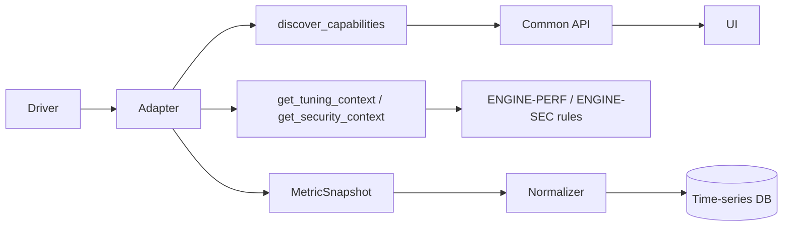

# Adding a new database engine

This tutorial walks through adding an engine end to end: adapter, driver, capabilities, metrics,
rules, tests, validation matrix and documentation. The seven shipped adapters are the reference —
PostgreSQL (`postgres/`, native asyncio) for the simplest structure, Oracle or Db2 LUW for a
blocking driver split by concern.

!!! info "Checklist"
    1. Adapter package `backend/app/adapters/<engine>/` with class metadata and capabilities
    2. Driver entry in `app/adapters/drivers.py` and the dependency in `backend/pyproject.toml`
       (plus any client library in `backend/Dockerfile`)
    3. Registration in `app/adapters/registry.py`
    4. Runtime discovery and the method contract
    5. Metrics on the common keys of `app/timeseries/catalog.py`
    6. Rules in `app/advisors/performance/<engine>.py` and `app/advisors/security/<engine>.py`
    7. Unit tests (scripted fake DB-API) and real-engine integration tests
    8. Validation matrix entry, so Engine support can show validated capabilities
    9. Optional UI hints, SQL classifier dialect, simulation profile
    10. Documentation: an engine page, the engines index and the least-privilege account

All engine-specific code lives in `backend/app/adapters/<engine>/`. The platform talks only to
`BaseDatabaseAdapter` (`app/adapters/base.py`); adding an engine requires no change to services,
API routes or the UI — the wizard fields, server tabs and the support matrix are generated from
the adapter's class metadata and capability definitions.



## Package layout

Large adapters are split by concern; the shipped engines are the reference:

```
adapters/
  base.py          capability model, DTOs, normalized errors, contract
  dbapi.py         SyncDBAPIAdapter: worker thread, timeouts, error normalization, workspace, admin
  drivers.py       driver registry and health (Platform → Database drivers)
  tls.py           shared TLS mode handling, private CA files
  admin.py         guarded action catalogue, AdminStatement, validators
  postgres/        reference adapter (asyncpg, native asyncio)
  mysql/           MySQLFamilyBase → MySQLAdapter, MariaDBAdapter
  mssql/  oracle/  db2/          base.py · sql.py · inventory.py · monitoring.py · evidence.py
  db2zos/                         plans.py · admin.py · adapter.py
```

`sql.py` holds every vendor statement as a named constant (so tests can syntax-check them all).
`base.py` holds connection, error classification and discovery; the mixins add inventory,
monitoring and evidence; `adapter.py` composes them, declares capabilities and implements
explain and admin.

## 1. Class metadata and capabilities

```python
class OracleAdapter(OracleEvidenceMixin, OracleMonitoringMixin, OracleInventoryMixin):
    engine = "oracle"; display_name = "Oracle Database"; default_port = 1521
    driver_key = "oracledb"                 # entry in adapters/drivers.py
    implemented = True
    support_level = "supported"             # supported | partial
    support_note = "..."                    # shown in the wizard and the matrix
    connection_options = [ {"key": "sid", "label": "SID", "type": "string", "help": "..."}, ... ]
    licensable_features = [ {"key": "diagnostics_pack", "label": ..., "default": False, ...} ]
    static_capabilities = { Capability.SESSIONS: cap(FULL, "V$SESSION ..."), ... }
```

* `connection_options` become engine-specific fields in the registration wizard and settings;
  values are stored in `server.options` (the API rejects keys that look like secrets).
* Every `Capability` should be declared. Levels: `FULL`, `PARTIAL`, `REQUIRES_CONFIGURATION`,
  `REQUIRES_PRIVILEGE`, `REQUIRES_LICENSE`, `REQUIRES_EXTENSION`, `REQUIRES_EXTERNAL_MONITORING`,
  `NOT_SUPPORTED`, `NOT_IMPLEMENTED`. Put the reason in the note.
* Unimplemented methods are left to the base class: they raise `AdapterNotSupported`, which the API
  returns as `capability_not_supported`. **Never return made-up data.**

## 2. Blocking drivers: `SyncDBAPIAdapter`

PyMySQL, pyodbc, python-oracledb and ibm_db are synchronous. `SyncDBAPIAdapter` runs every call
on one worker thread per adapter instance and gives each call two timeouts — the driver's own
statement/call timeout (set in `_open` / `_set_call_timeout`) and an asyncio deadline. When the
deadline fires, the worker and its connections are abandoned, so a hung Oracle, SQL Server or
Db2 socket never blocks the event loop or the scheduler. Engine hooks:

| Hook | Purpose |
|---|---|
| `_open(database)` | connect with timeouts, TLS, application name; session settings (UTC, lock timeout). Translate every TLS mode explicitly (`tls.ssl_context`, `tls.requires_tls`, `tls.CAFile`) and, when the driver can silently fall back to plain text, check after connecting that TLS was negotiated (as MySQL does with `Ssl_cipher`) |
| `_classify(exc)` | driver exception → `AdapterAuthenticationError`, `AdapterTLSError`, `AdapterDatabaseNotFound`, `AdapterConnectionError`, `AdapterPermissionError`, `AdapterTimeout`, `AdapterObjectMissing`, `DriverNotInstalled` |
| `_begin_read_only(cursor)` | start a read-only transaction where the engine has one |
| `_set_call_timeout(conn, s)` | per-statement timeout for the SQL workspace |
| `connection_per_database` | SQL Server opens one connection per database context |
| `_use_database(conn, database)` | for engines with one shared connection: make the workspace/EXPLAIN database current for one call and return a callable that restores the previous one (MySQL/MariaDB use `COM_INIT_DB`) |
| `single_database` | `True` when a connection reaches one database only (Db2 LUW): `_check_database` refuses statements for another database instead of running them in the registered one |

Helpers: `_query`, `_one`, `_try` (returns `None` for permission / missing-object / unsupported, so an
optional facility degrades instead of failing), `_memoized`. Error messages pass through
`clean_message`, which masks `PWD=`/`password=` fragments; credentials are never logged.

## 3. Runtime discovery

`discover_capabilities()` refines the static profile from the live server: version, edition,
privileges of the monitoring account, feature configuration and the licensing flags recorded on the
server. Examples: MariaDB query statistics → `REQUIRES_CONFIGURATION` when `performance_schema=OFF`;
SQL Server locks → `REQUIRES_PRIVILEGE` without `VIEW SERVER STATE`; Db2 EXPLAIN →
`REQUIRES_CONFIGURATION` without explain tables; replication → "not configured". The result is
stored on the server and drives the server tabs.

## 4. The contract

| Method | Returns | Notes |
|---|---|---|
| `get_server_info` | `ServerInfo` | version, `version_num`, edition, uptime, replica flag, engine facts in `extra` |
| `list_databases / list_schemas / list_objects / get_object_detail` | DTOs | object types: table, view, materialized_view, index, sequence, function, procedure, package, trigger, synonym |
| `list_users / list_roles / get_privileges` | `DbUser`, `Privilege` | fill `admin_reasons` with the engine's own authority names |
| `get_sessions / get_locks / cancel_session` | DTOs / bool | `blocked_by` chains; refuse what the engine cannot do (SQL Server cancel) |
| `get_performance_metrics(slow)` | `MetricSnapshot` | gauges + cumulative counters; expensive parts only when `slow=True`; `unavailable` with reasons |
| `get_query_statistics` | `QueryStat[]` | engine statement ID / digest as `query_id`; never full SQL as a label |
| `explain_query(sql, db, analyze)` | `ExplainResult` | `PlanNode` tree + `raw` vendor plan; analyze only on explicit request, rolled back |
| `get_replication_status / get_configuration / get_storage_metrics` | DTOs | `StorageInfo.top_tables`: each `{schema, name, row_estimate, table_bytes, index_bytes, total_bytes}` plus engine-specific keys; `None` for a size the engine cannot attribute |
| `get_security_context / get_tuning_context` | dict | evidence for the rule engine; `None` when not visible (rules must not fire on unknowns) |
| `execute_sql` | `ExecutionResult` | read-only enforced at the database level when possible; must run in the selected database or refuse it — never silently in another one |
| `build_admin(action, params)` / `run_admin(stmt)` | `AdminStatement` / dict | vendor statements from validated parameters; passwords bound or masked in `display` |

### Metrics

Use the keys of `app/timeseries/catalog.py` (`connections.total`, `sessions.blocked`,
`replication.lag_seconds`, `storage.database_bytes`, …). Report cumulative counters
(`transactions.commits`, `io.blocks_read`, `io.blocks_hit`, `query.calls`, `query.total_ms`,
`deadlocks`, `cpu.busy_time_cs` / `cpu.idle_time_cs`) and let the collector derive rates, hit ratio,
mean latency and CPU percent. Units: bytes, milliseconds, seconds, percent, counts — convert KB/pages
in the adapter. Engine-only metrics use a prefix (`oracle.sga_used_bytes`, `db2.log_used_percent`).
Do not force an engine concept into a common metric it does not match: `rows.returned` means rows
read by scans (PostgreSQL `tup_returned`, InnoDB `Innodb_rows_read`, Db2 `ROWS_READ`); Db2's rows
returned *to the application* are a separate engine metric.

## 5. Driver and registration

Declare the driver in `app/adapters/drivers.py` so **Platform → Database drivers** can report it
and connection tests return `DRIVER_NOT_INSTALLED` with a remediation instead of an import error:

```python
DriverSpec(
    "mydriver",            # key, referenced by the adapter's driver_key
    "mydriver",            # importable module
    "mydriver",            # distribution name (pip)
    ("myengine",),         # engines served
    "Pure-Python driver for MyEngine",
    "Apache-2.0",
    client_dependency=None # e.g. "Microsoft ODBC Driver 18" for pyodbc
),
```

and add a line to the remediation messages next to the existing ones. Import the driver lazily
with `drivers.load("<key>")` (as the shipped adapters do), never at module import time, so
the backend still starts when the driver is missing. Add the dependency to `backend/pyproject.toml`
and any native client to `backend/Dockerfile`.

```python
# app/adapters/registry.py
from app.adapters.myengine.adapter import MyEngineAdapter
for _cls in (PostgreSQLAdapter, ..., MyEngineAdapter):
    register(_cls)
```

Aliases (`ENGINE_ALIASES`) map alternative spellings to the engine key. Once registered, the
engine appears in the registration wizard, the support matrix (`python -m app.cli matrix`),
**Platform → Engine support** and the API's engine list.

## 6. Rules

Rules live in `app/advisors/performance/<engine>.py` and `app/advisors/security/<engine>.py`
(`common.py` applies to every engine) and must be scoped with `engines=(...)`. Follow the ID scheme `<PREFIX>-PERF-NNN` / `<PREFIX>-SEC-NNN`
and see [Adding metrics and rules](adding-metrics-and-rules.md) for the decorator, evidence and
sustained conditions. Mark `Capability.RECOMMENDATIONS` once engine rules exist.

## 7. Tests

* `tests/unit/test_<engine>.py` with `tests/unit/fakedb.py`: a scripted DB-API connection where any
  statement without a route fails the test — so a test also proves which SQL the adapter issues.
  Include a syntax check of every constant in `sql.py` (sqlglot dialect where one exists), an
  "empty server" test that runs every read path against empty results, error classification and
  admin statement generation.
* `tests/integration/test_<engine>.py`, skipped unless `DBM_IT_<ENGINE>_HOST` is set, with an optional
  service in `docker-compose.test.yml` when the vendor allows it. Mark tests with
  `pytest.mark.integration`, `pytest.mark.real_database`, the engine marker and
  `@pytest.mark.capability("sessions", ...)` for each capability they prove.

## 8. Validation matrix

Add the test file to `ENGINE_FILES` in `tests/integration/matrix.py`. After a real-engine run,
`scripts/integration-test.*` merges the results into `backend/app/data/real_engine_validation.json`.
**Platform → Engine support** shows a capability as plain FULL only once a test for it passed
against a real server and none failed; until then it is shown as `FULL*` (implemented, not
validated). Never edit the JSON by hand to mark something validated. See
[Integration tests](../operations/integration-tests.md).

## 9. Optional touchpoints

The UI is generated from adapter metadata; these maps only improve labels and hints and fall back
gracefully when an engine is missing:

| File | Purpose |
|---|---|
| `frontend/src/lib/engines.ts` | display label, short badge, color |
| `frontend/src/lib/capabilities.ts` (`DATABASE_FIELD`) | label and default of the "database" field |
| `frontend/src/features/fleet/register-server.tsx` (`MON_HINT`) | monitoring-account hint in the wizard |
| `backend/app/domain/sql_classifier.py` (`ENGINE_DIALECT`) | sqlglot dialect for SQL risk classification (falls back to generic parsing) |
| `backend/app/simulation/profiles.py` | include the engine in simulated fleets |

## 10. Documentation

* Add `docs/database-engines/<engine>.md` with the same sections as the existing engine pages
  (supported versions, driver, connection parameters, TLS, privileges, capabilities, limitations,
  metrics, security checks, recommendations, troubleshooting) and add it to `mkdocs.yml`.
* Add a row to the engines table in [Database engines](../database-engines/index.md) and the
  least-privilege script to the engine page.
* State limitations honestly: a capability that is not implemented is `NOT_IMPLEMENTED`, not
  omitted. Run `mkdocs build --strict` ([Documentation](documentation.md)).

## Cloud deployments

Managed services reuse the engine adapter (`deployment` = `aws-rds`, `azure-sql`, `oci-autonomous`,
`ibm-db2-cloud`, …). Discovery accounts for restricted privileges (e.g. RDS `mysql.rds_kill`,
Azure SQL Database without server DMVs).

## Db2 for z/OS

`Db2zOSAdapter` reuses only the connection and error mapping of the Db2 LUW base; catalog,
monitoring and evidence are its own (SYSIBM, real-time statistics, PLAN_TABLE). Functions that need
z/OS infrastructure are declared `REQUIRES_EXTERNAL_MONITORING`, stored-procedure paths that are
not built yet `NOT_IMPLEMENTED`.
