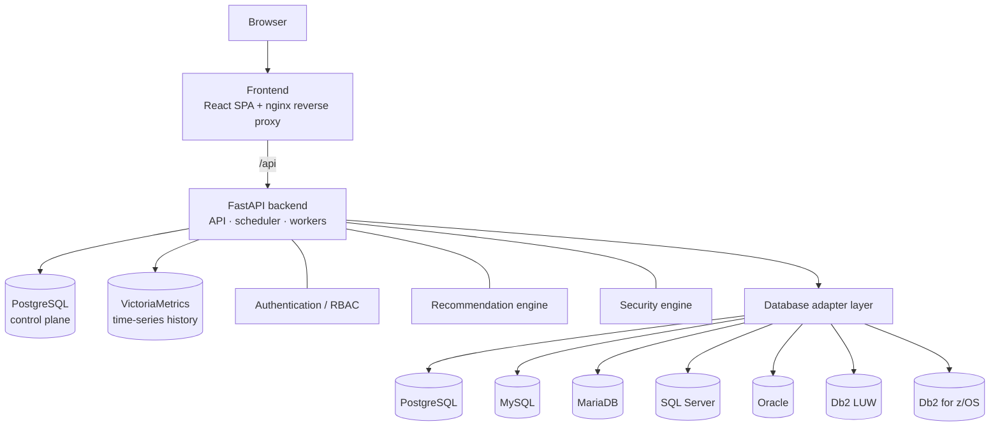

# Architecture overview

* **Frontend** — single-page application served by nginx, which also proxies `/api` to the backend.
* **Backend** — one Python process (or separate `api` and `worker` roles) providing the REST API,
  the collection scheduler and job workers.
* **Control plane** — PostgreSQL holds users, roles, servers, encrypted credentials, findings,
  audit events and job state. It never holds metric history.
* **Time-series database** — VictoriaMetrics stores every metric sample; it is internal-only.
* **Adapters** — one per engine, each declaring which capabilities it implements; the UI is driven
  by those declarations and by runtime discovery on each server.

Details: [System architecture](../architecture/index.md).
