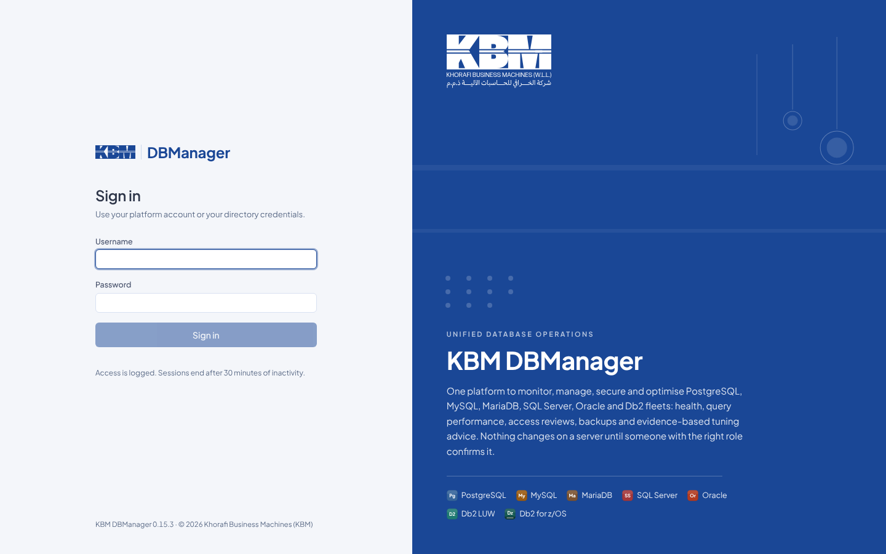

# Initial bootstrap and first login

On its first start the backend:

1. applies the Alembic migrations to the control-plane database;
2. synchronises the built-in roles;
3. creates the first administrator **only if no user exists**, using
   `DBM_BOOTSTRAP_ADMIN_USERNAME` (default `admin`) and `DBM_BOOTSTRAP_ADMIN_PASSWORD`.

## Sign in



Open <http://localhost:8080>, sign in as `admin` with the password from `.env`. If the password was
generated or reset, you are asked to change it immediately (12+ characters, three character classes).

## Run the setup wizard

Administrators (`settings.manage`) see the banner *KBM DBManager is not fully set up yet* with **Start setup** (or **Resume setup**) until
the [Platform setup wizard](../user-guide/onboarding/platform-setup.md) is completed
(**Platform → Setup → Setup wizard**). It is resumable: progress is saved after each step.


The wizard covers the administrator password, organization name and time zone, sites,
environments, sign-in method (local, LDAP, OIDC), monitoring profile, metric retention and the
first database. Afterwards the **Setup checklist** (on the dashboard and under
**Platform → Setup → Setup checklist**) shows what is still open.

If `DBM_MFA_REQUIRED_FOR` is `admins` or `all`, the administrator is sent to **Account → Security**
to set up an authenticator before anything else works; see
[Multi-factor authentication](../administration/mfa.md).

## Lost the admin password?

```bash
docker compose exec backend python -m app.cli reset-password admin
```
