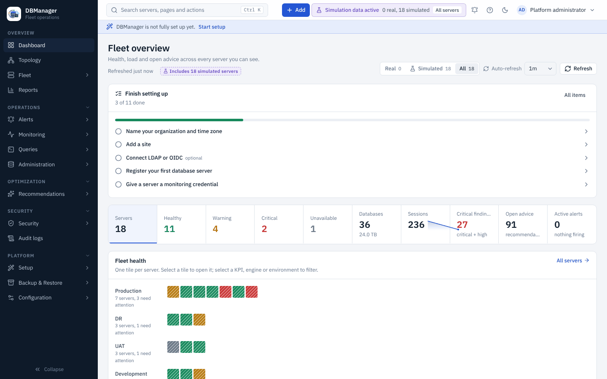

# DB Manager

**DB Manager** is a self-hosted platform for administering, monitoring and securing a fleet of
relational databases from one place: PostgreSQL, MySQL, MariaDB, Microsoft SQL Server, Oracle
Database, IBM Db2 LUW and (partially) IBM Db2 for z/OS.

It collects health, performance, query and security evidence through least-privilege monitoring
accounts, keeps metric history in a dedicated time-series database, turns evidence into
recommendations and security findings, and offers guarded administration with role-based access
control and a complete audit trail.

- **Getting started** — install with Docker Compose, sign in, add your first database.
  [Installation](getting-started/installation.md)
- **User guide** — dashboards, fleet, performance, queries, security, wizards.
  [User guide](user-guide/index.md)
- **Database engines** — supported versions, privileges, capabilities and limits per engine.
  [Engines](database-engines/index.md)
- **Administration** — users, RBAC, LDAP/OIDC, retention, drivers, backup and upgrade.
  [Administration](administration/index.md)
- **Architecture** — how the frontend, backend, adapters and storage fit together.
  [Architecture](architecture/index.md)
- **Development** — set up a dev environment and add a new database engine.
  [Development](development/index.md)

## Project status

**Version 0.13.0** — performance intelligence: baseline-relative alerts, query regression
detection, capacity forecasting, query and plan comparison, recommendation outcomes (see the
[release notes](release-notes/0.13.0.md), the
[changelog](https://github.com/hbenabdalla/dbmanager/blob/main/CHANGELOG.md) and
[versioning](product/roadmap.md#versioning)). DB Manager is pre-1.0 software. The capability status of every area is tracked honestly in the
[capability matrix](product/capability-matrix.md) and the [roadmap](product/roadmap.md):
PostgreSQL, MySQL, MariaDB, SQL Server, Oracle and Db2 LUW are validated against real engines
(see [Database engines](database-engines/index.md)); Db2 for z/OS is partial and still needs
external validation.

Source code: <https://github.com/hbenabdalla/dbmanager>
