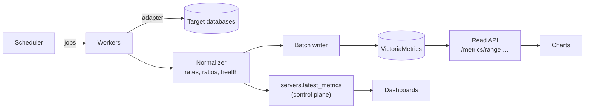

# Monitoring

| Topic | Page |
|---|---|
| Why a separate time-series database, data model, capacity | [Architecture](architecture.md) |
| Write path, read path, analysis on history, self-observability | [Pipeline](pipeline.md) |
| Jobs, intervals, jitter, circuit breaker, collector health | [Collectors and intervals](collectors.md) |
| How healthy / warning / critical / unavailable is decided | [Health calculation](health.md) |
| Every metric with key, unit, type, engines and interval | [Metric catalog](metric-catalog.md) |
| Operating VictoriaMetrics | [Time-series storage](timeseries-storage.md) |
| Retention and query-time downsampling | [Retention](../administration/retention.md) |
| Missing metrics, collector offline, storage unavailable | [Troubleshooting](../troubleshooting/monitoring.md) |

**Normalization.** Adapters report gauges and cumulative counters under common keys
(`connections.total`, `io.blocks_read`, `query.calls` …) in base units (bytes, milliseconds,
seconds, percent, counts); engine-only values use an engine prefix (`oracle.sga_used_bytes`,
`db2.log_used_percent`). The normalizer derives rates from counter deltas, cache hit ratio,
CPU percent (from busy/idle time counters) and mean latency. A metric the engine does not expose is
reported as *unavailable* with a reason and is never estimated.
