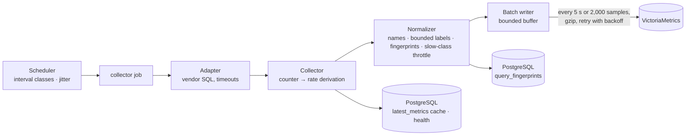
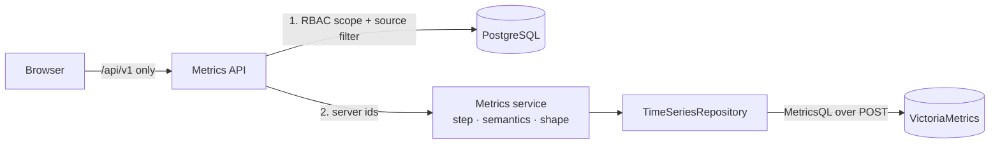

# Monitoring pipeline

## Write path

1. **Adapter** (`app/adapters/*`) runs the engine's catalog queries and returns a
   `MetricSnapshot`: gauges, cumulative counters and labeled values in platform keys. Every engine
   uses the same path — PostgreSQL, MySQL, MariaDB, SQL Server (DMVs), Oracle (`V$` views without
   management packs), Db2 LUW (`MON_GET_*`) and Db2 for z/OS (storage only; subsystem metrics need
   z/OS monitors). Nothing is written back into PostgreSQL except the operational cache. Units are
   converted in the adapter (pages/KB → bytes, centiseconds/microseconds → ms or s). The expensive
   part of a snapshot (database sizes, tablespaces, log space) is only collected on SLOW passes
   (`get_performance_metrics(slow=...)`, driven by `collector_state.slow_at`).
2. **Collector** (`app/services/collection.py`) derives per-second rates and deltas from the
   previous counter reading (`metric_catalog.derive`), updates the server's operational
   cache and health in PostgreSQL, and hands everything to the normalizer.
3. **Normalizer** (`app/timeseries/normalizer.py`) maps keys to storage names, attaches the
   required labels (`server_id`, `engine`, `data_source`), maps adapter labels to the
   allowed keys (`type` → `wait_type`), rejects anything else, and writes slow-class metrics
   (storage, capacity) only every 5 minutes even when collection runs every minute. Query
   statistics are merged per (database, fingerprint), ranked by total time, capped (top-N,
   per-server fingerprint limit) and turned into counters; the fingerprint metadata is
   upserted into PostgreSQL.
4. **Batch writer** (`app/timeseries/writer.py`) — `submit()` never blocks and never raises.
   A background task flushes every `DBM_METRIC_FLUSH_INTERVAL` seconds (5) or as soon as
   `DBM_METRIC_BATCH_SIZE` samples (2,000) are waiting; payloads above 4 KB are gzipped.
5. **Repository** (`app/timeseries/victoriametrics.py`) posts the batch to
   `/api/v1/import/prometheus` with explicit timestamps.

### Failure handling

* A failed batch is put back at the head of the buffer and retried with exponential backoff
  (1 s doubling up to `DBM_METRIC_WRITE_MAX_BACKOFF_SECONDS`, 60 s) — no tight retry loop.
* While the time-series database is down, up to `DBM_METRIC_BUFFER_MAX` samples (200,000,
  ≈ 80 minutes for 1,000 servers' server metrics) are kept; beyond that the oldest are
  dropped and counted. Collection, the API and the scheduler keep running.
* Retries cannot duplicate data: the storage runs with `-dedup.minScrapeInterval=1ms`, so
  the same series and timestamp is stored once.
* Verified in this project: with the time-series container stopped the backend stayed
  ready (`degraded: true`), buffered 1,023 samples, and wrote all of them within one flush
  interval after the container was back — 0 dropped.

### Partial collection

Each job records a per-component status in `collector_state.components` (performance,
query_statistics, inventory, recommendations, security): `ok`, `partial`, `insufficient_privilege`,
`configuration_required`, `license_required`, `not_supported`, `failed`. A permission or
not-supported error on one component never marks the server unavailable — only connection-level
failures count towards the circuit breaker. The server overview shows these as **Collection status**.

### Collection scheduling

| Class | Default | Used for |
|---|---|---|
| FAST | 30 s (`DBM_INTERVAL_FAST_SECONDS`) | connections, sessions, locks, waits — a server with a 15–30 s collection interval |
| NORMAL | 60 s | `collect_metrics` default (each server's `collection_interval_s`) |
| SLOW | 300 s | query telemetry (`collect_query_stats`); storage and capacity gauges are throttled to it |
| VERY_SLOW | 3,600 s | inventory discovery |

* **Jitter**: each (server, job kind) gets a stable phase offset of up to
  `DBM_COLLECTION_JITTER_RATIO` (20 %) of its interval, so 1,000 servers are spread across the
  minute instead of connecting in the same second, also after a restart.
* **Connection limits**: `DBM_COLLECTOR_CONCURRENCY` bounds concurrent target connections
  per worker; adapters use short-lived, timeout-bounded connections.
* **Circuit breaker**: after `DBM_CIRCUIT_FAILURE_THRESHOLD` consecutive failures a server is
  skipped with exponential backoff (up to 1 h) and its availability is written as `db_up 0`.
* Workers scale horizontally (PostgreSQL `SKIP LOCKED` queue); every worker process runs its
  own batch writer.

## Read path

| Endpoint | Purpose |
|---|---|
| `GET /servers/{id}/metrics` | range query for one server (performance tab); `range` 15m…90d or `start`/`end`, `agg`, `labeled`, `max_points` |
| `GET /metrics/range` | many servers in **one** request: per server (≤ 50) or combined with `group=sum\|avg\|max\|min` (whole fleet) |
| `GET /metrics/current` | latest value of chosen metrics for many servers in one query (`last_over_time` + `tlast_over_time`); falls back to the PostgreSQL cache when the storage is down |
| `GET /servers/{id}/metrics/latest` | operational cache from PostgreSQL (always available) |
| `GET /servers/{id}/metrics/baseline` | mean, stddev, p50/p95/p99 over N days and the z-score of the current value; refuses below 60 samples |
| `GET /servers/{id}/metrics/capacity`, `GET /metrics/capacity` | daily storage size, least-squares growth; "days until full" only with ≥ 7 days and ≥ 5 points of history and a known capacity |
| `GET /servers/{id}/query-stats`, `GET /queries/top` | statements ranked by activity in a window (counter increases), joined with fingerprint metadata |
| `GET /servers/{id}/query-stats/{fingerprint}/history` | executions/s, mean latency, physical reads per step |
| `GET /servers/{id}/databases/{db}/metrics` | executions/s and execution time/s of one database |
| `GET /metrics/catalog` | names, types, units, intervals, labels |
| `GET /platform/monitoring-storage` | storage status, retention, ingestion |

**Point counts.** The step is the smallest of 30 s, 1 min, 2 min, 5 min … 1 day that keeps a
series at or below 240 points (`max_points`, 10–1,000): 15 min → 30 s steps, 24 h → 10 min,
7 d → 1 h, 90 d → 12 h. Each step is the aggregation of the raw samples inside it, so long
ranges are downsampled by the database, not by the browser.

**No N+1.** The fleet dashboard issues three aggregated queries in parallel for the whole
visible fleet; the comparison page fetches all selected servers in one `/metrics/range`
call; current values for any number of servers are one query. Server id lists travel in
POST bodies (`-search.maxQueryLen=1MB`), tested with 2,000 ids.

**Outages.** A read that cannot reach the storage returns HTTP 503 with code
`timeseries_unavailable`; the UI shows "Monitoring Storage Unavailable" in place of the
charts while inventory, health, administration and security pages keep working.

## Analysis on history

* **Recommendation engine** — `metric_windows` computes avg/min/max/p95/count per metric over
  the 6-hour analysis window in one aggregate query per statistic. Sustained conditions are
  checked on the raw samples: GEN-PERF-001 fires (high, critical at ≥ 95 %) only when *every*
  connection-utilization sample of the last 15 minutes is above 85 % with at least 3
  samples; isolated peaks above 95 % give a medium-severity observation. Query advice uses
  the statements' activity within the window. When the storage is unreachable the analysis
  job fails and is retried; existing findings are not resolved for lack of data.
* **Baselines** and **capacity** — see the endpoints above; no forecast is produced from
  insufficient history.
* **Health** — computed by the collector from the latest snapshot and stored on the server
  row; `/metrics/current` provides the same values from recent telemetry.

## Frontend behaviour

* Auto-refresh: Off / 15 s / 30 s / 1 min (default) / 5 min, remembered per browser; ranges of
  7 days and longer never refresh more often than every 5 minutes, the fleet dashboard not
  more often than every minute, query statistics every 5 minutes (their collection
  interval); background tabs do not poll.
* One request per chart set, shared cache keys per (server, metrics, range, aggregation), so
  switching tabs does not refetch; previous data stays visible while a new range loads.
* Aggregation selector on the performance tab: average, minimum, maximum, median, p95, p99,
  sum, sample count. Counters are always shown as rates.

## Self-observability

`/metrics` on the backend exposes the pipeline's own counters (collected, written, write
failures, dropped by reason, buffer size, batch size, write latency, query latency,
collector duration and failures) — see [metrics-catalog.md](metric-catalog.md). They are
not fed back into the time-series database, to avoid recursive collection.
