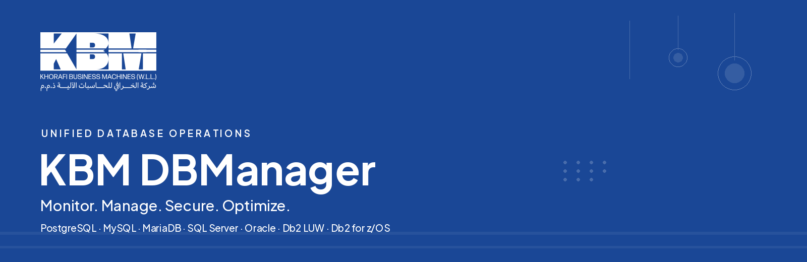

# KBM DBManager 0.16.0

**DBManager is now KBM DBManager**, a product of **Khorafi Business Machines (KBM)**. Release 0.16.0
gives the product KBM's corporate identity everywhere customers see it — the application, the
documentation, PDF reports, screenshots and the promotional videos — using KBM's own logo and visual
language. Nothing technical was renamed: APIs, configuration, data, images, the Helm chart and
volumes are unchanged, and upgrading needs no action.

## Branding changes

### The KBM identity

- The **KBM logo** exactly as supplied by KBM, in KBM blue on light surfaces and white on KBM blue,
  never redrawn or recoloured.
- The product **lockup** `KBM │ DBManager` in the navigation, on the sign-in page, in the setup
  wizard and on the loading and first-run screens.
- New **favicon and app icons**: the white KBM mark on KBM blue.

### A KBM design system

- **KBM blue `#1A4796`** is the action colour and the colour of the navigation rail; **KBM navy
  `#091450`** carries the dark theme, which is designed in its own right rather than inverted.
- Text, borders and fills use the colours of KBM's own documents; charts use the accents of KBM's
  presentation theme.
- **Plus Jakarta Sans**, the typeface of KBM's presentations, is the interface font.
- **Health and severity colours are unchanged**, so operational status reads exactly as before.
- **Engine marks are unchanged**: KBM identifies the platform, the marks identify the database
  technology.

### Screens

- **Sign in**: the login page is a KBM cover — KBM blue, the white KBM logo, the product statement
  and the supported engines. Local, LDAP, OIDC and MFA sign-in work as before.
- **About**: opens with a KBM banner.
- **Cards and page titles**: cards get KBM's soft shadow and page titles are set in KBM blue.

### Reports and documentation

- **PDF reports** follow KBM's document style: logo and product header, KBM-blue title, deep-blue
  table header, KBM footer.
- **Documentation** is now *KBM DBManager Documentation*, with the KBM theme and banner. Every
  screenshot was recaptured from the running application.

### Videos and marketing

- **Promotional videos**: the product overview, the LinkedIn version and the teaser were rebuilt
  with KBM branding from current screenshots, with new narration, subtitles and thumbnails.

### Brand rules

- The rules for future work are in the
  [KBM DBManager brand guidelines](../branding/kbm-dbmanager-brand-guidelines.md).

## Upgrade notes

No migration, no configuration change. A few visible texts change; check anything that matches
them:

- **E-mail subjects** of alerts and scheduled reports now start with `[KBM DBManager]` instead of
  `[DBManager]`. Update mail filters and rules that match the old prefix.
- **Slack and Teams buttons** read *Open in KBM DBManager*.
- **MFA**: new authenticator enrolments are labelled *KBM DBManager* (`DBM_MFA_ISSUER`). Existing
  entries keep their old label and keep working; set `DBM_MFA_ISSUER=DBManager` to keep the old
  label for new enrolments.
- **Browser**: the tab title and installed-app name are *KBM DBManager*; bookmarks and URLs are
  unchanged.

## Compatibility statement

Unchanged in 0.16.0, by design:

- REST API paths and payloads, including `GET /api/v1/version`, which keeps
  `"product": "DBManager"` as its machine identifier for load-balancer checks and scripts;
- `DBM_*` environment variables, the database schema (`0014`) and its data;
- image names `ghcr.io/hbenabdalla/dbmanager-backend` and `-frontend`, the Helm chart `dbmanager`,
  Docker Compose services and volumes, and the repository path.

Release notes of earlier versions keep the name DBManager.

## Testing

- Backend suite and frontend suite pass. Tests that expected the old name in e-mail subjects, MFA
  labels and Teams cards now expect the new one.
- New brand-consistency tests check customer-facing text, titles, retired artwork and the integrity
  of the KBM logo files.
- `mkdocs build --strict` passes with the KBM theme.
- Visual review covered every page in the light theme and the main pages in the dark theme
  ([test validation](../product/test-validation.md#release-0160-kbm-rebrand)).

## Known limitations

- KBM supplied its logo and sample documents but no written brand manual. Clear space, minimum sizes
  and colour proportions are inferred from those documents and await KBM's confirmation
  ([brand analysis](../branding/kbm-brand-analysis.md#missing-or-ambiguous-information)).
- The narration of the videos is synthesised speech. The scripts are ready for a recorded voice-over.
- Unchanged from 0.15: Db2 for z/OS requires external validation; Oracle TCPS is not exercised.

Full list of changes: [changelog](https://github.com/hbenabdalla/dbmanager/blob/main/CHANGELOG.md).
