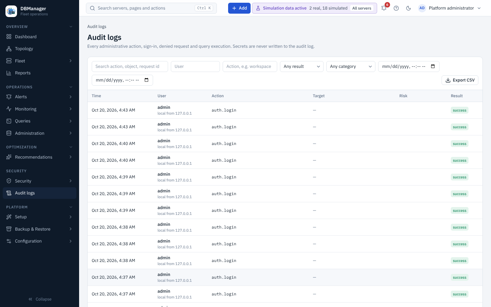

# Audit

**Security → Audit logs** (`audit.view`, platform scope) records sign-ins (success and failure),
configuration and RBAC changes, server registration and credential changes, SQL workspace
executions with classification, administration actions with their statements (passwords masked),
cancel/terminate, denied mutating requests (`access.denied`), alerting and backup activity, report
downloads and deliveries, simulation runs and identity-provider tests.

Filter by text (action, object or request id), user, action prefix, result (*success*, *failure*,
*denied*), category and a time range. Each event has a request id that also appears in the backend
logs. A server's **Audit** tab shows its own events.

## Export

**Export CSV** (permission `audit.export`, platform scope) downloads the filtered events
(`GET /api/v1/audit/export.csv`). The export itself is audited.

* Values that a spreadsheet would read as a formula (starting with `=`, `+`, `-`, `@`, tab or
  carriage return) are prefixed with an apostrophe, so a crafted username cannot run a formula.
* One export holds at most **200,000** events. When more events match, the response carries the
  header `X-DBM-Export-Truncated: true`; narrow the time range and export again.

Audit details are sanitised: keys that look like secrets are removed before storage. To send
events to a SIEM continuously, see [Audit forwarding](../administration/siem.md).
