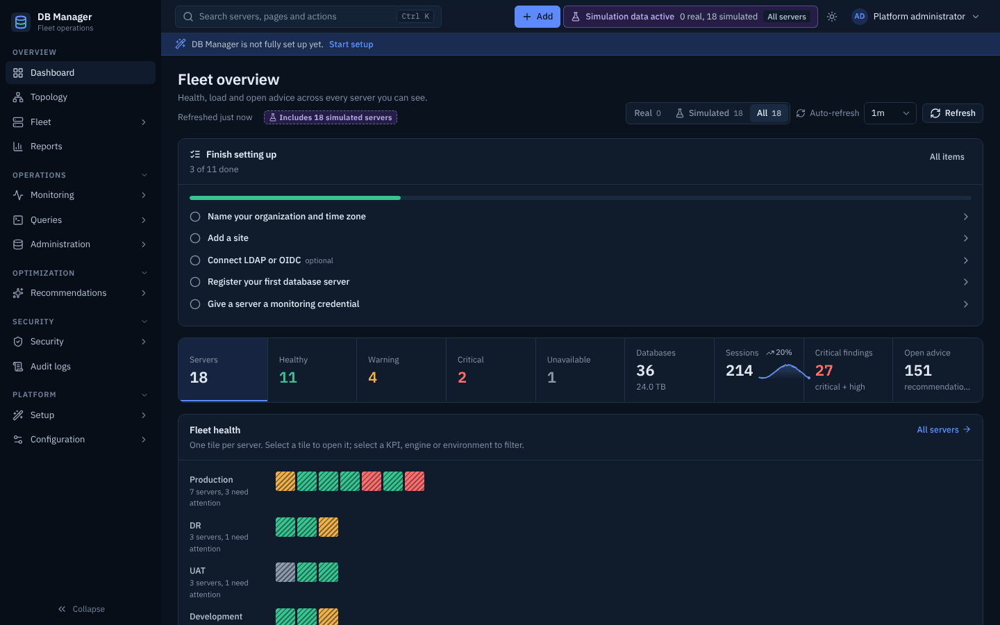

# Dashboard

The fleet overview answers "is anything wrong, and where?".

* **KPI row** — servers, healthy, warning, critical, unavailable, databases and total size,
  sessions (with a 24-hour sparkline and change), critical findings, open recommendations.
* **Filters** — selecting *Healthy*, *Warning*, *Critical* or *Unavailable*, an engine bar or an
  environment row filters the fleet map and the attention list in place. The filter is kept in the
  URL; **Open in server list** carries it to Fleet → All servers; **Clear** resets it.
* **Fleet health** — one tile per server grouped by environment; tile size shrinks with fleet size
  so thousands of servers still fit. Select a tile to open the server.
* **Trends** — connections, mean statement latency and transactions per second over 24 hours.
* **Servers requiring attention**, **Top recommendations**, **Security findings by severity** and
  **Capacity** (largest servers by size).
* **Setup checklist** (administrators) until the platform setup is complete.

Health is computed from the latest metrics: see [Health calculation](../monitoring/health.md).
Auto-refresh can be set from the toolbar; the dashboard never polls faster than once a minute.
