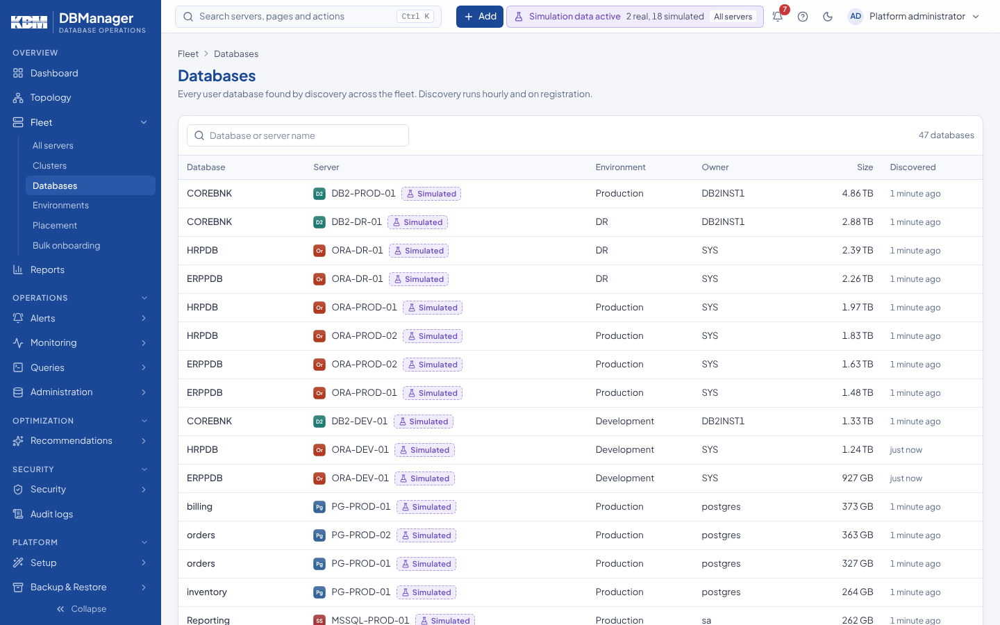

# Fleet

**Overview → Fleet → All servers** lists every server you may see, with engine and version,
environment, health, connection utilization, latency, open advice and last collection. Filter by
text, engine, environment, health or tag; sort any column. A server with active alerts shows an
alert badge next to its name.

| Page | Purpose | Permission |
|---|---|---|
| All servers | inventory and entry point to each [server](servers.md); **Add server** opens the [onboarding wizard](onboarding/database-onboarding.md) | `server.view`; adding needs `server.register` |
| Clusters | primary/replica, RAC, availability-group and HADR groupings with member roles; **New cluster** | `server.view` |
| Databases | every database across the fleet with size and owner server | `database.view` |
| Environments | production, DR, UAT, development, test tiers; production gets stricter confirmations; **New environment** | `server.view`; creating needs `inventory.manage` |
| Placement | create, edit and delete environments, sites, clusters and applications | `inventory.manage` (platform) |
| Bulk onboarding | register many servers from a grid, CSV or JSON — [Bulk onboarding](onboarding/bulk-onboarding.md) | `server.register` |

Sites, applications and tags are assigned during onboarding or in a server's **Settings** tab and
are used for filtering, topology grouping, alert and backup scopes and RBAC scopes (environment,
site, cluster). An environment, site, cluster or application can only be deleted while no server
references it.

Topology view of the same inventory: [Topology](topology.md).
