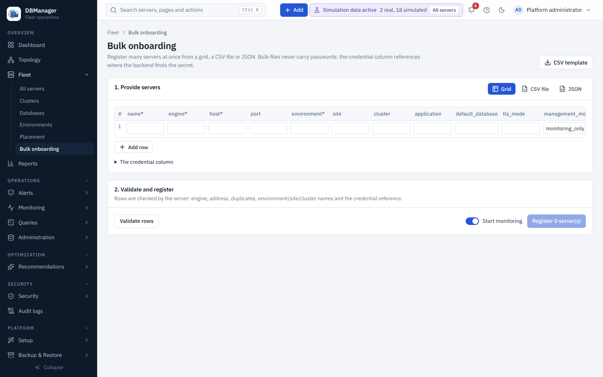

# Environments and sites

Environments and sites structure the fleet, drive the [topology](../topology.md) and are RBAC
scopes (for example *DBA Administrator* on environment *Production*).

* **Environment** — name, tier (`production`, `dr`, `uat`, `development`, `test`), description,
  sort order. Production tier makes destructive actions require the server name and a reason.
* **Site** — name, provider (`on-prem`, `aws`, `azure`, `gcp`, `oci`, `ibm`) and region.
* **Clusters** and **applications** are created under Overview → Fleet → Clusters or Placement, during onboarding or by bulk
  onboarding (unknown sites, clusters and applications in a bulk file are created on registration).

Create them in the setup wizard, under **Overview → Fleet → Environments** (**New environment**) or
**Placement**, or with **+ Add → Environment** (permission `inventory.manage`, platform scope).

 The REST resources are `/api/v1/environments`, `/sites`,
`/clusters` and `/applications`.
