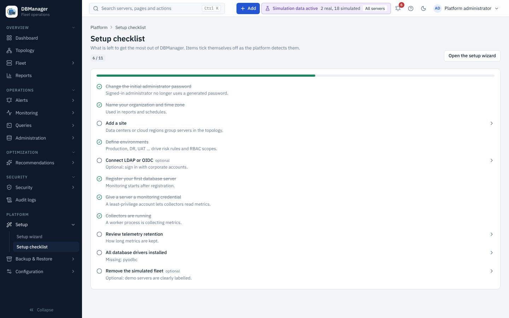

# Setup and onboarding wizards

| Wizard | Where | Who |
|---|---|---|
| [Platform setup](platform-setup.md) | Platform → Setup → Setup wizard (banner until finished) | `settings.manage` |
| [Environments and sites](environments.md) | setup wizard steps, Overview → Fleet → Environments / Placement, **+ Add → Environment** | `inventory.manage` |
| [Database onboarding](database-onboarding.md) | Overview → Fleet → All servers → Add server, **+ Add → Database server** | `server.register` |
| [Bulk onboarding](bulk-onboarding.md) | Overview → Fleet → Bulk onboarding | `server.register` |
| [LDAP / Active Directory](ldap.md) | Platform → Configuration → Identity wizard, **+ Add → Identity provider** | `idp.manage` |
| [OpenID Connect](oidc.md) | Platform → Configuration → OIDC (or Identity providers) → **OIDC provider** | `idp.manage` |
| [Monitoring profile](monitoring-profile.md) | setup wizard | `settings.manage` |
| [Retention](retention.md) | setup wizard, Platform → Configuration → Monitoring storage | `settings.manage` |

All wizards keep focus on the current step heading, validate each step before *Continue*, work on
small screens (the step list becomes a progress bar) and finish on a success screen. Secrets typed
into a wizard are sent once and never displayed again.

After setup, the **Setup checklist** (dashboard card and Platform → Setup → Setup checklist) lists
what is still open: administrator password changed, organization, sites, environments,
authentication (optional), first server, monitoring credential, collectors running, retention,
drivers healthy and simulation removed (optional). Items tick themselves off as the platform
detects them.
