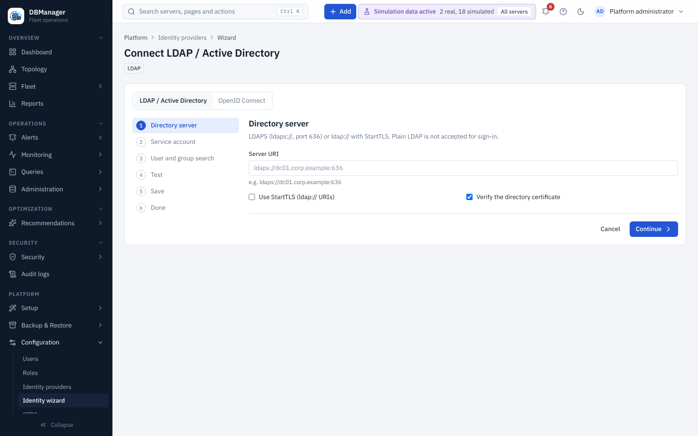

# LDAP / Active Directory wizard

Open it with **Platform → Configuration → Identity wizard**, **+ Add → Identity provider**, or
**LDAP directory** on **Platform → Configuration → LDAP** (which lists the directory providers
already configured, with **Test**, **Edit**, **All fields** and **Delete**).

Steps: **Directory server → Service account → User and group search → Test → Save → Done.**

* **Directory server** — `ldaps://host:636`, or `ldap://` with StartTLS; certificate verification
  on by default, optional CA (PEM). Plain LDAP is not accepted for sign-in.
* **Service account** — bind DN and password (stored encrypted; an existing password shows as
  *stored* and is not sent back).
* **User and group search** — user base DN and filter (for AD `(&(objectClass=user)(sAMAccountName={username}))`),
  attributes for username, email and display name, group attribute (`memberOf`) or group search.
* **Test** — staged checks: DNS → TCP → TLS → service bind → user search → group lookup → user bind
  (with an optional test user and password). Each stage reports ok, warn or fail with the reason.
* **Save** — name the provider and decide whether it is offered on the sign-in page; **Save
  provider** creates or updates it. Map directory groups to platform groups afterwards.

Reference of every setting and group mapping: [LDAP / Active Directory](../../administration/ldap.md).
