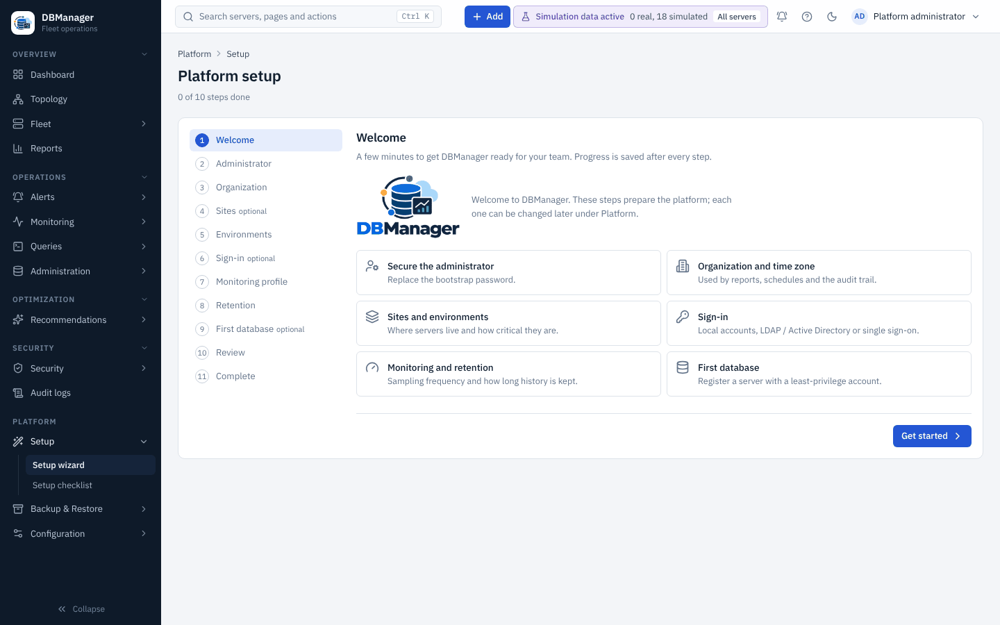

# Platform setup wizard

Steps: **Welcome → Administrator → Organization → Sites → Environments → Sign-in → Monitoring
profile → Retention → First database → Review → Complete.** Sites, sign-in and first database are
optional.

| Step | What it does |
|---|---|
| Administrator | replaces the bootstrap password (same policy as everywhere: 12+ characters, three classes) |
| Organization | organization name and IANA time zone (validated), used by reports, schedules and the audit trail |
| Sites | data centres or cloud regions (name, provider, region) |
| Environments | tiers such as production, DR, UAT, development, test — production servers get stricter confirmations |
| Sign-in | keep local accounts, or open the [LDAP](ldap.md) / [OIDC](oidc.md) wizard |
| Monitoring profile | default collection interval for new servers — [Monitoring profile](monitoring-profile.md) |
| Retention | how long metric history is kept — [Retention](retention.md) |
| First database | opens the [database onboarding wizard](database-onboarding.md) |
| Review / Complete | summary; completing records the setup as done and removes the banner |

The wizard is **resumable**: state is stored on the server after each step (`PUT /api/v1/platform/setup`),
so you can leave and continue later from another browser. Re-open it any time from
Platform → Setup → Setup wizard or the command palette (*Run the platform setup wizard*); completed
steps can be revisited.
