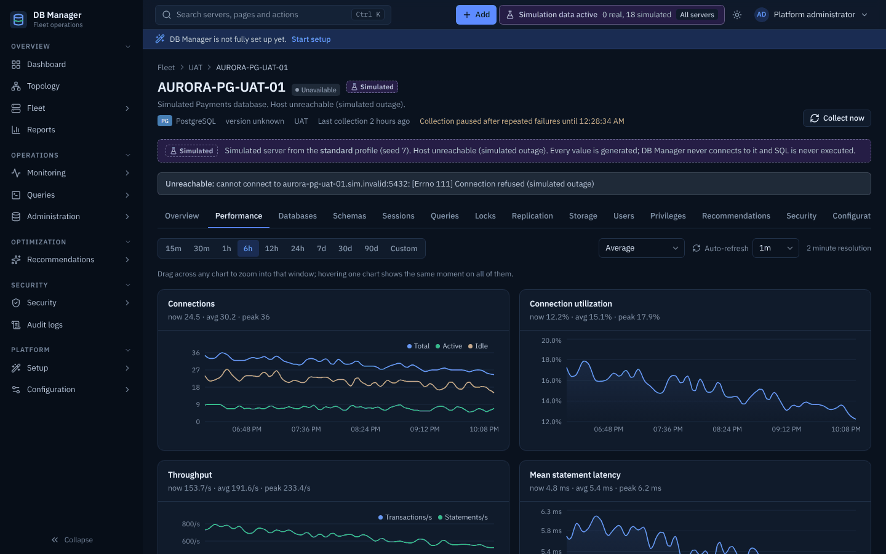

# Monitoring and performance

The **Performance** tab of a server (and **Operations → Monitoring → Performance** for comparing
servers) charts the metrics the engine provides:

connections and utilization · transactions and statements per second · mean statement latency ·
buffer cache hit ratio · physical reads · blocked sessions and deadlocks · temporary spills ·
replication lag · database size · CPU and memory (where the engine exposes them) · active sessions
by wait type.

* **Time range** — 15m, 30m, 1h, 6h, 12h, 24h, 7d, 30d, 90d or a custom start/end.
* **Drag across any chart** to zoom into that window; **Reset zoom** returns to the previous range.
* Hovering one chart shows the same moment on every chart.
* Each chart header shows the current, average and peak value of the range.
* **Aggregation** (avg, min, max, p95 …) applies per time bucket of the stored samples.
* **Auto-refresh** off/30 s/1 m/5 m.

Metrics an engine does not provide are listed under the charts as *Not available for this server*
instead of being shown empty or estimated. What each metric means: [Metric catalog](../monitoring/metric-catalog.md).

**Operations → Monitoring → Overview** shows fleet-wide current values; Sessions, Locks and
Replication pages aggregate across servers.
