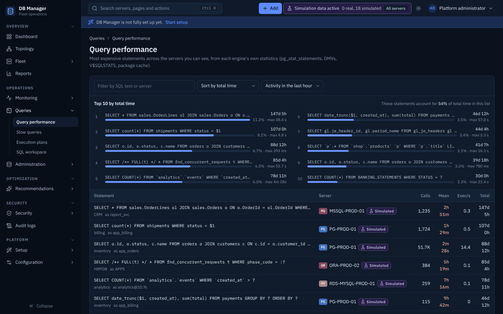

# Queries and execution plans

## Query performance

**Operations → Queries → Query performance** (fleet) and a server's **Queries** tab list statements
from each engine's own statistics (`pg_stat_statements`, `performance_schema` digests,
`sys.dm_exec_query_stats`, `V$SQLSTATS`, `MON_GET_PKG_CACHE_STMT`).

* Sort by total time, mean latency, executions, physical/logical reads, rows, temp usage or CPU,
  and choose the activity window (last hour … 7 days).
* The **Top 10** panel shows each statement's share of the chosen metric; select one to open its
  detail: full (parameterized) text, counters and 24-hour history of executions/s and mean latency.
* Literal values are masked for roles without permission to see them.
* **Slow queries** lists statements averaging more than 500 ms.

Mean and maximum are shown as the engines report them. **P95/P99 per statement are not shown**,
because no engine's cumulative statement statistics contain latency distributions — see
[Query statistics](../performance/query-statistics.md).

## Execution plans

**Execution plans** (or *Explain this query* from a statement) runs `EXPLAIN` on the chosen server
and database:

* **Explain (estimate)** never executes the statement.
* **Explain analyze** executes it inside a transaction that is always rolled back; it needs
  `query.explain_analyze` and a typed confirmation on production servers.

The result has three views: **Graph** (cost heat per operator, rows passed between operators,
estimated → actual rows with a misestimate badge at 10× or more), **Tree**, and **Raw** (the vendor
plan: JSON, SQL Server showplan XML or text). Detected issues (sequential scans on large tables,
misestimates, spills …) are listed with severity. Details: [Execution plans](../performance/execution-plans.md).

Enter a label in **Save plan as** before running EXPLAIN to keep the plan; **Queries → Compare plans**
puts two saved plans side by side (cost, operators, access paths, issues).

## Regressions and period comparison

**Queries → Regressions** lists statements whose mean latency is well above their own baseline, with
plan changes on Oracle and SQL Server. **Queries → Compare periods** compares statement activity in
two periods (presets such as *last 24 h vs the same day a week ago*). Details:
[Regressions, comparisons and outcomes](../performance/regressions-and-comparison.md).

## SQL workspace

**SQL workspace** (`query.execute`) runs one statement at a time with a row limit
(`DBM_WORKSPACE_MAX_ROWS`) and timeout. Every statement is classified before it runs (READ,
LOW_RISK_CHANGE, PRIVILEGED_CHANGE, DESTRUCTIVE); changes need the matching permission, an
*Administration enabled* server and confirmation. Results can be exported to CSV; history is kept per user.
