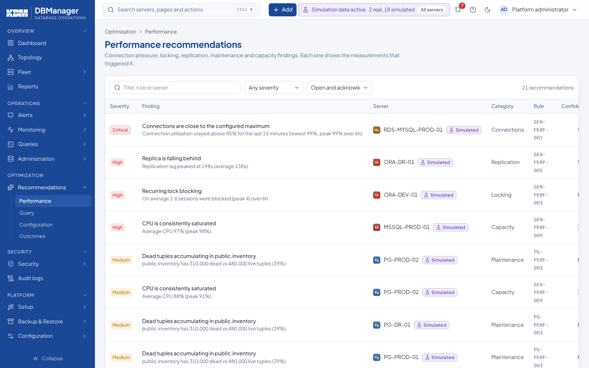

# Recommendations

**Optimization → Recommendations** has one page per group — **Performance**, **Query** and
**Configuration** — listing advice produced by 61 deterministic performance rules over each
server's metrics and evidence (see [Performance recommendations](../performance/recommendations.md)).
Viewing needs `performance.view`. Filter by text, severity and status (*Open and acknowledged*,
*Dismissed*, *Resolved*, *All*).

Select a recommendation to open it: finding, **Evidence** (measured values and time window),
**Recommendation**, expected impact, risk, confidence and **Implementation guidance** (for example
an SQL statement to review), with a link to the server.

With `performance.tune` the dialog offers **Acknowledge**, **Dismiss**, **Mark resolved** and
**Reopen**, with an optional *Note for the audit log*. A recommendation is also resolved
automatically when the rule no longer finds the condition at a successful collection.

Recommendations are **never executed automatically**. Applying one is a normal guarded change by a
DBA (Administration tab or SQL workspace), subject to RBAC, confirmation and audit.

## Outcomes

When a recommendation is resolved, KBM DBManager measures the metric (or the statement latency) that
triggered it for a window before and after the resolution and shows the outcome — *improved*,
*unchanged*, *regressed* — in the recommendation's dialog and on **Optimization → Recommendations →
Outcomes**. See
[recommendation validation](../performance/regressions-and-comparison.md#recommendation-validation-before-after).
