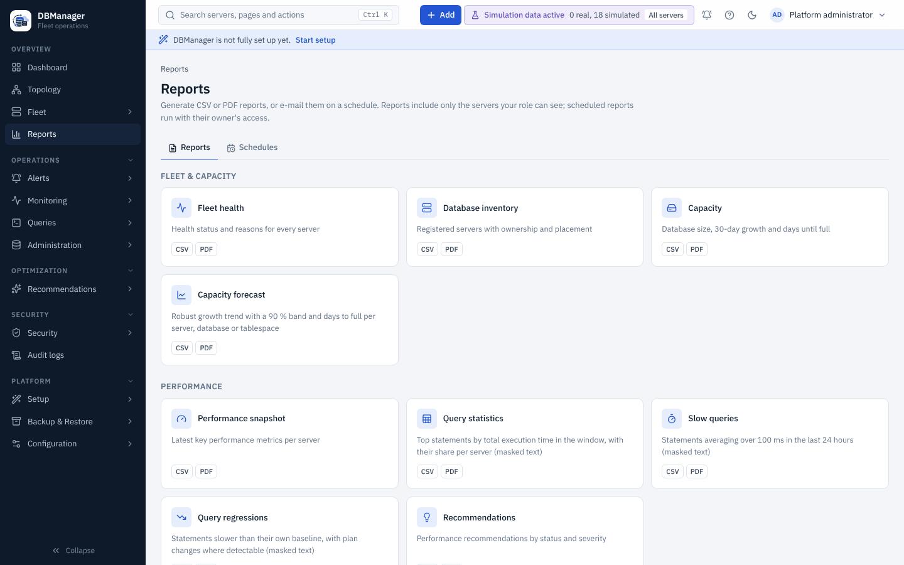

# Reports

**Overview → Reports** generates reports as **CSV** or **PDF**, and e-mails them on a schedule.
A report contains only the servers the person it runs for may see, and every download and every
delivery is recorded in the audit log.

## Report catalog

| Report | Contents | Parameters | Permission |
|---|---|---|---|
| Fleet health | health status and reasons per server | scope | `server.view` |
| Database inventory | servers with ownership and placement | scope | `server.view` |
| Capacity | database size, 30-day growth and days until full | scope | `performance.view` |
| Capacity forecast | Theil–Sen growth trend with a 90 % band and days to full | scope, per server / database / tablespace | `performance.view` |
| Performance snapshot | latest key metrics per server | scope | `performance.view` |
| Query statistics | top statements by total time in the window: calls, total / mean / max time, share of the server's time, rows, CPU, reads, masked text | scope, window (1–744 h) | `query.view` |
| Slow queries | statements averaging over 100 ms in the last 24 h (masked text) | scope | `query.view` |
| Query regressions | statements slower than their own baseline, with plan changes where the engine exposes plan identity (Oracle, SQL Server) | scope | `query.view` |
| Security findings | findings with severity, status, affected object, first/last seen, resolution date and remediation | scope, statuses, minimum severity | `security.view` |
| Security posture | open security findings | scope | `security.view` |
| Privileged users | administrative database accounts | scope | `user.view` |
| Recommendations | performance recommendations by status and severity | scope, statuses, minimum severity | `performance.view` |
| Audit activity | daily audit event counts (30 days) | — | `audit.view` at platform scope |

*Scope* is an optional environment, engine and server. Reports also need `reports.view`. Findings
reports include open and acknowledged findings unless you pick statuses. Query text in every report
is masked the same way as on the Queries pages (literals replaced).

## Generating a report

Select a report card. The dialog shows its parameters; **Preview** shows the first 50 rows and the
total, **CSV** and **PDF** download the whole report with the same parameters.

- **CSV** has every row and full timestamps. Text values that a spreadsheet would read as a formula
  (starting with `=`, `+`, `-`, `@`, tab or carriage return) are prefixed with an apostrophe.
- **PDF** is rendered on the server: DBManager logo, title, description, who it was generated for,
  when, the scope and the row count, then the table with its header repeated on every page
  (landscape when the table is wide). It lists at most 5,000 rows and cuts cells after 400
  characters; the CSV has everything. Every page footer says that the file contains data visible to
  that account.

The same downloads are available from the API: `GET /api/v1/reports/{key}.csv` or `.pdf` with the
parameters as query string (`environment_id`, `server_id`, `engine`, `window_hours`, `statuses`
(repeatable), `min_severity`, `scope`), and `GET /api/v1/reports/{key}/preview`.

## Scheduled reports

**Reports → Schedules** (permission `reports.schedule`, platform scope) e-mails a report as an
attachment. A schedule is created with a wizard:

1. **Report** — the report, its parameters and a name.
2. **Format** — PDF or CSV.
3. **Schedule** — daily, weekly (a weekday) or monthly (day 1–28) at a time in an IANA time zone;
   daylight-saving changes are handled.
4. **Delivery** — one or more **e-mail notification channels** (their recipients receive the file;
   webhook channels cannot carry attachments) and the account the report **runs as**.
5. **Review**.

The **Generate** dialog also has *Schedule…*, which opens the wizard with that report and its
parameters filled in.

### Whose data a schedule sends

A schedule runs **with its owner's access at the time of each run**: the owner's roles are loaded
again for every run, so a schedule never sends more than its owner may see now. By default the owner
is the person who creates the schedule, and they must be allowed to run the report themselves.
Choosing another owner needs `users.manage`. When the owner is disabled or deleted, or no longer
has the report's permission, the run **fails without sending anything** and says why.

### Runs and history

The scheduler (on the scheduler leader, checked every minute) runs schedules that are due. A run
missed while DBManager was stopped is sent once at the next start, not once per missed period.
**Send now** runs a schedule immediately without changing its timing.

Each run is recorded with its status — `success`, `partial` (some channels failed) or `failed` —,
the row count and file size, and the result per channel (recipients, or the delivery error).
**History** shows the last runs; the schedule list shows the last status and error. Every run is
also audited as `report.delivered`, and creating, changing and deleting schedules as
`report_schedule.create` / `.update` / `.delete`.

Files larger than `DBM_REPORT_MAX_ATTACHMENT_MB` (default 10 MB) are not sent; the run fails with
the size and asks to narrow the scope. Mail is sent with the SMTP settings of each channel
([notifications](../administration/notifications.md)).

Deleting a schedule deletes its run history; the audit log keeps every delivery. Platform backups
include schedules (component *alerting*) but not their run history.
