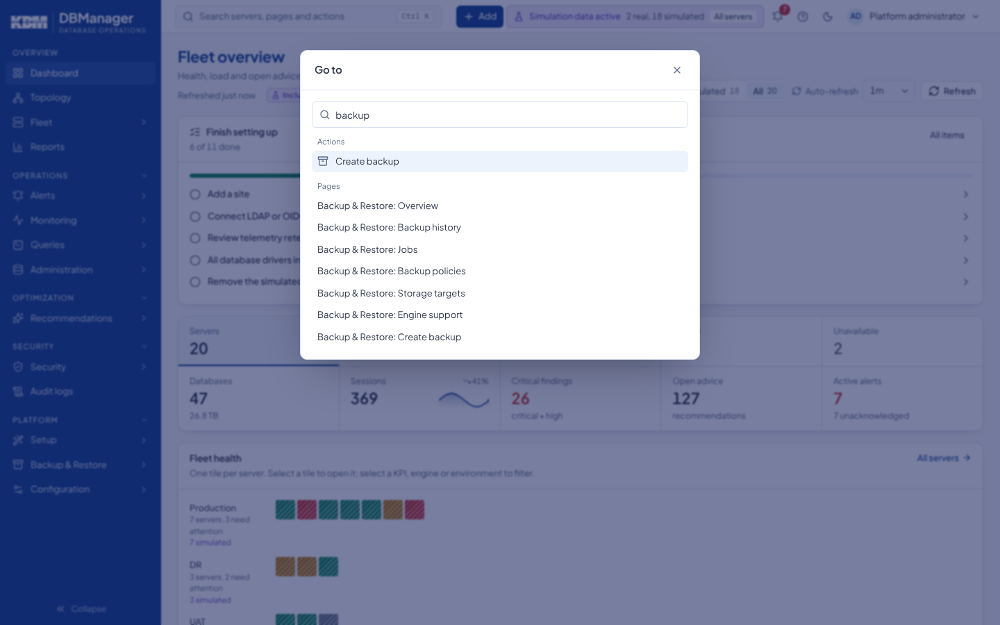

# Search and command palette

Press **Ctrl + K** (Windows/Linux) or **Cmd + K** (macOS), or select the search box in the top bar
(*Search servers, pages and actions…*).

* **Servers** — type part of a name; results show health, engine and environment.
* **Actions** — only the actions your role allows are listed:

    | Action | Opens | Needs |
    |---|---|---|
    | Add a database server | the onboarding wizard | `server.register` |
    | Bulk onboard servers (CSV / JSON) | Overview → Fleet → Bulk onboarding | `server.register` |
    | Open fleet topology | Overview → Topology | `server.view` |
    | Review security posture | Security → Security posture | `security.view` |
    | Configure an identity provider | Platform → Configuration → Identity wizard (the LDAP wizard; OIDC providers are added from Platform → Configuration → OIDC) | `idp.manage` (platform) |
    | Run the platform setup wizard | Platform → Setup → Setup wizard | `settings.manage` (platform) |
    | Create backup | Platform → Backup & Restore → Create backup | `backup.create` |
    | Generate report | Overview → Reports | `reports.view` |
    | Account security | your MFA settings (user menu → Security) | — |
    | Show active alerts | Operations → Alerts | `alerts.view` |
    | Open the documentation | the documentation (unless `DBM_DOCUMENTATION_URL=off`) | — |
    | About KBM DBManager | Platform → Configuration → About | — |
    | Toggle light / dark theme | — | — |

* **Pages** — every page of the sidebar you can open, listed as *Section: Page*.

The **+ Add** button in the top bar offers the creation actions, filtered by permission:
**Database server**, **Bulk onboarding**, **Environment** (`inventory.manage`), **Database user**
(`user.manage`; opens a server picker, then the server's Administration tab), **Platform user**
(`users.manage`) and **Identity provider** (`idp.manage`; opens the LDAP wizard).

The top bar also has the alert bell (count of active alerts), **Help** (Documentation, Source code
on GitHub, About KBM DBManager), the theme toggle (sun/moon) and the user menu (your roles and scopes,
**API tokens**, **Security**, **Change password** for local accounts, **Sign out**).
