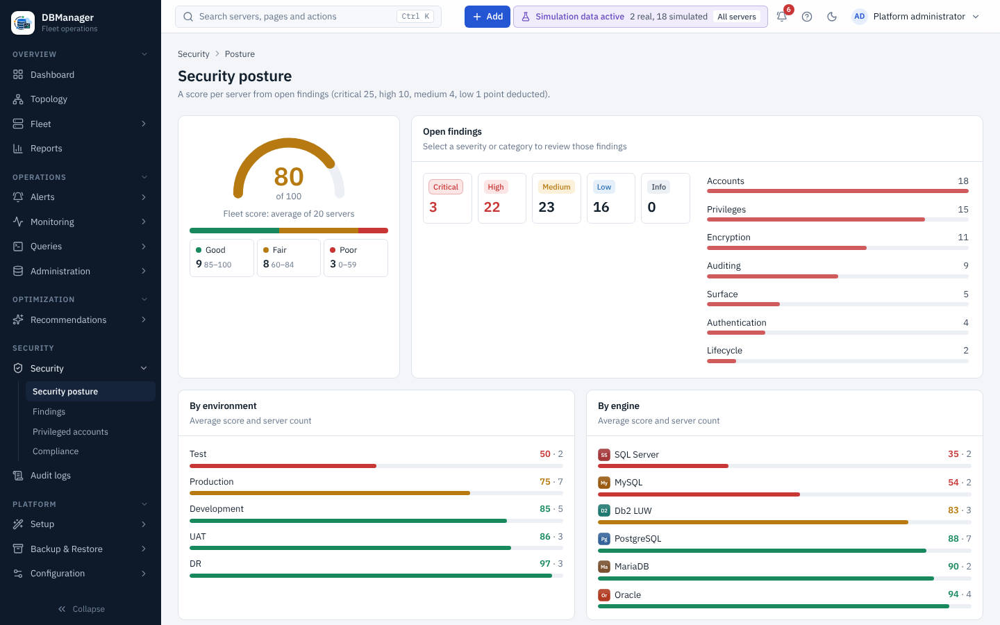
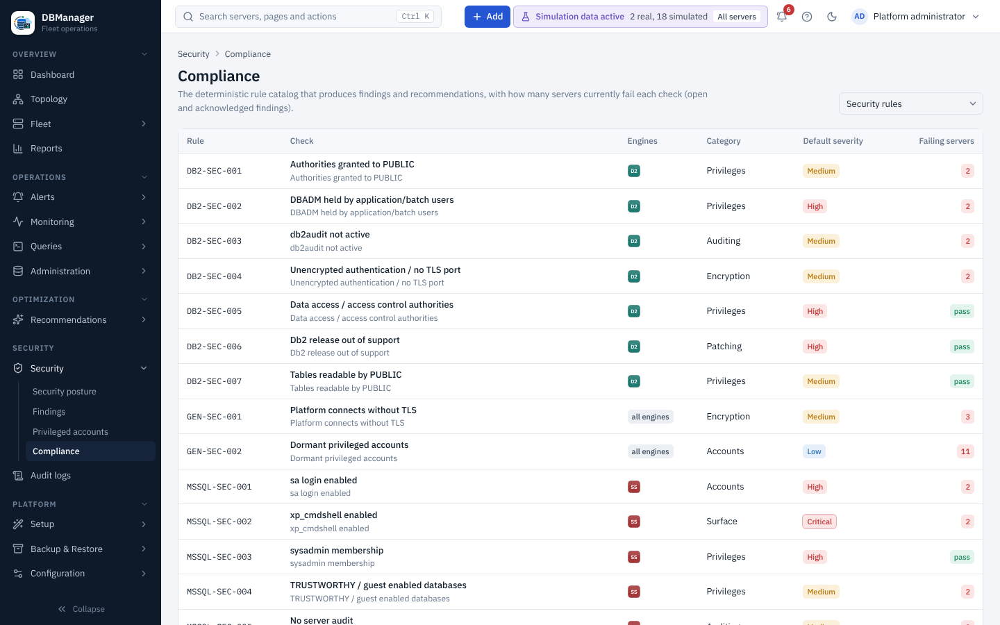

# Security

The **Security** section of the sidebar has four pages:

* **Security posture** (`security.view`) — a score per server (100 minus 25 per critical, 10 per
  high, 4 per medium and 1 per low open finding) and the fleet average; *Good* (85–100), *Fair*
  (60–84) and *Poor* (0–59) bands filter the server list; severity tiles and categories under
  **Open findings** open the matching findings; averages **By environment** and **By engine**.
* **Findings** (`security.view`) — results of the 55 security rules (accounts, privileges,
  authentication, encryption, auditing, surface, lifecycle). Filter by text, severity and status.
  Select a finding for its evidence, recommendation and implementation guidance; with
  `security.manage` the dialog offers **Acknowledge**, **Dismiss**, **Mark resolved** and
  **Reopen**, with an optional *Note for the audit log*.
* **Privileged accounts** (`user.view`) — administrative database accounts across the fleet from
  the latest security scan, with the engine's own reason (superuser, `sysadmin`, DBA role, DBADM …),
  direct grants and last login where the engine tracks it. The filter switches between
  *Administrative accounts*, *Administrative, no login in 90 days* and *All accounts and roles*.
* **Compliance** (`security.view`) — the rule catalog. **Rule set** switches between *Security
  rules* and *Performance rules*. For each rule: id, check, engines, category, default severity and
  **Failing servers** — the number of servers with an open or acknowledged finding of that rule
  among the servers you can see (hover it for the number of findings), or *pass*. The counts come
  from `GET /api/v1/advisor/rule-summary`, aggregated in the database over all findings, not one page.

Security scans run every 6 hours. **Scan security now** on a server's **Settings** tab (permission
`security.manage`) queues one immediately (`POST /api/v1/servers/{id}/security-scan`). The rules per
engine are listed on the [engine pages](../database-engines/index.md); how the platform itself is
protected is described in [Security](../security/index.md).

Step by step: [Review security findings and compliance](tasks/review-security.md).
