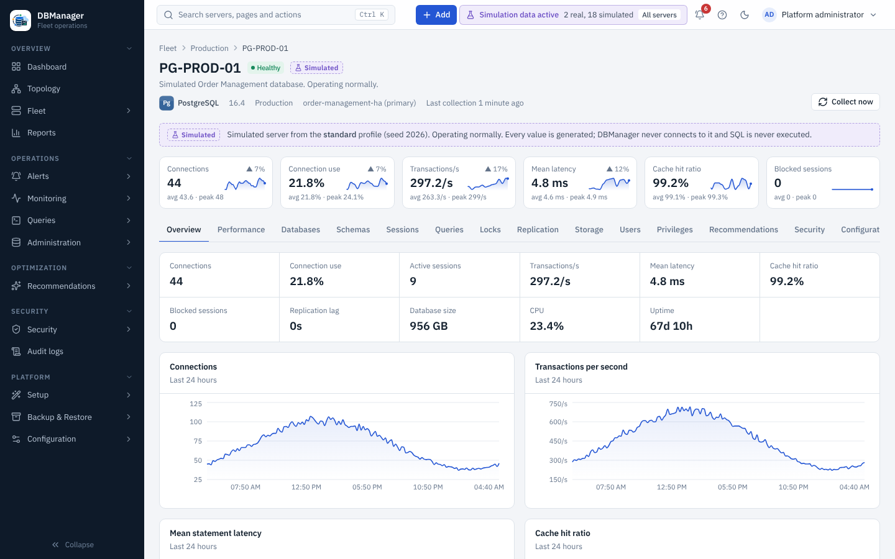
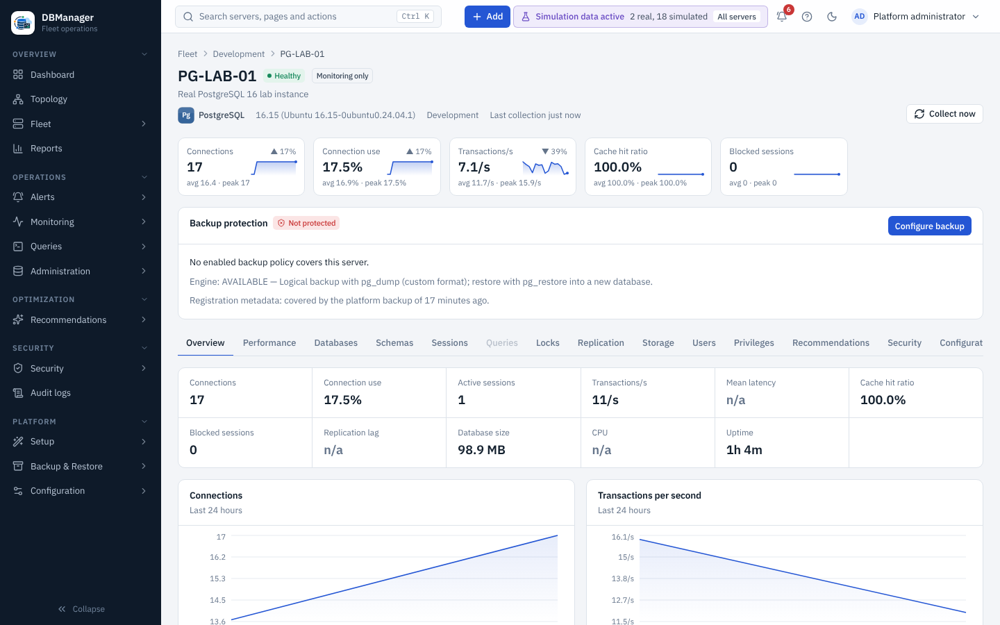

# Servers

A server page has a header (health, *Simulated* / *Monitoring only* / *Administration enabled*
badges, alert badge, engine, version, environment, cluster role, last collection), **live metric
cards** for the last hour, the server's active alerts and maintenance windows, a **Backup
protection** panel (with `backup.view`: *Protected*, *At risk* or *Not protected*, and
**Configure backup** when nothing protects it), and tabs. Tabs the server's engine or your role
cannot use are disabled; hovering them shows the reason (for example
*Requires privilege: grant VIEW SERVER STATE*).

| Tab | Content | Permission |
|---|---|---|
| Overview | key metrics, 24 h charts, collection status per component, capabilities found by discovery | — |
| Performance | all metric charts with time range, aggregation and auto-refresh — [Performance](performance.md) | `performance.view` |
| Databases | databases with size and attributes — [Databases, schemas and objects](databases-and-objects.md) | `database.view` |
| Schemas | schema and object browser | `schema.view` |
| Sessions | connections, blocking, cancel/terminate — [Sessions and locks](sessions-and-locks.md) | `session.view` |
| Queries | top statements of this server — [Queries and plans](queries-and-plans.md) | `query.view` |
| Locks | lock entries and waiters | `session.view` |
| Replication | role, lag, replication diagram — [Replication](replication.md) | `performance.view` |
| Storage | sizes, tablespaces, largest objects — [Storage](storage.md) | `performance.view` |
| Users / Privileges | database accounts, roles and grants — [Users and privileges](users-and-privileges.md) | `user.view` / `privilege.view` |
| Recommendations | open advice for this server | `performance.view` |
| Security | security findings for this server | `security.view` |
| Configuration | engine parameters with defaults and pending changes | `performance.view` |
| Logs | collection and database logs where the engine provides them | `logs.view` |
| Administration | guarded actions: choose an action, **Preview statements**, **Execute** — [Guarded administration](users-and-privileges.md#guarded-administration) | the action's permission; executing needs *Administration enabled* |
| Audit | audit events about this server | `audit.view` (platform) |
| Settings | connection and placement, management mode, collection interval, credentials (write-only), **Operations** (Collect now, Test connection, Scan security now, Download diagnostics), Remove server | any of `server.modify`, `credentials.manage`, `server.delete`, `collectors.manage`, `collectors.view`, `security.manage` |

**Collect now** (header, permission `collectors.manage`) queues an immediate collection and
resets a paused circuit breaker. When collection failed repeatedly, the header shows
*Collection paused after repeated failures until …*.

## Management mode

A server is either **Monitoring only** or **Administration enabled** (Settings tab →
**Management mode**). Servers registered without a mode — in the wizard, by bulk onboarding or
through the API — are *Monitoring only*. Servers registered before version 0.14.0 were kept in
administration mode by migration `0013`, because that was their behaviour before.

On a *Monitoring only* server DBManager refuses every change action, whatever the stored
credential allows (`409 monitoring_only`): administration actions, session cancel and terminate,
modifying statements in the SQL workspace, EXPLAIN ANALYZE of a modifying statement, and database
restores into it. The Administration tab still previews statements but cannot execute them.
