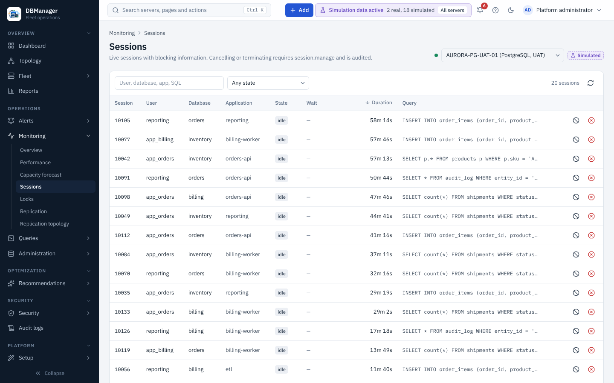

# Sessions and locks

**Sessions** (server tab, or **Operations → Monitoring → Sessions** with a server selector) lists connections with user,
application, client, database, state, current statement, wait event and duration. Sessions that are
blocked show **blocked by** with the blocking session; the blocking chain is highlighted.

**Locks** lists lock entries with mode, object, granted/waiting state and the blocking session.

## Cancel and terminate

In the session list, the **Cancel query** and **Terminate session** icons open a confirmation
dialog with an optional reason.

| Action | Effect | Requirements |
|---|---|---|
| Cancel query | stops the running statement, keeps the session | `session.manage` on the server, an *Administration enabled* server, engine support |
| Terminate session | ends the session and rolls back its open transaction | the same, plus typing the session id to confirm |

The administration credential is used when one is stored, otherwise the monitoring credential (the
engine then decides whether that account may cancel).

Engine notes: SQL Server cannot cancel another session's statement from T-SQL (terminate uses
`KILL`); Oracle cancel uses `ALTER SYSTEM CANCEL SQL` (18c+); Db2 cancel uses
`WLM_CANCEL_ACTIVITY` and terminate `FORCE APPLICATION`; Db2 for z/OS has no session monitoring.
Every cancel/terminate is audited. See [Locks and blocking](../performance/locks-and-blocking.md).
