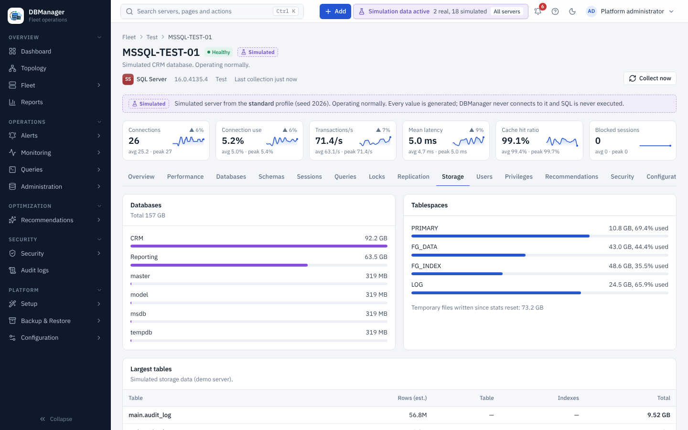
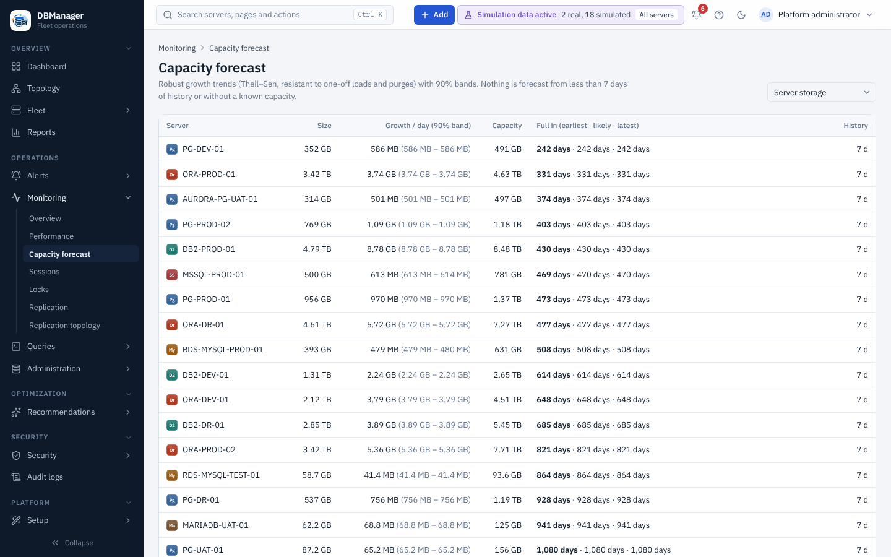

# Storage

A server's **Storage** tab shows total size, per-database sizes, tablespaces (where the engine has
them), the largest tables and indexes, and temporary space. The time series `storage.database_bytes`
feeds the capacity view.

**Capacity** (dashboard card, Capacity report, `GET /api/v1/metrics/capacity`) estimates growth
per server from daily values of the last 30 days with a least-squares fit. A *days until full*
forecast is only given when the history spans at least 7 days with at least 5 daily points, the
trend is growing and a capacity is known; otherwise the reason is shown. Details:
[Baselines and capacity](../performance/baselines-and-capacity.md).

**Operations → Monitoring → Capacity forecast** forecasts growth per server, database or tablespace with a robust
trend and a 90 % band, and gives the earliest, likely and latest number of days until full. Click a
row for the history and forecast chart. Details: [capacity forecasting](../performance/baselines-and-capacity.md#capacity-forecasting).

