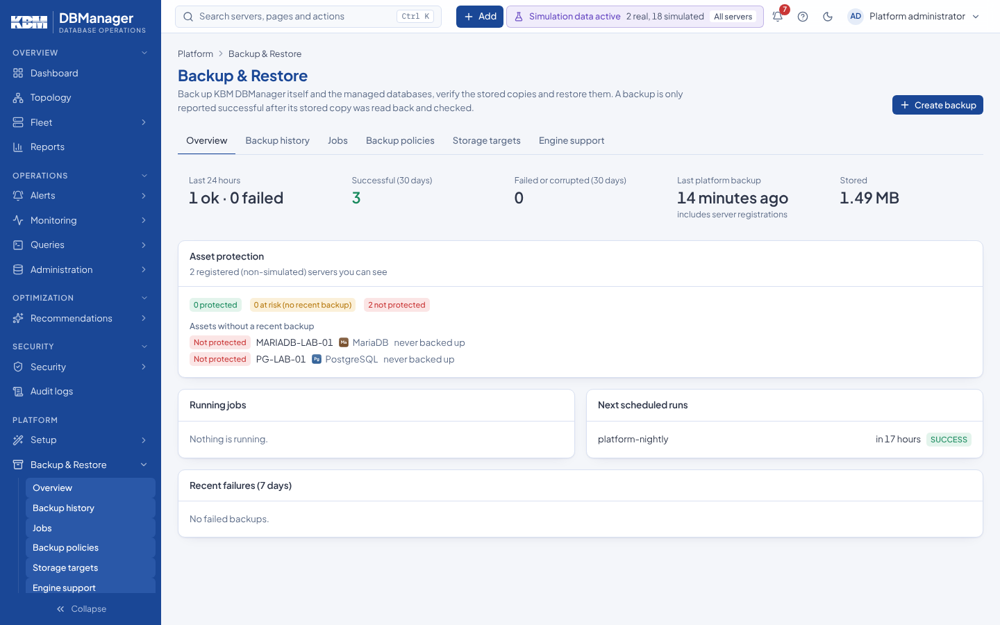
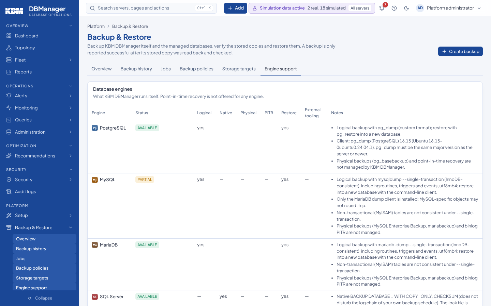
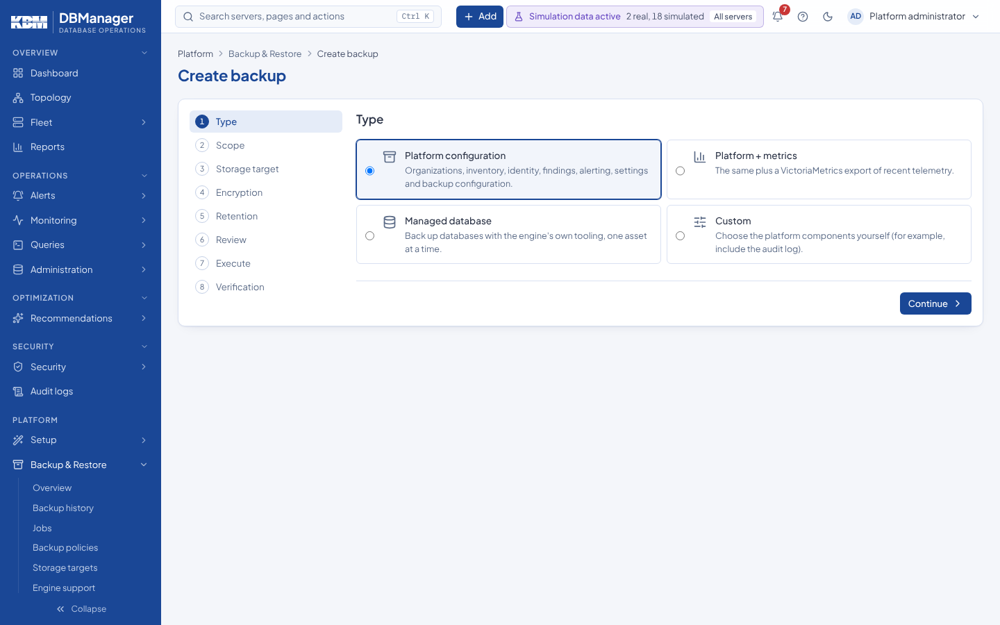
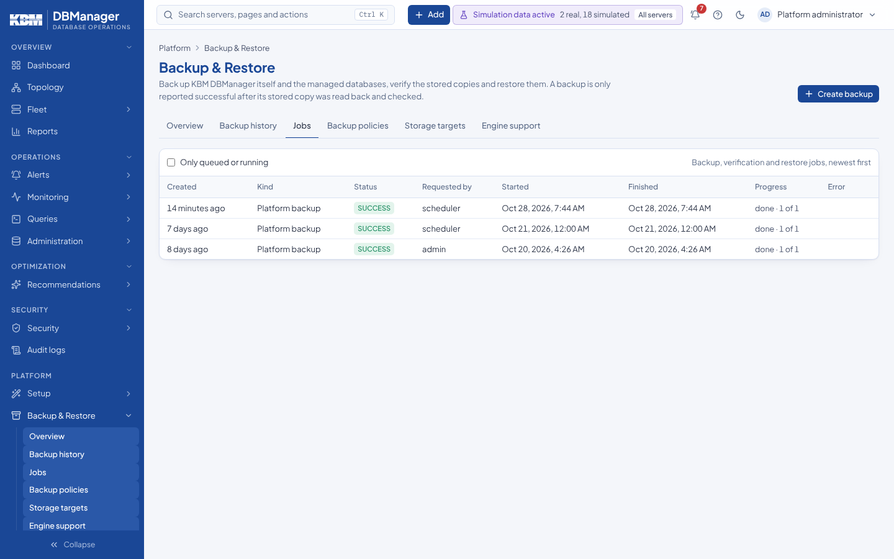
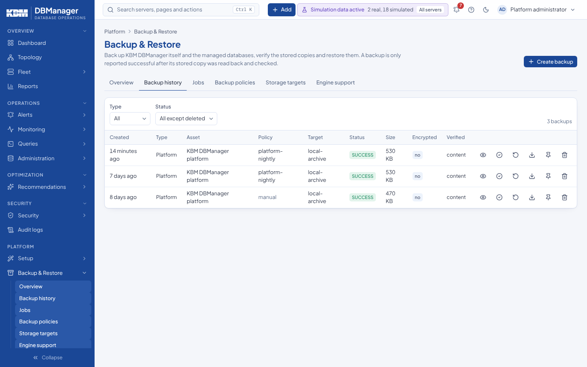
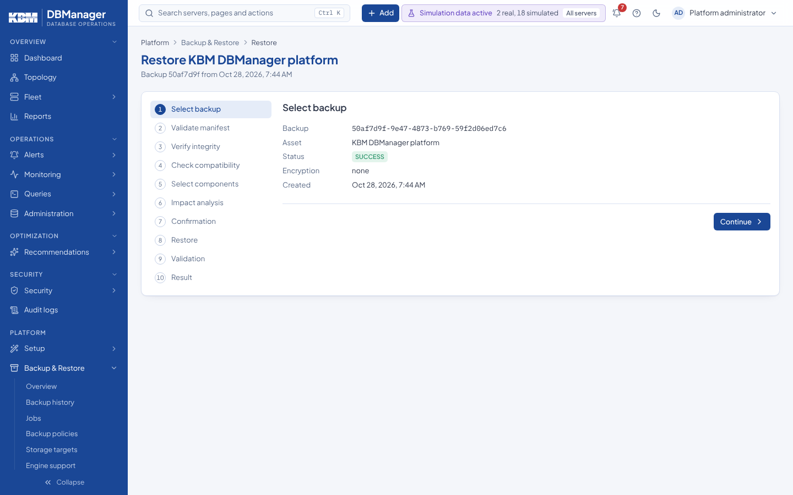

# Back up and restore a database

**Goal:** a managed database is backed up with the engine's own tool, the stored copy is verified,
and — when needed — restored into a **new** database on a server of the same engine. Restores never
overwrite an existing database.

## Before you start

* Permissions: `backup.view` and `backup.create` to back up, `backup.verify` to verify,
  `restore.execute` **and** `restore.database` to restore — on the server. The **Backup Operator**
  role holds exactly these (plus `server.view` and `database.view`); DBA Administrator holds them too.
  Scoped users see only the backups and jobs of the servers they can see.
* An **administration credential** stored for the server (database backups and restores connect
  with it). A restore also needs the target server registered as **Administration enabled**.
* A **storage target** (**Platform → Backup & Restore → Storage targets**, created by someone with
  `backup.target.manage`): a local directory, a mounted volume, an NFS mount or an S3-compatible
  bucket. SQL Server, Oracle and Db2 write the backup file on the database server itself; KBM DBManager
  records and verifies it there.
* What each engine supports: **Platform → Backup & Restore → Engine support**. PostgreSQL, MySQL,
  MariaDB, SQL Server and Oracle can be restored by KBM DBManager; Db2 restores and every Db2 for z/OS
  operation need the engine's own tools. Point-in-time recovery is not offered.

    

## Back up now

1. Open **Platform → Backup & Restore → Create backup** (or **Create backup** on the Backup &
   Restore page, or *Create backup* in the command palette).

    

2. **Type** — select **Managed database**. **Continue**.
3. **Scope** — select the **Servers** (or environments, sites, tags) and, under **Databases (comma
   separated)**, the databases; empty means each server's default database (Oracle: schema names).
   **Continue**.
4. **Storage target** — choose the target. **Continue**.
5. **Encryption** — **age public key (recommended)** (paste the recipient key; only the holder of
   the private key can decrypt), **Passphrase**, or **None**. **Continue**.
6. **Retention** — backups created here are manual: retention rules never remove them.
   **Continue**.
7. **Review** — select **Start backup**.
8. **Execute** and **Verification** — the job runs; a backup is only reported *SUCCESS* after its
   stored copy was read back and checked. **Go to backup history** opens the list.

For regular backups create a policy instead: **Platform → Backup & Restore → Backup policies →
New policy** (needs `backup.policy.manage`), with **What to back up** *Managed databases*, a
**Schedule**, **Retention** rules and **Notification channels**. **Run now** on a policy starts it
immediately. A server's page shows **Configure backup** in its **Backup protection** panel while
nothing protects it.

## Follow and verify

1. **Platform → Backup & Restore → Jobs** lists backup, verification and restore jobs, newest
   first, with progress. **Only queued or running** narrows the list. **Cancel** stops a queued or
   running job (needs the permission that started it).

    

2. **Platform → Backup & Restore → Backup history** lists the backups with type, asset, policy,
   target, status, size, encryption and verification. Row icons: details, verify, restore,
   download, pin, delete.

    

3. Select the verify icon, provide the private key (or passphrase) of an encrypted backup, and
   select **Verify**. With the key, the engine's own check runs on the content as well.
4. To keep a backup regardless of retention, select the **Pin** icon (needs
   `backup.policy.manage`); **Unpin** lets retention apply again.

## Restore into a new database

1. In **Backup history**, select the restore icon on a *SUCCESS* backup. The *Restore* wizard opens.

    

2. **Select backup** — check the backup, enter the key or passphrase if it is encrypted, and pick
   **Restore to server** (servers of the same engine). **Continue**.
3. **Validate manifest**, **Verify integrity**, **Check compatibility** — read the results; the
   wizard stops when the engine cannot be restored by KBM DBManager and shows the command to run with
   the engine's tools instead. **Continue** after each.
4. **Select components** — enter the **New database (or schema) name**; it must not exist on the
   target server (default: the original name with `_restored`). **Continue**.
5. **Impact analysis** — what will be created. **Continue**.
6. **Confirmation** — type the new database name in **Type … to confirm** and select **Restore**.
7. **Restore**, **Validation**, **Result** — the job runs; the result says *Database … was created*.
   **Back to backup history** returns to the list.

## What you should see

* The backup in **Backup history** with status *SUCCESS* and its verification level.
* The **Backup protection** panel of the server shows *Protected* while a policy's recent backup
  exists. A manual policy without **Alert when no successful backup for (hours)** counts as
  protection for 8 days after its last successful backup.
* After a restore, the new database on the target server (server page → **Databases** after the
  next inventory collection). Backups, verifications, restores and cancellations are audited.

## If it does not work

* *an administration credential is required*: store one on the server's **Settings** tab.
* `409 monitoring_only` on restore: switch the target server to *Administration enabled*.
* *TOOL_MISSING* in Engine support: the client tools are not in the backend image
  ([Engine support](../../backup-restore/engine-support.md)).
* More: [Backup and restore troubleshooting](../../backup-restore/troubleshooting.md),
  [Database backup](../../backup-restore/database-backup.md), [Restore](../../backup-restore/restore.md).
