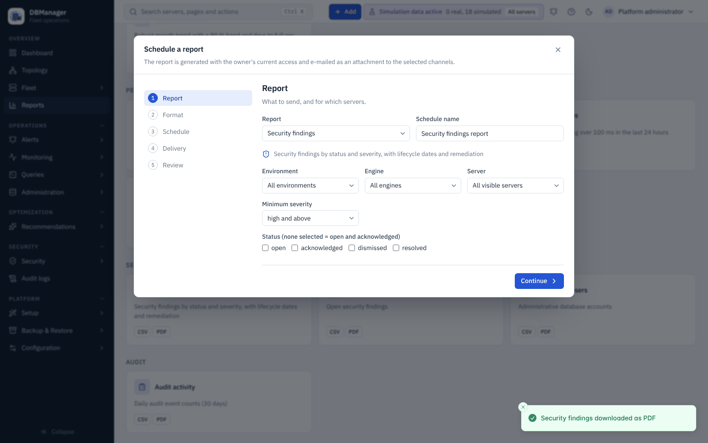

# Schedule a report

**Goal:** a report (for example *Security findings* of production) arrives by e-mail as a PDF or
CSV every week, containing only what its owner may see.

## Before you start

* `reports.view` and the report's own permission (for example `security.view` for *Security
  findings*) to run it; `reports.schedule` at platform scope to schedule it. Making someone else
  the owner needs `users.manage`.
* At least one **e-mail** notification channel (**Platform → Configuration → Notification
  channels**, `channels.manage`) whose recipients should receive the file, and working SMTP settings
  ([Notifications](../../administration/notifications.md)). Webhook channels cannot carry
  attachments.

## Steps

1. Open **Overview → Reports** (or *Generate report* in the command palette) and select the report
   card.
2. Set the parameters (**Environment**, **Engine**, **Server**, and for findings **Minimum
   severity** and **Status**). Select **Preview** to see the first 50 rows and the total.

    

3. Select **Schedule…**. The schedule wizard opens with the report and its parameters filled in.
   (Alternatively: the **Schedules** tab → **New schedule**.)

    

4. **Report** — check the report and parameters, enter a **Schedule name** (for example *Weekly
   security findings*). **Continue**.
5. **Format** — **PDF** for reading (at most 5,000 rows) or **CSV** for spreadsheets (every row).
   **Continue**.
6. **Schedule** — **Frequency** *Weekly*, the **Day**, **Time (24 h)** such as `07:00` and the
   **Time zone** as an IANA name (`Europe/Paris`). **Continue**.
7. **Delivery** — tick one or more **E-mail channels**. **Runs as** is you; choose another user only
   if you have `users.manage`. Leave **Enabled** on. **Continue**.
8. **Review** — select **Create schedule**.
9. On the **Schedules** tab, select **Send now** on the new schedule to try it without changing its
   timing.

## What you should see

* The schedule in the **Schedules** list with its next run, and after **Send now** a run with status
  `success` in **History** (clock icon): row count, file size and the recipients per channel.
* An e-mail with the subject `[DBManager] <report title> — <schedule name>` and the file attached.
* Audit events `report_schedule.create` and `report.delivered`.

Only the schedule's owner, its creator or a user with `users.manage` can edit, send or delete it.
Each run uses the owner's access **at the time of the run**: if the owner loses a permission or is
disabled, the run fails without sending anything.

## If it does not work

* Run status `failed` with a size message: the file exceeds `DBM_REPORT_MAX_ATTACHMENT_MB`
  (default 10 MB); narrow the scope or use CSV.
* Status `partial`: some channels failed; **History** shows the error per channel. Test the channel
  with **Test** on the Notification channels page.
* *Only the schedule's owner or creator (or a user administrator) can change, send or delete it*:
  ask the owner, or a user with `users.manage`.
* No e-mail channel offered: create one first; webhook channels are not listed.

Reference: [Reports](../reports.md).
