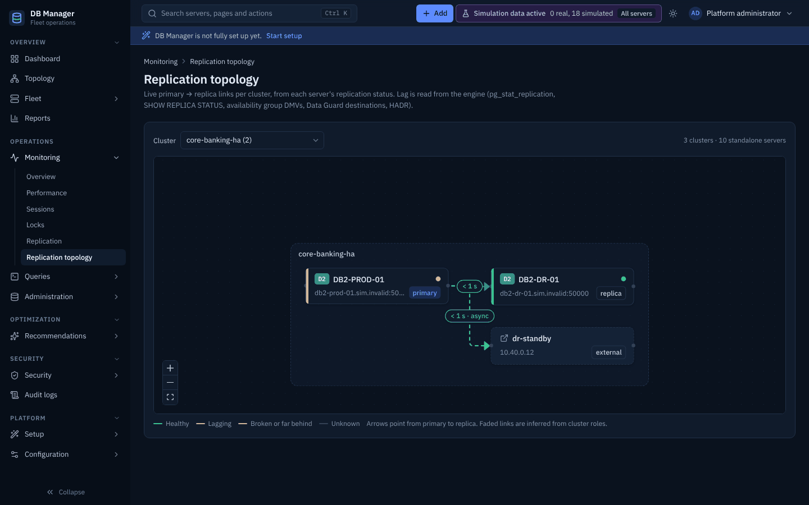

# Topology

**Overview → Topology** draws the estate as Environment → Site → Cluster → Server → Database.

* Groups show their server count and a health bar; on first view only as many levels open as fit
  (about 140 nodes). Groups with more than 40 members page them behind a *+N more* node, so fleets of
  1,000+ servers stay usable.
* **Search** by name, host or `tag=value`: matching branches expand and the rest can be hidden
  with *Matches only*.
* Select a server to open it; its arrow loads its databases on demand.
* Toolbar: expand groups, collapse all, reset, fit view; minimap and zoom controls; every node is
  keyboard focusable.

## Replication topology

**Operations → Monitoring → Replication topology** shows primary → replica links per cluster,
from each server's replication status (PostgreSQL streaming, MySQL/MariaDB replicas, SQL Server
availability groups, Oracle Data Guard, Db2 HADR).

Arrows point from primary to replica and animate in the direction of flow (static when the browser
asks for reduced motion). Labels show lag; colour shows health (≤ 10 s healthy, ≤ 60 s lagging,
otherwise broken). Replicas reported by a server but not registered appear as dashed *external*
nodes; links inferred only from cluster roles are drawn faded. The same diagram appears on a
server's **Replication** tab.
